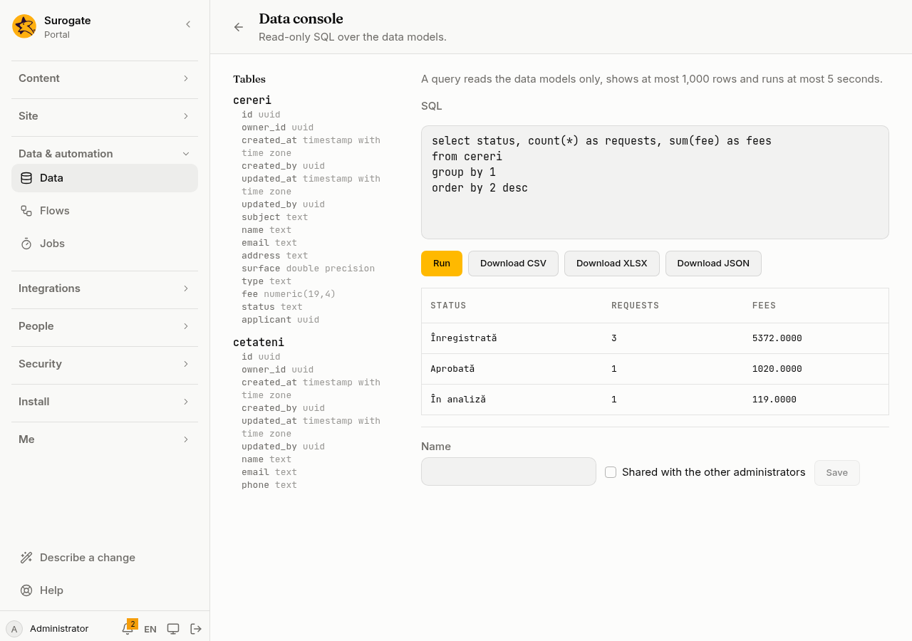
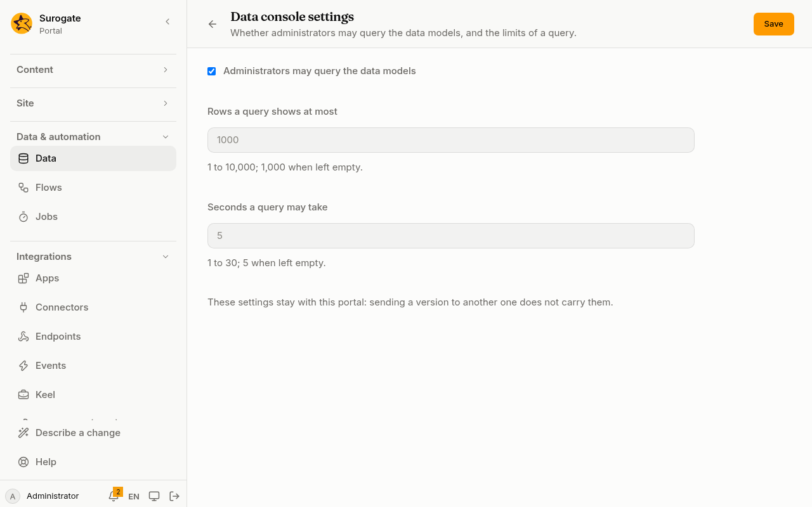

The **Data console** lets the portal's administrators ask questions of the [data models](/portal/sites/data-models/) in SQL: how many requests came in each month, which records have no owner, what a link table holds. It only ever reads. Open it from **Data**, with **Query**.

## What you see

The page lists the tables a query may read, with their columns, beside a box for the SQL. **Run** shows the answer as a table below it:



## Turn it on

The console is off until it is turned on. On the console's page, **Turn it on** or **Settings** opens its settings:

- **Administrators may query the data models:** on or off. Turning it on is warned: administrators then read every record of every model, whatever its permissions say.
- **Rows a query shows at most:** 1 to 10,000; 1,000 when left empty.
- **Seconds a query may take:** 1 to 30; 5 when left empty.

Turned off, the limits are kept for the next time. These settings stay with this portal: a version sent to another does not carry them. Where the portal does not keep its files, whoever installs the portal turns it on. Developers: see [Developer: Data console](/portal/developer/data-console/).

 If the page says the console cannot run here, the install's operators have to allow the portal to set it up.

## What a query may read

A query is one `SELECT`. It reads:

- each model's table, by the model's id, with its fields as columns and `id`, `owner_id`, `created_at`, `created_by`, `updated_at` and `updated_by`;
- each many-links field's table, `<model>__<field>`, with `from_id` and `to_id`.

The page lists these tables and their columns beside the query. Joins, subqueries, `WITH` (not recursive), `GROUP BY`, window functions, `CASE` and casts to the usual types work. So do the common functions for counting, adding up, text, numbers and dates. A query that asks for anything else, or names a table by another prefix, is refused before it runs, and the page says why.

```sql
select date_trunc('month', created_at) as month, count(*)
from requests
group by 1
order by 1
```

A query shows at most the rows allowed and says when there were more. One that takes longer than the time allowed stops. One query of the portal runs at a time.

## Download and keep

**Download CSV**, **Download XLSX** and **Download JSON** run the query again and save its answer as a file. In the CSV, a text cell that a spreadsheet would read as a formula starts with `'`.

Give a query a **Name** and **Save** it to find it again in **Saved queries**. A query is yours unless you share it with the other administrators. Only you may change or delete yours.

## Who may use it

Only the portal's administrators, never while seeing the portal as someone else. An app's token needs the `tenant:read` and `data` access. Every query run is in the [audit log](/portal/console/audit/), with the tables it read and how many rows it showed, never the query itself.
