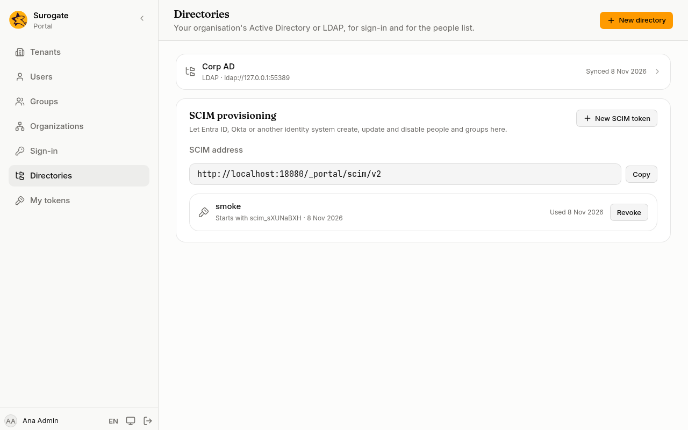
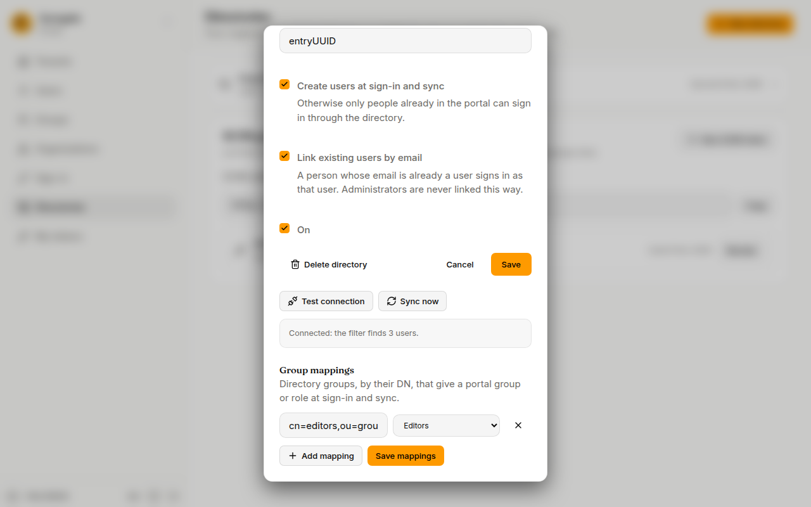

On **Directories**, an administrator connects the portal to the organisation's Active Directory or another LDAP directory. People then sign in on the console with the username and password they already use at work, and the portal keeps its list of people in step with the directory.

## Add a directory

1. Press **New directory** and choose **LDAP** or **Active Directory**.
2. **Name** and **Slug**: how the console shows it, and a short name in lower-case letters, digits and hyphens.
3. **Server URL**: the directory's secure address, such as `ldaps://dc.example.ro`. A plain `ldap://` address works only with **Use StartTLS** ticked, so passwords never travel unencrypted. If the server's certificate comes from your organisation's own authority, paste it in **CA certificate**.
4. **Service account DN** and **Service account password**: an account the portal uses to look people up. It only needs to read people and groups.
5. **Base DN**: where people are, such as `ou=people,dc=example,dc=ro`. **Groups base DN** is where groups are, if they are elsewhere.
6. The attribute fields show, in grey, what this kind of directory usually uses (`sAMAccountName` and `mail` for Active Directory, `uid` and `mail` for LDAP). Leave them empty unless your directory differs. For Active Directory, disabled accounts are left out.
7. **Create users at sign-in and sync**: on, anyone the directory has can sign in, and gets an account the first time. Off, only people already in the portal can sign in through it.
8. **Link existing users by email**: a person whose email is already a user of the portal signs in as that user. Administrators are never linked this way; link them on their user page (see [Users](/portal/console/users/#linked-accounts)).
9. Press **Add directory**.

## Test and sync

Open the directory and press **Test connection**. The console says how many people the user filter finds, or why it could not connect:

| Message | What to check |
|---|---|
| **The server cannot be reached.** | The server URL, and that the directory accepts connections from the portal. |
| **The secure connection failed: check the address and the CA certificate.** | The name in the URL matches the server's certificate, and the CA certificate is pasted. |
| **The service account's DN or password was refused.** | The service account DN and password. |
| **The search failed: check the base DN and the filter.** | The base DN, the groups base DN and the user filter. |

Press **Sync now** to bring everyone the filter finds into the portal: new people are added, names and emails are brought up to date, and people the directory no longer has are disabled. People without an email in the directory are skipped, and the console says how many it skipped and why. A sync that finds nobody changes nothing. If a sync would disable more than half of the directory's people, the console asks first: check the directory's settings, then press **Sync anyway** if they are right.

A person an administrator disabled stays disabled, whatever the directory says.

## Signing in through a directory

The sign-in page asks for **Email or username** as soon as a directory is on. People type their directory username, or their email, and their directory password. After 4 wrong passwords in 15 minutes, the portal stops sending that person's password to the directory for a while, so it never locks their account there.

People from a directory have their name and fields managed by the directory, and no portal password: they change their password where they always do.

## Delete a directory

Open it and press **Delete directory**, then confirm. Its people stay, but lose the groups and roles it gave them and can no longer sign in through it.
