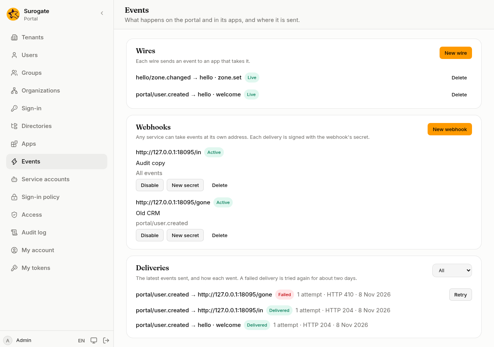
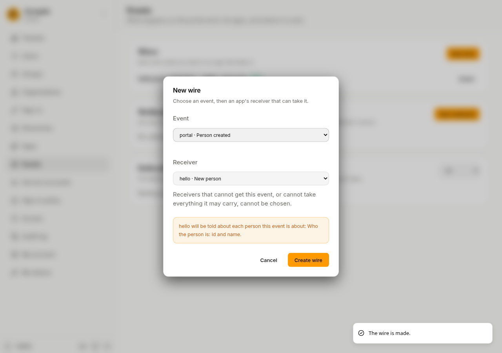

Things happen on the portal: a person is created, an app is approved, a new configuration goes live. Apps have events of their own, such as a deal won or a form sent. **Events** is where an administrator decides where these events go: to apps that take them, and to other services at addresses of their own.

## Wires

A wire sends an event to an app that takes it. Apps say in their manifest which events they send and which they take, so the console only offers what can be joined.

1. Press **New wire**.
2. Choose the **Event**. The portal's own events come first, then the apps' events.
3. Choose the **Receiver**. A receiver that cannot get this event is shown but cannot be chosen, with why: **needs city** when it needs something the event cannot always give, **takes events only in the browser** or **takes events only at its webhook** when the two never meet.
4. If the event is about a person, the dialog says what the receiving app will be told about each person, from what you [approved](/portal/console/apps/) for it. For an app's own events, it says what the app will be told when an event names a person.
5. Press **Create wire**.

Each wire shows whether it is **Live**. A wire is **Broken** when:

- an app waits for approval;
- an app's new version no longer declares the event or the receiver;
- the receiver now needs something the event cannot always give, or can no longer get it.

A broken wire sends nothing, and what it still had to send is cancelled. When the site's files remove an app, its wires go too.

**Delete** stops a wire at once, including what it still had to send.

## The portal's events

| Event | When |
| --- | --- |
| Person created | Someone creates a person on the console, through the API, or a provisioning system adds them |
| Person changed | A person's details or roles change, or a provisioning system removes them (the account stays, disabled) |
| Person erased | A person is [erased](/portal/console/users/#personal-data) |
| Person signed in | A person signs in |
| Configuration activated | A new configuration goes live |
| App approved, Approval revoked | An administrator approves or revokes an app |

People added or changed by a [directory](/portal/console/directories/) sync, or when they first sign in with a sign-in provider, do not raise these events yet.

## Webhooks

A webhook sends events to any service, at the address it gives you, such as a CRM or a log store.

1. Press **New webhook**.
2. **URL**: the service's address. It starts with `https://`.
3. **Description**: what the service is, for whoever reads the list later.
4. Tick the events it takes, or **All events**. Events that apps send only on the page, in the browser, are not listed: they never reach a server.
5. Press **Create webhook**. Copy the **Signing secret** and give it to the service's team over a safe channel. It is shown this once.

The service gets each event with the person's id, name and email when the event is about a person, signed with the secret so it can tell the request comes from your portal.

- **Disable** stops sending to it and cancels what it still had to send; the console asks first. **Enable** starts again with new events.
- **New secret** gives the webhook a new secret, after asking. The old one stops at once, so give the new one to the service straight away.
- **Delete** removes it.

## Deliveries

**Deliveries** lists the latest events sent and how each went. Choose a status to see only those.

| Status | Means |
| --- | --- |
| **Delivered** | The app or service took it. |
| **Waiting** | It will be sent, or sent again. A delivery that fails is tried again after a minute, then after longer and longer waits, for about two days. |
| **Failed** | It failed eight times, or the service said it no longer wants it. |
| **Cancelled** | Its wire was deleted or broke, its webhook was disabled or no longer takes the event, or the receiving app is no longer approved or no longer takes what was sent. |

Each delivery says why it did not go, such as **no answer in time** or **its webhook was disabled**. **Retry** sends a failed or cancelled delivery again, now; it is not offered when the wire or webhook it was for is gone. Delivered, failed and cancelled deliveries are kept 30 days.

Each wire, webhook and retry is in the [audit log](/portal/console/audit/).
