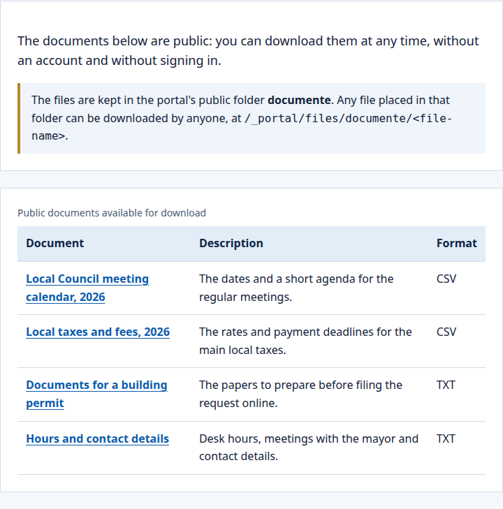
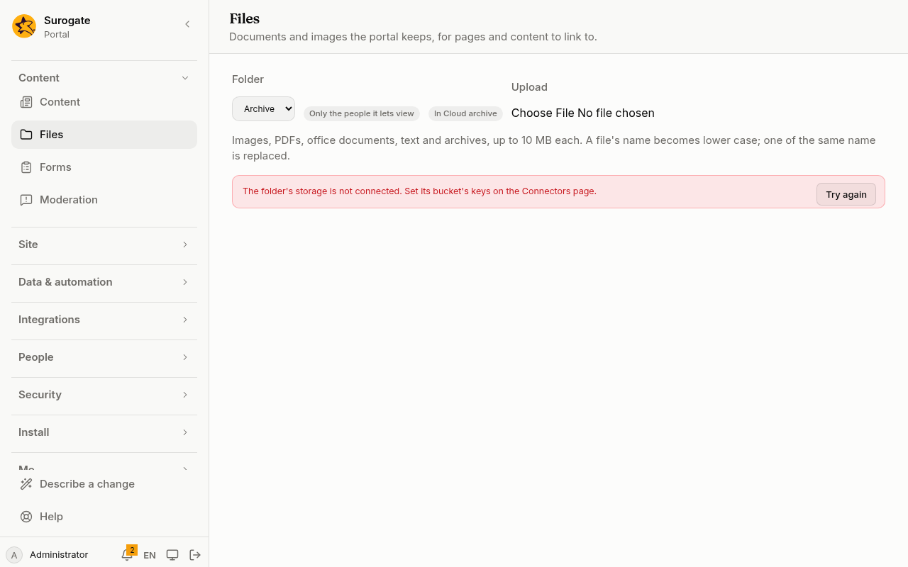

**Files** keeps the portal's documents and images, such as forms to download, reports, or photos for news, in folders. Pages, HTML blocks and content entries link to them.

**Files** is in the menu for the people who edit a folder: the editors it names, those given it on [Access](/portal/console/access/), and the administrators.

## What people see

Visitors and people signed in meet the files as links on the site's pages and entries. Here a page lists the documents of a public folder, and each title is a link to a file anyone can download:

Editors and administrators keep the files under **Files** in the console, as the sections below say.

## Folders

Each folder is either:
- **Public**: anyone downloads its files, signed in or not;
- **Secure**: only the people the folder names may open its files, and its editors. A secure folder that names no one is for its editors only.

A folder has a name, in Romanian and English, and is secure unless it is made public. A secure folder names who may open its files, and who edits the folder besides the administrators. Administrators make and change folders on [Folders](/portal/console/folders/), which **Folder settings** next to the folder selector opens. Developers: see [Developer: Files](/portal/developer/files/).

## Where files are kept

A folder's files are kept by the portal itself, or in a bucket of an S3-compatible storage service (Amazon S3, Cloudflare R2, MinIO, Garage) that you name with a [bucket connector](/portal/sites/connectors/#buckets). Administrators choose it under **Where its files are kept** in the folder's settings, with the connector and, if they want, a prefix of the bucket for its files: see [Folders](/portal/console/folders/#where-its-files-are-kept). Developers: see [Developer: Files](/portal/developer/files/#a-folder-kept-in-a-bucket). Next to the folder's name, **Files** says which: **In the portal**, or **In** and the connector's name.

A folder kept in a bucket works like any other: upload, link, remove, search, and the forms' and jobs' [file actions](/portal/sites/actions/#files). The differences:

- **No earlier versions.** The bucket keeps what its own settings keep.
- **Its own place.** Its files are under the folder's prefix in the bucket (its id and a slash, unless it says otherwise); two folders never share one place of one bucket. Files elsewhere in the bucket, in sub-prefixes, or with names the portal does not serve are not listed.
- **New files at once.** When two people send a new file of the same name at the same moment, both may be written, and the last one is kept.
- **When the bucket cannot be reached.** Until its connector's keys are set, **Files** says the folder's storage is not connected; when the bucket refuses or does not answer, it says the bucket could not be read. Search keeps finding the folder's files as they were.

## Upload a file

Choose the **Folder**, then **Upload** a file. The portal keeps:
- images (PNG, JPEG, GIF, WebP, AVIF) and text, which browsers show;
- PDFs, Word, Excel and PowerPoint documents, OpenDocument files, CSV, JSON and ZIP archives, which browsers download.

A file is at most 10 MB. Its name becomes lower case, with other characters as hyphens: `Cerere Înscriere.PDF` becomes `cerere-inscriere.pdf`. Uploading a file of the same name replaces it, after the console asks you; links then open the new file.

## Images at a width

Each image under **Files** shows small beside its name. A page can ask for an image at the width it lays it out at, so a phone never downloads a photo made for a print: add `?w=` and a width to the image's address, such as `/_portal/files/news/stadion.jpg?w=512`.

- The widths are 64, 128, 256, 384, 512, 768, 1024, 1536 and 2048 pixels; another width is not found.
- JPEG, PNG, WebP, AVIF and still GIF images are served as WebP at that width, never wider than the image itself, turned the right way up. Anything else, such as an SVG drawing, an animated GIF or PNG, or a very large image, is served as it is.
- A secure folder's image keeps to the folder's permissions at every width.

## Link to a file

**Copy link** copies the file's address, such as `/_portal/files/forms/cerere-inscriere.pdf`. Use it in a page's text, an [HTML block](/portal/sites/layouts/#an-html-block), or a content entry's link or image field.

A visitor opening a secure folder's file is asked to sign in; someone the folder does not let view it is told there is no such file.

## Move or copy a file

**Move** opens a dialog for the file:
- **Folder**: where it goes, among the folders you edit; the one it is in, to rename it.
- **Name**: its name there. A name the portal keeps stays as you write it; any other becomes what an upload's would, and the file keeps its extension.
- **Keep the original here (copy)**: the file stays where it is, and a copy goes to the folder.

A file already there under that name is never replaced: the console says so, and nothing changes. Links to a moved or renamed file stop working; link to its new address. Forms and jobs move, copy and pack files with the [file management actions](/portal/sites/file-management/).

## Remove a file

**Remove** takes a file away, after asking. Links to it stop working. Earlier versions of a file, replaced or removed, are kept a month, then gone.

A folder that holds files is never removed: [Folders](/portal/console/folders/#removing) asks you to move or remove its files first. Earlier versions are the portal's own: a folder kept in a bucket has none.
