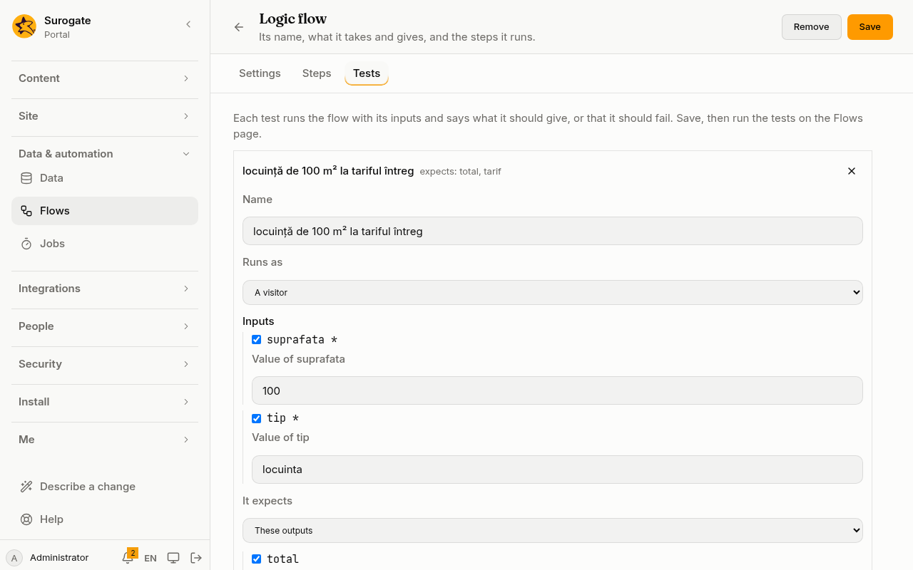
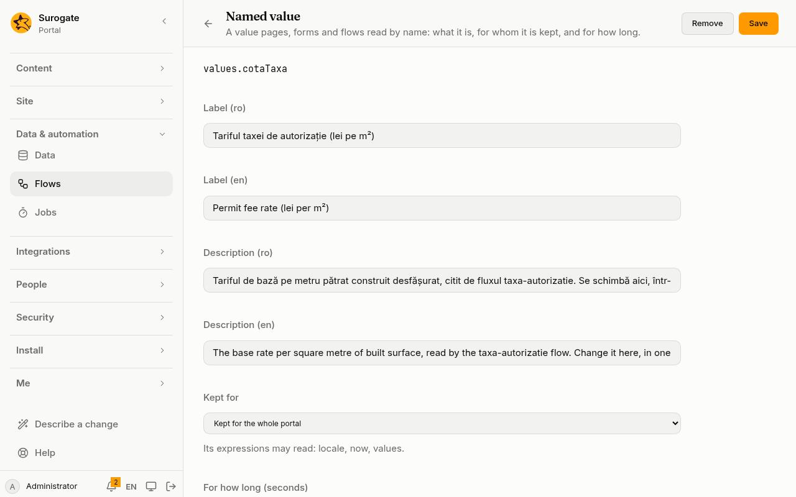

**Flows** shows administrators the [logic flows](/portal/sites/flows/), contracts and [named values](/portal/sites/values/) the portal runs now. This page shows them, runs their tests, and makes and changes each: see [Make or change a flow](#make-or-change-a-flow), [Make or change a contract](#make-or-change-a-contract) and [Make or change a named value](#make-or-change-a-named-value). Developers can also write them in the site's configuration: see [Developer: Logic flows](/portal/developer/flows/).

## Logic flows

Each flow shows its name and id, the contract it implements, and its inputs and outputs as `name: type` (a `?` marks an optional one).

## Run tests

**Run tests** runs the flow's tests one after another, and lists each as **Passed** or **Failed**, with why it failed. **Open** shows the outputs it gave and its log. The tests of one flow stop after 30 seconds; those left are listed as not run. A flow without tests cannot be run from here.

## Make or change a flow

**New flow** makes one and **Edit** opens one. A flow, contract or value whose file has problems, or that was written by hand in a shape the console cannot draw, is listed under **Not running**, with **Edit**. The editor has three tabs:

- **Settings:** the id (lower-case letters, digits and hyphens, fixed once saved), the name and description in each language, and **Follows a contract**: a contract's inputs and outputs, or the flow's own. Its own **Inputs** and **Outputs** are rows: a name like a variable's, a type, whether it **May be left out**, and a note.
- **Steps:** **Starts at** names the first step. The map shows how the steps lead to each other, in columns from the start; a step nothing leads to stands apart, under **Nothing leads here**. Click a step, on the map or in the list, to open it:
  - its name: change it, and every step that leads to it follows;
  - its type: **Actions**, **Decision** or **End**;
  - **Actions** runs an action list, built as a form's [steps](/portal/console/forms/#steps) are, and **Then** names the step after it;
  - **Decision** has ways, each an **If** condition and the step to **go to**, and **Otherwise**, the step when no way holds; with none, the flow fails;
  - **End** gives each output with an expression; a `*` marks one it must give.

  **Add a step** adds one of the type chosen. Removing a step leaves what led to it naming a step that is gone, said at each, to be chosen again.
- **Tests:** the flow's tests. **Add a test** adds one; click a test's name to open it:
  - its **Name**, and whom it **Runs as**: a visitor, or a person with an id, a name, an email and roles;
  - **Inputs**: tick **Give** for each input the test gives, and write its value; an input marked `*` is required. A value not of its input's type is said: the run refuses it;
  - **It expects** these outputs, each given exactly (`"5"` is not `5`), or that the flow fails;
  - **More**: the values it pins, its own records by model, its own files by folder, and the answers its web calls get, by connector, method and path.

  Renaming an input or an output carries the new name into the tests and the ends. Save the flow, then **Run tests** here on the Flows page.

  

Each problem is said at its field as you type, and **Save** waits until there are none; above the tabs, the editor says what it still needs and which tabs have problems. A problem in another file, such as an endpoint calling the flow without an input it now needs, is listed above the tabs with that file's name. **Remove** takes the flow away, after asking.

## Contracts and values

**Contracts** lists each contract's inputs and outputs. **Named values** lists each value with what it is (an expression, a flow's outputs, a web call's answer or a collection's entries), for whom it is kept, and for how long. Each has **Edit**.

## Make or change a contract

**New contract** makes one and **Edit** opens one: its id (lower-case letters, digits and hyphens, fixed once saved), its name and description in each language, and its **Inputs** and **Outputs**, as a flow's own are written. Each flow that follows the contract takes these inputs and gives these outputs: a change that leaves such a flow wrong is refused, and the flow's problems are listed above the form with its file's name. **Remove** takes the contract away, after asking.

## Make or change a named value

**New value** makes one and **Edit** opens one:

- **Name:** how pages, forms and flows read it, as `values.<name>`: letters, digits and `_`, starting with a lower-case letter, fixed once saved. A word such as `in`, `true` or `null` cannot be a name.
- **Label** and **Description** in each language.
- **Kept for:** the whole portal, each site, each person, or not kept; under it, what its expressions may read. **For how long**: seconds, from 1 to 86,400; 300 when empty.
- **It is:**
  - **An expression**;
  - **A flow's outputs**: the flow, and an expression for each of its inputs; a `*` marks one it must give;
  - **A web call's answer**: a web connector, the path and the query. A connector that signs in as each person serves only a value kept for each person;
  - **A collection's entries**: a collection anyone may read.

A value that reads another value kept for fewer people, or a connector it may not use, is said before **Save**, which waits until it is fixed. Removing a value that a page, form, flow or value reads is refused, and what reads it is listed with its file.
