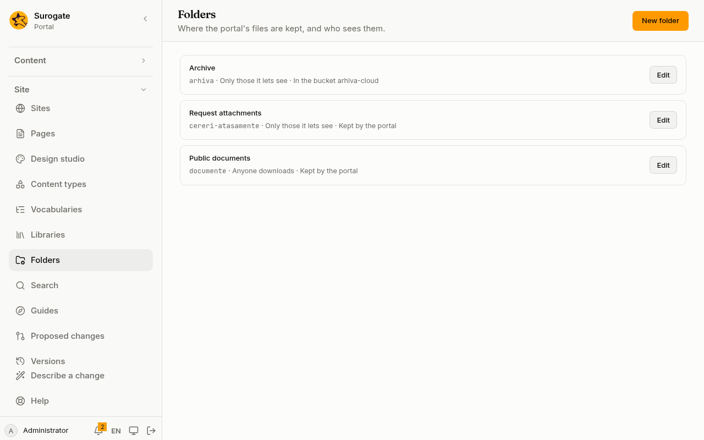
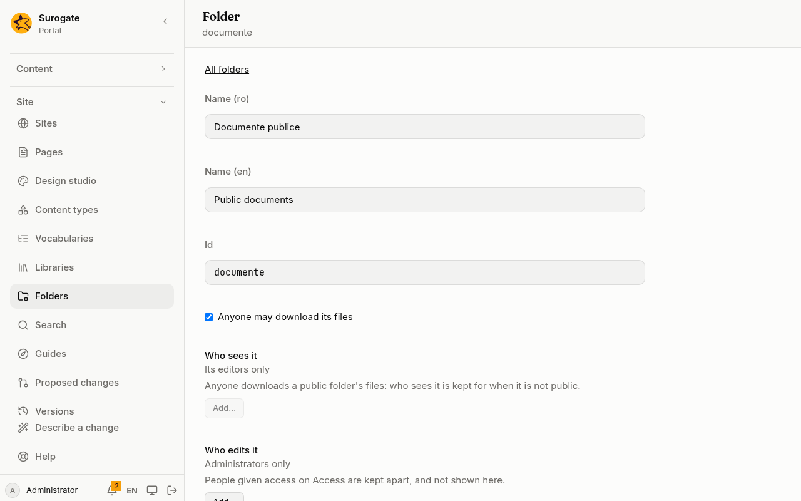

A [folder](/portal/console/files/#folders) keeps documents and images that pages, forms and content link to. **Folders** makes and changes them, and **Files** keeps what is in them. Every save is a [version](/portal/console/versions/) you can undo.

**Folders** is for administrators, on a portal whose site files the portal keeps. It is in the menu after **Libraries**. Developers: see [Developer: Files](/portal/developer/files/).

## The list

Each folder shows its name, its id, and two facts about it:

- who may download its files: **Anyone downloads**, or **Only those it lets see**;
- where its files are kept: **Kept by the portal**, or **In the bucket** and the connector's name.

**Edit** opens a folder. A folder written in a way the console cannot edit is marked **Cannot be read**. **Remove folder** is the only thing offered for it.

A portal has at most 50 folders. When it has 50, **New folder** is off, and the page says: "The portal has its 50 folders, the most it keeps."

On [Files](/portal/console/files/), administrators find **Folder settings** next to the folder selector. It opens the chosen folder here.

## Make a folder

1. Press **New folder**.
2. Type its **Name (ro)** and **Name (en)**, in Romanian and in English. Both are required.
3. Its **Id** is made from the English name, and you can change it before the first save. It is fixed after that. An id is lower-case letters, digits and hyphens, starting with a letter, and no other folder may have it. The id `folders` is not available.
4. Choose who may download its files and who edits it, as the next section says.
5. Choose where its files are kept, or leave them with the portal.
6. Press **Save**.

## Settings

### Who may download

- **Anyone may download its files**: tick it for a public folder. Anyone downloads its files, signed in or not.
- **Who sees it**: a picker, the one described in [Choose who](/portal/sites/permissions/#choose-who). By default it is **Its editors only**. It says: "People must be signed in to see it." Add **Anyone signed in**, groups, organizations and people to let them open the files of a secure folder, or **Only editors and administrators**. **Everyone** is not offered: that is a public folder.

While **Anyone may download its files** is ticked, **Who sees it** is off, and it says: "Anyone downloads a public folder's files: who sees it is kept for when it is not public." What you chose stays, and applies again when the folder is no longer public.

### Who edits it

**Who edits it** is the same picker. By default it is **Administrators only**. Add the groups, organizations and people who may also keep the folder's files. They find **Files** in the menu.

The picker says: "People given access on Access are kept apart, and not shown here." People given the folder on [Access](/portal/console/access/) are not listed in the picker, and saving the folder does not take them away.

## Where its files are kept

Under **Where its files are kept**, choose:

- **Kept by the portal**: the portal keeps the files itself. This is the default.
- **In a bucket**: a bucket of an S3-compatible storage service keeps them. This needs a [bucket connector](/portal/sites/connectors/#buckets). When the portal has none, the choice is off and reads "In a bucket: the portal has no bucket connector yet".

**In a bucket** asks for two things:

- **Bucket connector**: choose one of the portal's bucket connectors. When its keys are not set, the page says: "This connector is not connected yet: the folder cannot be read until it is." Set its keys on [Connectors](/portal/console/connectors/).
- **Prefix in the bucket**: where the folder's files are in the bucket. It is optional. When left empty, it is the folder's id and a slash, such as `archive/`. A prefix is lower-case letters, digits, hyphens, underscores and slashes, ending in a slash. Two folders never share one place of one bucket.

A folder that holds files keeps them where they are. The page says so: "A folder that holds files keeps them where they are: empty it before keeping it elsewhere." The portal refuses to keep such a folder in another place, or under another prefix, and says "The folder holds files, which would stay where they are kept now: move or remove them first." Move the files to another folder, or remove them, on [Files](/portal/console/files/#move-or-copy-a-file). A folder whose storage cannot be read can be changed or removed anyway: nothing in it can be seen.

How a folder kept in a bucket works is on [Files](/portal/console/files/#where-files-are-kept).

## Removing

**Remove folder** takes the folder away. It asks first: "Only an empty folder is removed. Forms and actions that name it must be changed first, and people given access to it on Access lose it."

- A folder that holds files is not removed. The page says: "The folder holds files: move or remove them first."
- A form or an action that names the folder must be changed first. The console lists them, and removes nothing until then.
- People who were given the folder on **Access** lose it.

The same holds for every way a change reaches the site: saving files, undoing or restoring a [version](/portal/console/versions/), and approving a [proposal](/portal/console/proposals/). A folder that holds files is never removed, and never kept elsewhere.

## When a save is refused

The portal checks a folder before it keeps it. A problem is listed in words, such as another folder keeping its files in the same place of the bucket, and nothing is saved until it is put right.

When someone else saved a change in the meantime, the console shows the newest version of the folder, and your changes to it are not kept. Make them again. A new folder is simply saved again.

Comments written in a folder's file by hand are not kept when the console saves it.
