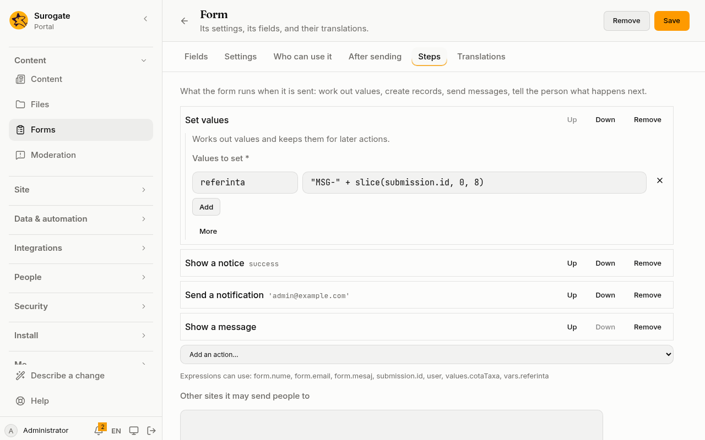

**Forms** shows what people sent through the portal's forms. It is in the menu for each form's reviewers and for the administrators, who also build the forms there. For what a form may hold and who sends it, see [Forms](/portal/sites/forms/) in the site guide.

## What the list shows

Choose the **Form**. The list shows what was sent through it, newest first: when, by whom (or **Visitor**, for someone not signed in), and the first answers. **Older** shows the next ones.

Under the form's name is its own address, `/_portal/forms/<id>`, on each site that offers it.

## Read a submission

**Open** shows each answer under its field's label, in your language. When the form asks for consent, **Agreed to** shows the text the person agreed to. Ticked boxes and several choices are listed together; a checkbox reads Yes or No; a field left empty shows a dash.

## Report

**Report** shows the chosen form's last 30, 90 or 365 days:
- how many were sent in all, and on each day that had any;
- for each choice of the form (a list, radio buttons, boxes to tick or a checkbox), how many people chose each option.

What people typed in their own words is never counted.

## Runs

**Runs** lists what the form's [actions](/portal/sites/actions/) did each time it was sent, newest first: when, and whether they finished or failed, with the failure. **Open** shows the run's log. Runs are kept for 30 days.

## Export

**Export CSV** downloads every submission of the form, at most 50,000, newest first: one row each, with when it was sent, its language, the email of whoever sent it, and one column per field. It opens in Excel or LibreOffice. A value starting like a formula is written so that a spreadsheet does not run it.

## Delete

**Delete** removes one submission, after asking. **Delete all** removes every submission of the form, after asking. Neither can be undone.

Submissions belong to their form's id. If a form is removed from the portal, its submissions are hidden, and they show again if a form with the same id comes back. Delete them first when they should go with the form.

## Build a form

Administrators see **Build forms** at the top of the page: **New form** makes one, and **Edit** opens one.

- **Settings:**
  - the form's id (lower-case letters, digits and hyphens, fixed once saved);
  - its name in each language;
  - the language its text is written in;
  - whether it goes step by step;
  - the sites that offer it (none ticked: every site);
  - the thanks shown once it is sent, in each language.
  - whether people can leave the form and come back to it;
  - who is told by email when it is sent, and whether the email holds the answers;
  - whether people must agree to a text before sending, and that text in each language;
  - how many days submissions are kept (empty: always).
  - whether a public form can be filled in offline at its own address.
- **Who can use it:** who sends the form and who reads what was sent. Each uses the picker described in [Choose who](/portal/sites/permissions/#choose-who): **Add…** opens the choices, and **Remove** takes one away.
  - **Anyone may send it, signed in or not**: tick it to make the form public.
  - **Who may send it**: by default **Its reviewers only**. It says: "Reviewers also send it. To let anyone send it, make it public." It is off while **Anyone may send it, signed in or not** is ticked. It offers no **Everyone**: to let everyone send the form, make it public.
  - **Who reads what was sent**: by default **Administrators only**. It says: "Administrators always read what was sent." The people chosen read, export and delete the submissions.
- **Fields:** drag fields from the left onto the form, and drop them where they go.
  - **Fields:** text, text area, number, checkbox, select, radio, select boxes and the submit button.
  - **More fields:** email, web address, phone number, day, time and currency.
  - **Layout:** panels, columns, fieldsets, tabs, wells and text blocks.

  Click a field to change it. **Display** sets its label, the text shown in it, its help, whether it is required, and its options. The **Key** is the name its answer is kept under; it follows the label until you change it. **Shown when** shows the field only when another field has a value. In a step-by-step form, each panel at the top is a step.
- **Steps:** what the form does once it is sent and kept. See [Steps](#steps) below.
- **Translations:** a row for each text of the form, with a box for each of its sites' other languages. Every row needs a translation before the form can be saved.

**Save** keeps the form; pages that show it change at once. If the portal refuses it, the reasons are listed above the form. If someone changed the portal's files since you opened the form, reload it and make your changes again. **Remove** takes the form off every page; what was sent through it stays, under its id.

A form written by hand with parts the builder does not keep opens as one the console cannot draw. Change it in the portal's files.

### Steps

**Steps** builds the form's [actions](/portal/sites/actions/): what runs, in order, each time the form is sent and kept. Each action is a row. Click its name to open it; **Up**, **Down** and **Remove** sit beside it.

- **Add an action…** offers the actions a form can run, by kind: values, control, the page, calls, records and messages.
- Each action asks for what it needs. A box marked `*` must be filled in. Values are [expressions](/portal/sites/actions/#expressions): under the list, **Expressions can use** names what they may read, such as the form's fields as `form.<key>` and values set by earlier actions as `vars.<name>`.
- Connectors, models, flows, guides and folders are chosen from the site's own.
- **More** sets when an action runs (**Only when**), a **Note** for the people who build the form, the **Message if it fails** that the person sees, and actions to run **When it fails**. There, `vars.error` holds what failed: its message and the action.
- **For each**, **Repeat** and **Group** hold actions of their own, built the same way.
- A problem the console sees, such as a name an expression cannot read, is said at its box as you type, and the row says it has problems.

If the portal refuses the form for its steps, **Some steps have problems** shows on every tab; **Open Steps** goes to them, each said at its action.

**Other sites it may send people to** lists the addresses outside the portal that **Go to a page** may send people to, each on a line of its own.

Actions the builder does not draw yet, such as those of an app or the file actions, are kept as they are written when you save. Change them in the site's configuration: see [Developer: Forms](/portal/developer/forms/#actions-after-it-is-sent).

