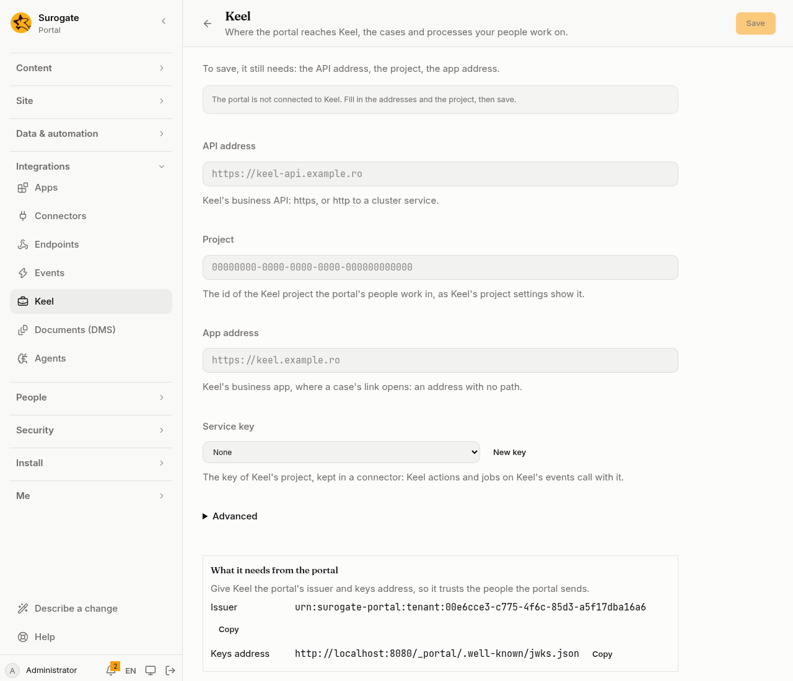
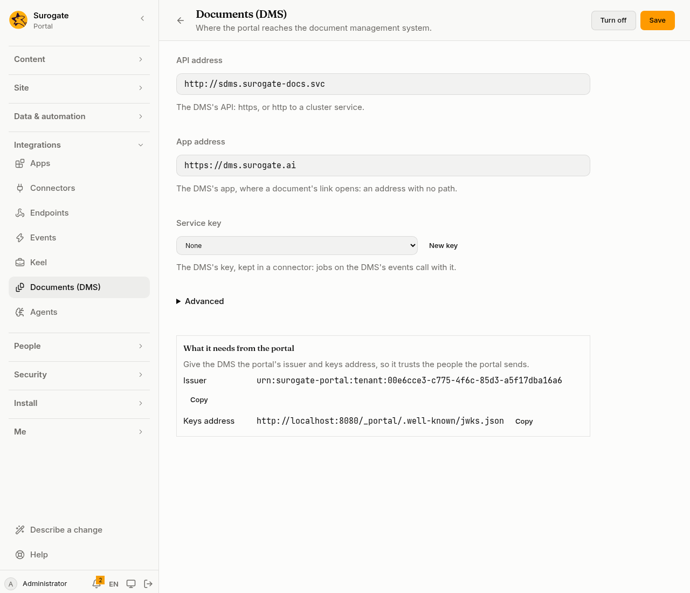
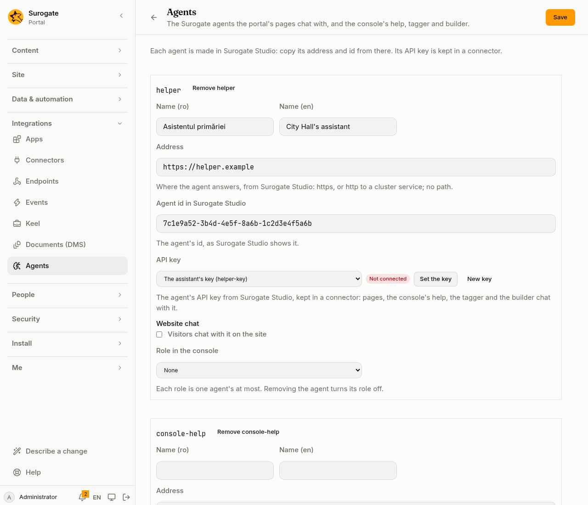

Under **Integrations**, administrators connect the portal to the services it works with: [Keel](#keel), the [document management system](#documents-dms), [Surogate agents](#agents) and the [other portals](/portal/sites/environments/#name-the-environments) it sends its versions to. Each page saves its settings as a new version of the portal, like every other change; a change that would leave something that uses the service without it is refused, and the console lists what uses it.

## Keys

A service's key is never written in its settings. It is kept in a [connector](/portal/console/connectors/) of its own, a secret, and each setting names the connector:

- **New key** makes the connector, with its id and name.
- **Set the key** asks for its value, once; the value is never shown again.
- Beside each key, **Connected** or **Not connected** says whether its value is set.

A key serves one setting only: a key that Keel, the DMS, an agent or an environment holds is listed, but cannot be picked. A key is set for the address it is used with: change Keel's API address or project, the DMS's API address, or an agent's address or id, and the page says to set the key again after saving.

A value that starts as a key does, such as `surg_sk_`, `keel_`, `sdms_sk_` or `pat_`, is refused in any field: paste keys only with **Set the key**.

## Keel

- **API address** and **App address:** Keel's business API, and its business app, where a case's link opens. Inside the same cluster, the API's service address works too.
- **Project:** the id of the Keel project the portal's people work in.
- **Service key:** the key of Keel's project, for [Keel actions](/portal/sites/keel/) and jobs on Keel's events. Not needed to show Keel's work on pages.
- **Advanced:** the audience the portal names Keel with, and how long it waits, from 1,000 to 10,000 ms.
- **What it needs from the portal:** the portal's issuer and keys address, with **Copy**, for Keel's administrator.

**Turn off** disconnects Keel. The key's value stays on its connector. See [Keel](/portal/sites/keel/).

## Documents (DMS)

The same, for the [DMS](/portal/sites/documents/): its API and app addresses, its **Service key** for jobs on its events, and under **Advanced** the audience, the timeout and the largest file people upload, from 1 to 5,120 MB.

## Agents

The [Surogate agents](/portal/sites/assistants/) the portal's pages chat with, at most 20. **Add agent** adds one:

- **Id in the portal:** how the pages name it. It cannot change once saved.
- **Name**, in each language, optional.
- **Address** and **Agent id in Surogate Studio:** where the agent answers, and its id, both from Surogate Studio.
- **API key:** the key the portal chats with. **None** leaves the agent a website chat only.
- **Website chat:** visitors chat with it on the site. Paste the **Publishable key** from the agent's Website channel in Surogate Studio; the **Public address** may stay empty when the agent's own address is https.
- **Role in the console:** **Console help**, **Content tagger** or **Builder**. Each role is one agent's at most: giving it to an agent takes it from the one that had it. A role needs the API key, and help and builder have no website chat. See [Assistants](/portal/sites/assistants/#describe-a-change).

**Remove** takes an agent out when saved; a page or a job that names it must stop first. Removing the agent with a role turns that role off.
