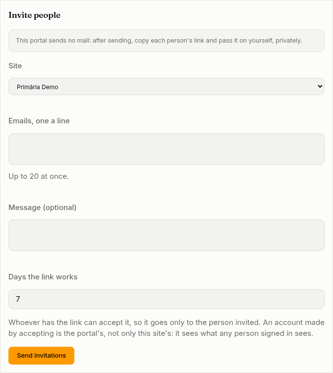
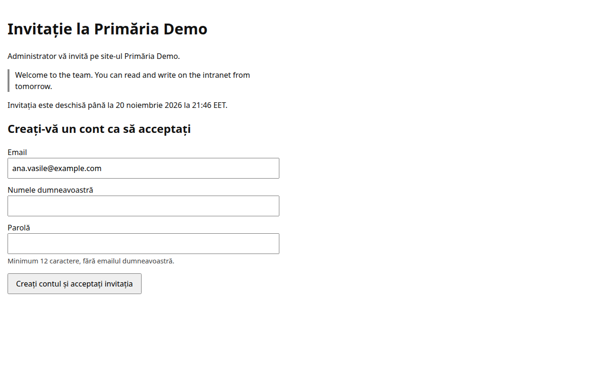

**Invitations** sends people an email inviting them to one of the portal's sites. Each person follows the link in the mail to accept: they sign in with the account they have, or make their account there. On accepting, they join the groups the invitation names.

Administrators invite to any site, into any [group](/portal/console/groups/). A site's [editors](/portal/sites/permissions/) invite only when the site lets them (see below), and only into the groups it names. No one invites while seeing the portal as someone else.

## Invite people

The form is at the top of **Invitations**:

1. Choose the **Site**.
2. Write the **Emails, one a line**: up to 20 at once.
3. Tick the **Groups they join**, if any.
4. Add a **Message (optional)**: up to 1,000 characters, shown in the mail and on the invitation's page.
5. Set the **Days the link works**: 1 to 30 (7 when left as it is).
6. Press **Send invitations**.

The mail is in the site's language, its times in Romania's time zone. Its link opens on the site's own address and works once, until the invitation expires.

An email already invited to the same site and still waiting is not invited twice: inviting it again sends the waiting invitation again, with what the new one says and a new link, at most once an hour. A site's editor cannot take over someone else's waiting invitation; an administrator can. An administrator sends at most 100 invitations an hour, a site's editor 20, sending again included, and each keeps at most 200 waiting. The portal also keeps within the number of mails it may send in an hour.

When the portal sends no mail, administrators can still invite. After **Send invitations**, or **Send again**, the page shows each person's link, only then: copy each and pass it on yourself, privately. A site's editors cannot invite on such a portal.

Whoever has the link can accept the invitation, so it goes only to the person invited. An account made by accepting belongs to the portal, not only to the site: it sees what any person signed in sees, and the groups give it the rest.

## What the person sees

The link opens the invitation's page: who invites them, to which site, the message, and until when it is open. The page is in the site's language; here, a person with no account is asked to make one:

- **Signed in as the person invited:** they press **Accept the invitation**. The page then says they joined the site, with a link to it.
- **With an account, not signed in:** they press **Sign in to accept** and sign in, by password or with the portal's sign-in providers. Then they come back to the page and accept.
- **Without an account:** they write their name and a password, and press **Make my account and accept**. They are signed in at once and the page says they joined; when the portal asks for a second sign-in step, they are sent to sign in, which says their account is made.
- **Signed in as someone else:** the page says so, without saying whom it is for, and offers **Sign out**.

An invitation already accepted, withdrawn or expired says so and opens nothing. A link replaced by sending again no longer works, and its page says to use the latest email. An invitation for a disabled account cannot be used, nor one whose sender may no longer invite: disabled, no longer an editor of the site, or on a site that stopped letting its editors invite. Of the groups an editor named, the person joins only those the site still lets its editors give.

When an invitation is accepted, the person who sent it is told by a notification. Invitations sent, sent again, withdrawn and accepted are written to the [audit log](/portal/console/audit/); so is an account made by accepting, and its first sign-in.

## Follow your invitations

Below the form, **Sent** lists the invitations: **Waiting**, **Accepted**, **Withdrawn** or **Expired**, with their site, groups, and until when they are open. Administrators see every invitation; a site's editors see their own.

- **Send again** sends a waiting or expired invitation with a new link and a new expiry, ending the old link. It is offered an hour after the last send; until then the list says when.
- **Withdraw** ends a waiting invitation's link at once, once you confirm.

## Let a site's editors invite

A site says whether its editors invite people, into which groups (10 at most, by name; names the portal does not have are left out), and for which email domains. When it gives domains, editors may invite only those, matched exactly: primarie.ro does not cover mail.primarie.ro. When it says nothing, only administrators invite. The site's editors then see **Invitations** in the console.

Set it in the site's settings, on [Sites](/portal/console/sites/#change-a-sites-settings), under **Invitations**. Developers: see [Developer: Invitations](/portal/developer/invitations/).

## What happens to them later

Invitations ended more than 90 days ago are forgotten. When a person is erased from the portal, the invitations to their email go, and those they sent stay without their name. Both are part of what they get when they ask for their data.

When a directory or SCIM later provides the same person, it may take over the account made by accepting.
