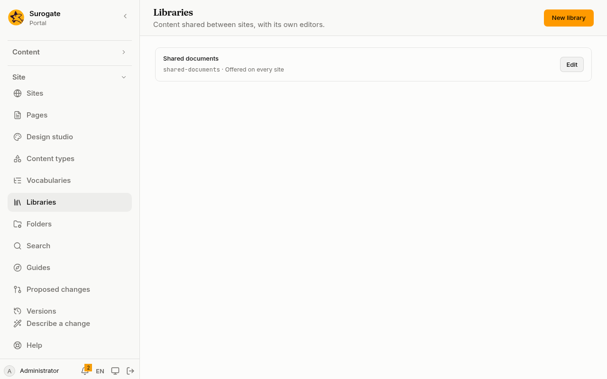
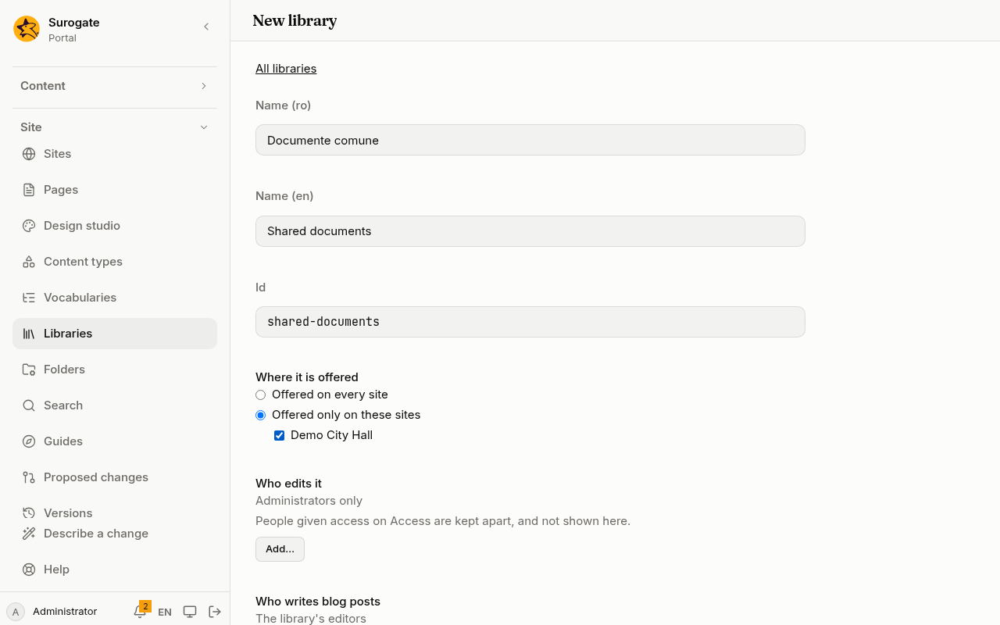

A [library](/portal/sites/content-types/#libraries) holds content that several sites share, such as announcements every site of a city hall shows. **Libraries** makes and changes them. Every save is a [version](/portal/console/versions/) you can undo.

**Libraries** is for administrators, on a portal whose site files the portal keeps. It is in the menu after **Vocabularies**. Developers: see [Developer: Content types](/portal/developer/content-types/#a-librarys-file).

## The list

Each library shows its name, its id, and where it is offered: **Offered on every site**, or **Offered on** and the ids of its sites.

- **Edit** opens it.
- A library written in a way the console cannot edit is marked **Cannot be read**. **Remove library** is the only thing offered for it.
- A portal has at most 20 libraries. When it has 20, **New library** is off, and the page says: "The portal has its 20 libraries, the most it keeps."

## Make a library

1. Press **New library**.
2. Type its **Name (ro)** and **Name (en)**, in Romanian and in English. Both are required.
3. Its **Id** is made from the English name, and you can change it before the first save. It is fixed after that. An id is lower-case letters, digits and hyphens, starting with a letter, and no other library may have it.
4. Under **Where it is offered**, choose the sites that show it.
5. Choose **Who edits it** and **Who writes blog posts**, or leave them as they are.
6. Press **Save**.

## Settings

### Where it is offered

- **Offered on every site**: every site of the portal shows it, those made later too. This is the default.
- **Offered only on these sites**: tick the sites that show it. With no site ticked, **Save** is off, and the page says "Fill in: a site." A site the portal no longer has shows as missing, and is left out when you save.

Pages of the sites a library is offered on can show its entries. See [Content types](/portal/sites/content-types/#libraries).

### Who edits it

**Who edits it** is a picker, the one described in [Choose who](/portal/sites/permissions/#choose-who). By default it is **Administrators only**. Add the groups, organizations and people who may also write the library's entries. **Everyone** and **Anyone signed in** are not offered.

The picker says: "People given access on Access are kept apart, and not shown here." People given the library on [Access](/portal/console/access/) are not listed in the picker, and saving the library does not take them away.

The people who edit a library find its entries under **Content**, as **Library:** and its name. A site's editors do not edit a library unless they are named here or on **Access**.

### Who writes blog posts

**Who writes blog posts** is the same picker. By default it is **The library's editors**. Add the groups, organizations and people who may write their own [blog posts](/portal/sites/blogs/) in the library, and nothing else. See [Name the bloggers](/portal/sites/blogs/#name-the-bloggers).

## Removing

**Remove library** takes the library away. It asks first: "Pages and collections that show it must be changed first. Its entries stay in the portal, out of reach, and come back if a library with the same id is made again."

- A page that shows the library's entries, and a collection that names it, must be changed first. The console lists them, and removes nothing until then.
- The library's entries are kept, out of reach. Make a library again under the same id, and its entries come back, the published ones included.

## When a save is refused

The portal checks a library before it keeps it. A problem is listed in words, and nothing is saved until it is put right.

When someone else saved a change in the meantime, the console shows the newest version of the library, and your changes to it are not kept. Make them again. A new library is simply saved again.

Comments written in a library's file by hand are not kept when the console saves it.
