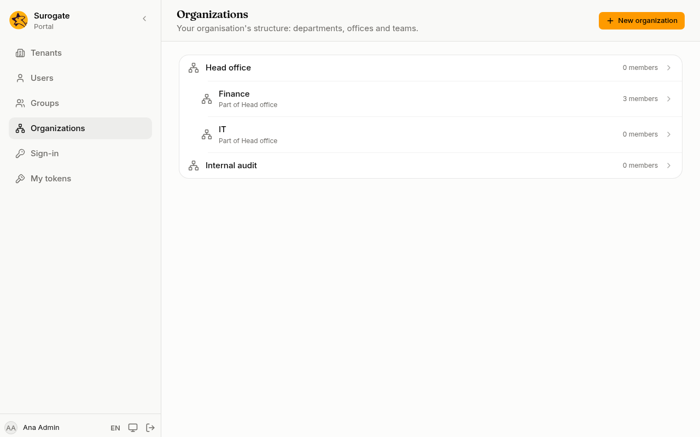
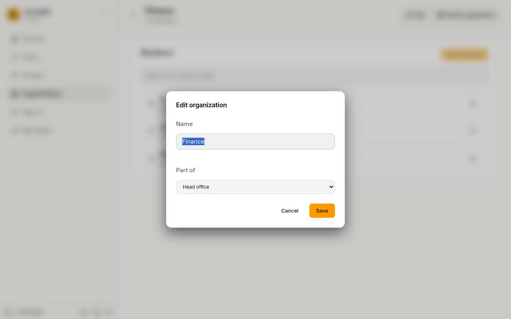

**Organizations** is your structure: directorates, departments, offices and teams, each inside another. You need the **Administrator** role.

The list shows the structure as a tree: organizations inside another are indented under it and say which one they are **Part of**, with how many members each has.

## Add an organization

1. Press **New organization**.
2. Type its **Name**.
3. In **Part of**, choose the organization it belongs to, or **Nothing (top level)**.
4. Press **Create organization**.

Two organizations in the same place cannot have the same name: the console says **An organization with this name already exists here.**

## Members

Open an organization to see its **Members**. Add and remove people as for a [group](/portal/console/groups/#members), then press **Save members**. A person can belong to several organizations.

## Rename or move an organization

1. On the organization's page, press **Edit**.
2. Change the **Name**, or choose another organization in **Part of** to move it there with everything inside it.
3. Press **Save**.

**Part of** never offers the organization itself or the ones inside it. A name that is already used where you move it is refused, and then nothing changes: neither the name nor the place.

## Delete an organization

Press **Delete organization**, then **Delete organization** again to confirm. An organization that still has members or organizations inside it is not deleted: the page says **Remove its members and sub-organizations first.**
