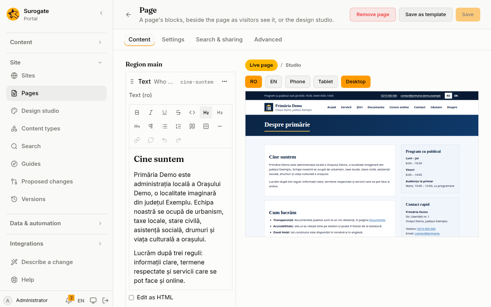
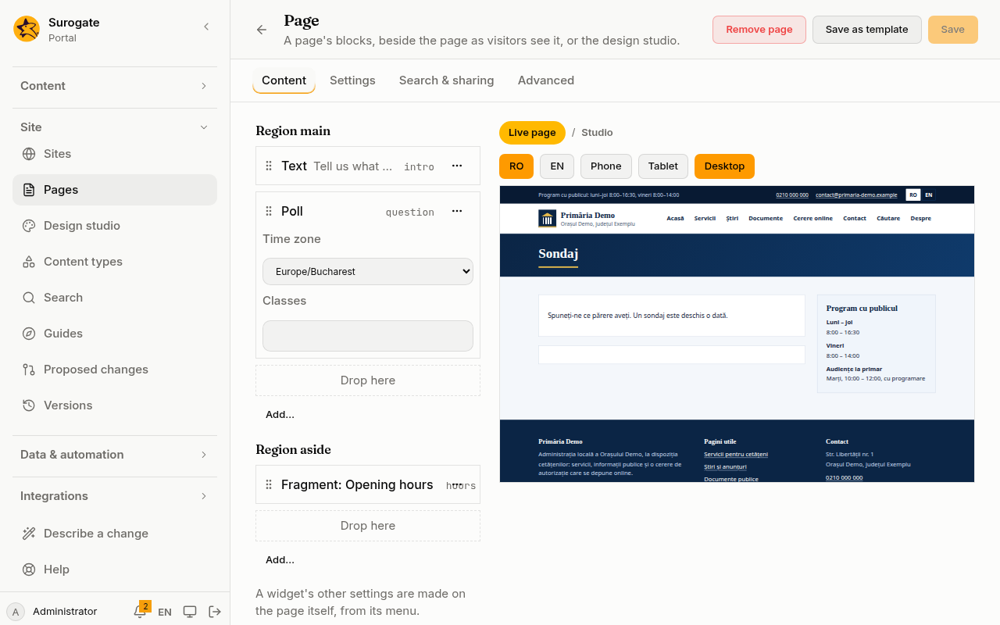

**Pages** builds the portal's sites in the console. It shows each site's pages as a tree. For each page you set its title, its address and its layout, and arrange what each part of the layout holds. Every save is a [version](/portal/console/versions/) you can undo.

**Pages** is for administrators, on a portal whose site files the portal keeps. It is not in the menu otherwise. A new site, and a site's name, languages and home page, are made on [Sites](/portal/console/sites/).

## The page tree

Each site lists its pages by address. A page sits under the page above it: `/servicii/taxe` under `/servicii`. The home page is marked **Home page**. A page file the portal cannot read is marked **Cannot be read**; fix or remove it where the site's files are edited.

- **Edit** opens a page in the editor.
- **New page** opens the editor for a new page of that site.

## Edit a page

- **Address**: where the page is, such as `/despre`. The site's home page keeps its address. Changing another page's address asks first: links to the old address stop working, and settings made on the page itself start again. When the page holds a widget people write in, the question adds that what they wrote stays at the old address, and the page no longer shows it.
- **Title**: one per language of the site.
- **Layout**: the portal's `one-column` or `two-column`, or one of the site's own [layouts](/portal/sites/layouts/).

**Search and sharing** sets how [search engines and link previews](/portal/sites/seo/) show the page: a description in each language, a share image, and **Hide from search engines**.

Under them, each part of the layout lists what it holds, in order:

- **Add text** adds a text block, one text for each of the site's languages. See [Write text](#write-text).
- **Add content…** shows the site's [content](/portal/console/content/#show-content-on-a-page) of one type: its newest entries, or one entry.
- **Add a widget…** adds one of [the portal's own widgets](#the-portals-widgets) or one of the apps' widgets. A portal widget has its settings in its row. When an app's widget needs a setting to work, the editor asks for it; the app's widget has its other settings on the page itself, from its menu.
- **Remove** takes a block or widget off the page.

**Save** stays off until something changed and every title, every text and every required setting is filled in.

## Write text

A text block's text is written as in a word processor. Select text, then use the toolbar above it:

- **Bold**, **Italic**, **Underline**, **Strikethrough** and **Code**.
- **Heading 2**, **Heading 3** and **Heading 4**, and **Paragraph** for ordinary text. The page's title is its only top heading.
- **Bulleted list**, **Numbered list**, **Quote**, **Code block** and **Horizontal line**.
- **Link** puts a link on the selected text. Type its **Address**:
  - a page of the site, such as `/despre`;
  - a web address (`https://` is added when you leave it out);
  - an email address or a phone number, which mails or calls.
  
  Tick **Open in a new tab** when it should. Addresses the portal does not take, such as the console's own, are refused with the reason.
- **Remove link**, **Undo** and **Redo**.

**Edit as HTML** shows the text's HTML, for those who want it. It holds what an [HTML block](/portal/sites/layouts/#an-html-block) may hold.

A text written with markup the editor cannot keep, such as a class, a table or a picture, opens as HTML, with a note. It stays HTML, so nothing written by hand is ever rewritten. The same editor writes [fragments](#fragments) and content's [rich text](/portal/console/content/#write-an-entry).

## The portal's widgets

The portal has widgets of its own, such as a listing, a poll or a calendar. The page editor places each one and sets it in a form. No file needs to be written by hand.

### Add one

1. In the part of the page where it goes, press **Add…**, then **Add a widget…**.
2. Under **The portal's**, choose the widget. It is added to that part of the page, or to that group. The apps' widgets are in a group of their own.
3. Open its row. Its settings are there.
4. Set what you need, then **Save**.

A setting the widget cannot work without, such as the **Data model** of a **Listing**, must be filled in before you can save.

### When one cannot be added

A widget the portal cannot serve is listed, but you cannot choose it. The list says why:

- **needs Keel**: the portal is not connected to [Keel](/portal/sites/keel/#connect-keel). This holds for **My work** and **Work overview**.
- **needs a DMS**: the portal is not connected to a [DMS](/portal/sites/documents/#connect-the-dms). This holds for **Documents** and **Document**.
- **needs an agent**: no agent fits yet. See [Assistants](/portal/sites/assistants/#connect-your-agents) for naming agents. This holds for **Assistant** and **Website chat**.
- **one per page**: the page has a **Website chat** already. A page holds one, in any part or group.

### The widgets

Each widget has a page in the guide. It says what people see and what each setting does.

- **Listing** shows a data model's records as a table. See [Listings](/portal/sites/listings/#place-a-listing).
- **Figures** shows a model's figures as tiles and bars. See [KPIs](/portal/sites/kpis/#show-them).
- **My work** shows each person the work Keel holds for them. See [Keel](/portal/sites/keel/#my-work).
- **Work overview** shows the headline figures of a Keel project. See [Keel](/portal/sites/keel/#the-overview).
- **Notifications** shows each person's notifications. See [Notifications](/portal/sites/notifications/#where-people-find-them).
- **Comments** and **Rating** let people signed in comment and give stars. See [Comments and ratings](/portal/sites/comments/#place-the-widgets).
- **Activity** shows posts, comments and published entries. See [Activity](/portal/sites/activity/#what-people-see).
- **Blog** shows the posts of one blog type. See [Show a blog](/portal/sites/blogs/#show-a-blog).
- **Blogs** shows the newest posts of several sites and libraries. See [Show several blogs](/portal/sites/blogs/#show-several-blogs).
- **Bloggers** lists who blogged lately. See [Recent bloggers](/portal/sites/blogs/#recent-bloggers).
- **Forum** is a board of topics, or of questions and answers. See [Forums and Q&A](/portal/sites/forums/#place-a-forum).
- **Wiki** is a wiki, or a knowledge base. See [Wikis and knowledge bases](/portal/sites/wiki/#place-a-wiki).
- **Calendar** is a calendar of events. See [Calendars](/portal/sites/calendar/#what-people-see).
- **Announcements** shows what a site's editors want people to know. See [Announcements](/portal/sites/announcements/#what-people-see).
- **Poll** asks readers one question at a time. See [Place a poll](/portal/sites/polls/#place-a-poll).
- **Documents** shows the documents of a DMS folder. See [Show a folder](/portal/sites/documents/#show-a-folder).
- **Document** shows one DMS document and its versions. See [Show one document](/portal/sites/documents/#show-one-document).
- **Assistant** is a chat with one of your agents, for people signed in. See [Assistants](/portal/sites/assistants/#connect-your-agents).
- **Website chat** is a chat with an agent for any visitor. See [A chat for visitors](/portal/sites/assistants/#a-chat-for-visitors).

### Settings

- A setting left at its default is not saved with the page. The widget uses the portal's default.
- A setting that names something, such as a data model or an agent, is a list of what the portal has. A setting that asks for several things, such as **Columns**, uses its default when you tick none. The row says what that default is.
- **Assistant** warns that everyone who may see the page may chat with the agent and use what it can do. Set who sees the page with that in mind.
- A portal widget the console has no settings for says **Set in the site's files**. The editor keeps it as it is written.

### Remove one

**Remove** asks first when the widget is one that people write in: **Comments**, **Rating**, **Activity**, **Forum**, **Wiki**, **Calendar** or **Poll**. What people wrote stays in the portal, but no page shows it.

- A **Poll**, **Calendar**, **Wiki**, **Forum** or **Activity** widget keeps what people wrote in it for itself. A new one starts empty. It never shows what was written in one you removed.
- **Comments** and **Rating** belong to the page, or to the entry it shows, not to the widget. Put them back on the page, and what people wrote shows again.

### When a widget's setting is refused

When a save is refused because of a widget's setting, the problem is listed above the page. Press it to open the widget. The problem also shows at the setting itself. Nothing is saved until every problem is fixed.

## Move what a page holds

Drag a block or widget by its handle onto another one to put it before it, or onto **Drop here** to put it at the end of a part. With the keyboard, use **Move up**, **Move down**, or **Move to** to send it to the end of another part.

When you choose a layout without one of the page's parts, what that part held moves to `main`, and the editor says so.

## Fragments

A fragment is text kept once and shown on many pages, such as opening hours or a contact box. Change it once, and every page that holds it changes.

Each site lists its fragments under its pages. **New fragment** asks for:
- an id, such as `program`: lower-case letters, digits and hyphens, fixed once saved;
- a name and the text in each of the site's languages, written as a page's [text](#write-text).

**Edit** changes a fragment. In the page editor, **Add a fragment…** places one in a part of the page. It shows as **Fragment:** and its name, with nothing to fill in.

**Remove** takes a fragment off the site. When pages or templates still hold it, the confirmation names them, and the removal is refused until the fragment is taken off them.

## Page templates

A page template is a page's starting point: a layout and what its parts hold.

- **Save as template**, in the page editor, keeps the page's layout and blocks as a template. It asks for an id and a name in each language. The page's address and titles stay with the page.
- When you make a **New page**, **Start from** offers the site's templates.
- **Remove** takes a template off the site; pages made from it keep what they hold.

## Search

**Add a search box** puts the site's search in a part of the page: a box, and the results below it. See [Search](/portal/sites/search/) for what it finds and for whom.

## Forms

**Add a form** puts one of the portal's forms in a part of the page; it offers the forms the site offers, at most five on a page. People who may not send the form do not see it. See [Forms](/portal/sites/forms/) for writing a form and saying who sends it.

## Display pages

A display page shows one entry at a time: each published entry of a content type gets its own address, the page's address followed by the entry's. A display page at `/stire` shows the entry `program-de-iarna` at `/stire/program-de-iarna`.

1. Make a page, such as `/stire`, and choose a type under **One entry at a time**, **Shows one entry of**. Choose a type *from* a library to show that library's entries.
2. Under **Add content…** in a part of the page, choose **The entry shown here**. It shows the whole entry. To show one field alone, such as its image in a wide part, choose it under **Part of the entry**.
3. Add anything else the page needs, such as a list of the newest entries beside it.

What visitors see:
- The page takes the entry's title, in their language or else in the site's main one. Search engines and link previews see the entry's address, title and first image.
- The page's own address shows nothing: only the entries' addresses do. In the page tree it shows as `/stire/…`.
- A draft, or an address no entry has, shows the site's "page not found".
- Lists of the type on the site link each entry's title to its address.
- If a page of the site has the same address as an entry, visitors see the page.

The home page and personal dashboards cannot be display pages, and a site has one display page per type and library. Choosing **No entries** removes the parts that showed the entry; choosing another type shows those parts as the whole entry. **Save as template** leaves them out, since a template shows no type of entries. **Preview** shows a display page with the newest published entry.

Apps on a display page are told the page's address, not which entry it shows.

## Personal dashboards

A page can be a personal dashboard: each person signed in arranges it for themselves. Under **Personal dashboard** in the editor, tick **People arrange this page for themselves**, then tick what they may add: the apps' widgets that need no settings, and the site's fragments.

A dashboard is only for people signed in. If the page was open to everyone, ticking the box lets only people signed in see it.

On the page, people see **Customize this page**. There they can:
- move a section up or down, or to another part of the page;
- remove a section;
- add one of the sections the page offers;
- go back to the page as it is made.

Each person's changes are theirs alone. A section you add to the page later shows for everyone, where you put it. A section you take off the page goes from everyone's dashboard. A person holds at most 30 sections.

Sections on a dashboard have no menu on the page itself: set their settings here, in the editor. An administrator seeing the portal as someone sees that person's dashboard but cannot change it.

## Preview before saving

**Preview** shows the page as it is being edited, before anything is saved, as visitors would see it. Choose **Phone**, **Tablet** or **Desktop** to see it at that width, and the language to see it in. Press **Preview** again after more changes.

Only the portal's administrators can open a preview, and only for a quarter of an hour. A preview shows only what anyone may see, and is never shown to search engines. An app that is not live yet shows as waiting.

When the page cannot be shown as it is, the editor lists what is wrong, as it does when a save is refused.

## When a save is refused

- **Problems**: the save would break the site, so nothing is saved. The editor lists what is wrong. Pressing a problem in a [widget's setting](#when-a-widgets-setting-is-refused) opens the widget.
- **Someone saved this site meanwhile**: another administrator saved first. **Load the newest** shows the page as it is now. Your changes to it are lost, so the editor asks first.

**Remove page** takes the page off the site, after asking. The home page cannot be removed. Undo the version on [Versions](/portal/console/versions/) to bring a page back.
