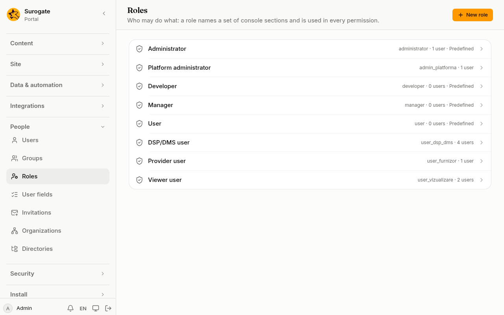
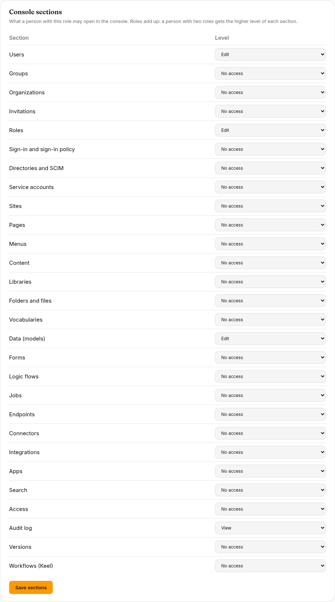

A role is a name for what a person may do. You make roles on **Roles**, give them to people, and then name a role wherever the portal asks who may see, edit or call something. A person can hold several roles, and has the rights of each. You need the **Administrator** role, or a role that opens **Roles** at **Edit**.

**Roles** lists every role with its code, how many people hold it, and **Predefined** for the four every portal starts with.

## The four roles every portal has

| Role | What it opens in the console |
|---|---|
| **Administrator** | Everything. It cannot be deleted, and its sections cannot be narrowed. |
| **Developer** | The sections that build a portal: sites, pages, menus, content, data, forms, flows, jobs, endpoints, search, versions and workflows, all at **Edit**. Not people, roles, sign-in or the audit log. |
| **Manager** | People: users, groups, organizations, invitations and roles at **Edit**; the audit log and **Access** at **View**. Nothing that builds the portal. |
| **User** | Nothing in the console. Every new account starts with it. |

Developer, Manager and User can be renamed, changed and deleted like any role you make. **Reset to default** on one of them gives back the sections it started with.

## Make a role

1. Press **New role**.
2. Type the **Code**: lower-case letters, digits and underscores, starting with a letter, such as `user_furnizor`. Permissions name the role by this code, so it cannot change once the role is saved.
3. Type the **Name in Romanian** and the **Name in English**, and a **Description** if you like.
4. Under **Start from**, choose **An empty role**, or another role to begin with the same console sections.
5. Press **Create role**. The role's page opens.

A second role with the same code says **A role with this code already exists.**

## What a role opens in the console

On a role's page, **Console sections** has a line for every section of the console. Set each to **No access**, **View** or **Edit** and press **Save sections**.

- At **View** a person opens the section and reads it, but every button that changes something is missing, and the server refuses a change.
- At **Edit** they change it too.
- A person with two roles gets the higher level of each section.
- The console's menu shows only the sections a person's roles open. Typing the address of another page shows **Your roles do not allow this page**, and the server refuses its data to anyone whose roles do not open it.

The **Administrator** role has every section at **Edit**, and the page says so; its levels cannot be changed.

## Clone, rename and delete

- **Clone role** makes a new role that starts with the same console sections. The first role stays as it was.
- Change the names and the description, and press **Save**. The code never changes, so renaming a role never breaks a permission that names it.
- **Delete role** asks first. If a model, a site, a form or an endpoint still names the role, the console lists where and refuses until you take it out of those places. If a [group mapping](/portal/console/group-mappings/) gives the role, it says so too. If only people hold the role, it says how many people lose it, and deleting takes it from all of them.

## Who may give which role

Someone who is not an administrator, but whose roles open **Roles** or **Users**, can give roles, with these limits:

- They cannot give or take the **Administrator** role.
- They cannot give or take a role that opens a section they do not have themselves.
- They cannot give a role a section they do not have themselves.
- They cannot change their own roles.

Each of these answers **You cannot give or take a role that has more access than you have.**

The same limits hold for the rest of what changes who someone is:

- A person who is not an administrator cannot set the password, reset the second step, end the sessions, link a sign-in identity, disable, export or erase a person, nor make a token or a client for a service account, when that person or program holds the Administrator role or a role with a section the first person does not have.
- They cannot change or delete such a role either, and they cannot map an outside group to the Administrator role or to a role with more access than they have, in a directory or a provider.
- Only an administrator changes the sections of the **User** role, which every new account gets, and no one but an administrator ever changes their own fields.
- The **Data console** is never a section of a role: it reads past the rules of access on records, so only the Administrator has it.

## Roles from an action

A job that runs as an administrator can make and change roles with the Portal administration actions, under the same limits as the console:

- **Make a role** takes the role's id (its code, which never changes), its name in each language, an optional description, and **Rights**: the console sections it opens, each `'view'` or `'edit'` (for example `users: 'view'`, `sign_in: 'edit'`). A section the console does not have is refused.
- **Change a role** takes the role's id and any of the name, the description and the rights. What it does not name stays as it is. The rights it names replace the role's sections.
- **Remove a role** is refused while a model, a site, a form or an endpoint names the role, while a group mapping gives it, and while any person still holds it: take it from them first with **Give or take roles**.
- **Give or take roles** works on any role of the portal, as the console does it. A run does not give the Administrator role unless it holds it, and does not leave the portal without an active administrator.

A run never gives a role a section it does not hold itself, and never changes a role that carries one it lacks.

## Where a role is used

Choose **A role** in the picker that asks who may see or edit something: a site, a page, a block, a form, a library, a folder, and who may use a model's records. See [Choose who](/portal/sites/permissions/#choose-who). A role also narrows who may call an [endpoint](/portal/sites/endpoints/#who-may-call-it), and a [service account](/portal/console/service-accounts/) can hold any role.

To see what a role gives a person, use [Check access](/portal/console/access/).

Every change to a role, and every time one is given or taken, is in the [audit log](/portal/console/audit/) with what it was and what it became.
