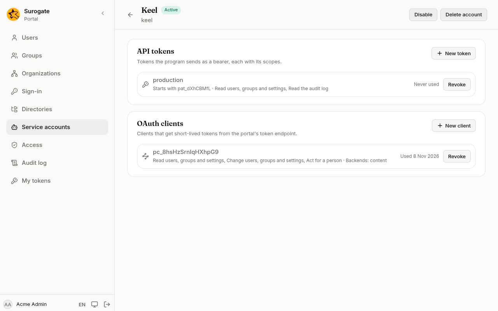

A service account is an account for a program, such as a case system or a nightly import, that calls the portal. It never signs in and is not one of the portal's people. It acts through its own tokens and OAuth clients, each limited to what you allow. **Service accounts** is for administrators.

## Create a service account

1. Press **New service account**.
2. **Name**: what people call the program, such as "Keel".
3. **Slug**: a short name for it in lower-case letters, digits and hyphens, such as `keel`. It cannot change.
4. Tick **Administrator** if the program manages users, groups or settings. Leave it unticked for a program that only reads its own data.
5. Press **Create account**. The account's page opens.



## API tokens

An API token is the simplest way for a program to call the portal: it sends the token with every request.

1. On the account's page, under **API tokens**, press **New token**.
2. Name the token, such as "production".
3. Tick its [scopes](/portal/console/tokens/#scopes): only what the program needs.
4. Press **Create token**, then **Copy**. The console shows the token this once.

## OAuth clients

An OAuth client gets short-lived tokens from the portal itself, which programs built on standard libraries expect. A client can also let an app's backend act for the person who uses the app.

1. Under **OAuth clients**, press **New client**.
2. Tick its scopes. A client never has **Full access**.
3. Tick **Act for a person** only if the program does work on a person's behalf: the audit log then names both the program and the person.
4. Under **App backends**, tick the apps whose backends may use this client to call on behalf of the person signed in to the app. The list shows the apps your implementation team has set up with a backend.
5. Press **Create client**. Copy the **Client ID** and the **Client secret** and give them to the program's team over a safe channel. The secret is shown this once.

The program asks for tokens at `/_portal/oauth/token` on the tenant's address.

## Revoke, disable and delete

- **Revoke** beside a token or a client stops it at once. Revoked ones stay in the list, marked **Revoked**.
- **Disable** at the top stops every token and client of the account until you press **Enable**.
- **Delete account** removes the account with its tokens and clients. This can't be undone.

Everything a service account does is in the [audit log](/portal/console/audit/) under its name.

The same can be done from the command line with an administrator's [token](/portal/console/tokens/):

```
portal service-accounts create <slug> --name "<name>" [--role administrator]
portal service-accounts token <slug> <token name> --scope <scope>
portal service-accounts client <slug> --scope <scope> [--audience <app>]
```
