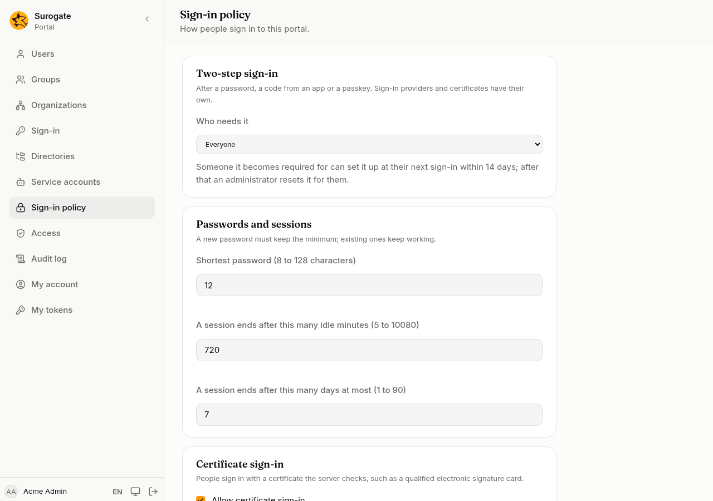

**Sign-in policy** sets how the portal's people sign in. It is for administrators.

## Two-step sign-in

**Who needs it** after a password:

| Choice | What it does |
|---|---|
| **Nobody (turned off)** | No second step, and nobody can set one up. |
| **Whoever sets it up** | People who set up an app or a passkey on [My account](/portal/console/account/#two-step-sign-in) are asked for it. |
| **Administrators** | Everyone with a role must have one; others as above. |
| **Everyone** | Everyone must have one. |

When it becomes required for someone who has none, they set it up at their next sign-in, within 14 days. Changing from **Administrators** to **Everyone** starts the 14 days again. After that, an administrator [resets](/portal/console/users/#two-step-sign-in) them so they can. Someone who knows only the password could set it up in their place during that time, so tell people to set it up as soon as you turn it on.

People who sign in through a sign-in provider, or with a certificate, are not asked: the provider and the card do their own checks.

## Passwords and sessions

- **Shortest password**: from 8 to 128 characters. New passwords must keep it; passwords already set keep working.
- **A session ends after this many idle minutes**, and **after this many days at most**. Shorter times apply at once, to people already signed in too; longer ones apply from their next sign-in.

## Certificate sign-in

**Allow certificate sign-in** shows **Sign in with a certificate** on the sign-in page. People sign in with a certificate the server checks, such as a qualified electronic signature card; the team that runs the portal sets this up. Link each person's certificate on their [user page](/portal/console/users/#linked-accounts); a person has one linked certificate at a time.

**Also sign in a person whose email is in the certificate** signs in someone not linked yet, when their email is in the certificate. It never signs in an administrator, nor someone from a directory, this way.

Press **Save**. The change is in the [audit log](/portal/console/audit/).

## People's own accounts

Under **People's own accounts**, you can let people make their own account and set a new password when they forgot theirs. Both are off until you switch them on, and both need the portal to send mail.

**People may create their own account** adds **Create an account** to the sign-in page of each of your sites.

1. The person writes their email address and agrees that the portal keeps their name and address to let them in.
2. The portal mails them a link that works for 24 hours. It answers the same whether the address already has an account or not. An address that has one gets a mail saying so, with the sign-in page.
3. On the link's page they write their name and choose a password, and their account is made. Your apps' person hooks see it first, as for an account you make.

Choose **Groups people who sign up get**, and, to take only some addresses, **Email domains taken**, such as `primaria.ro`. When people also sign in with a provider or a directory, name the domains: accounts made by signing up are kept by the portal, outside the provider's or directory's offboarding and second steps. Required user fields are filled on the person's profile later.

**People may set a new password by a link mailed to them** adds **Forgot your password?** to the sign-in page. The portal mails a link that works for an hour, then ends every session the person had. Some people are never sent a link: administrators, people a directory or SCIM keeps, people who sign in only with a provider, and accounts that are turned off. The page answers the same for them, and for addresses without an account. A link stops working when it is used, when an hour passes, or when the password changes some other way.

Each address gets at most 3 links an hour, and each network 5.
