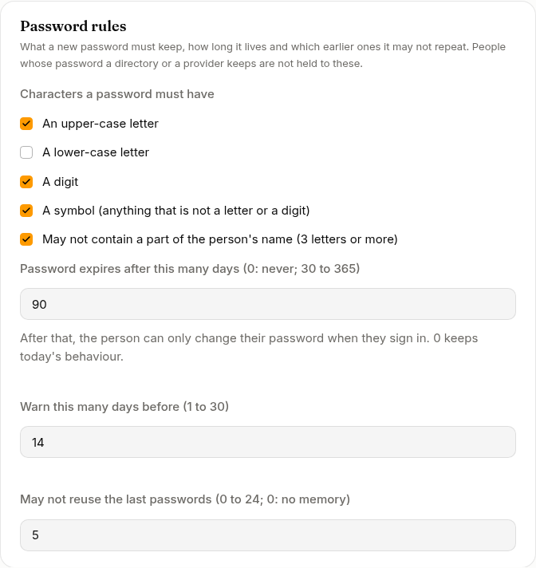
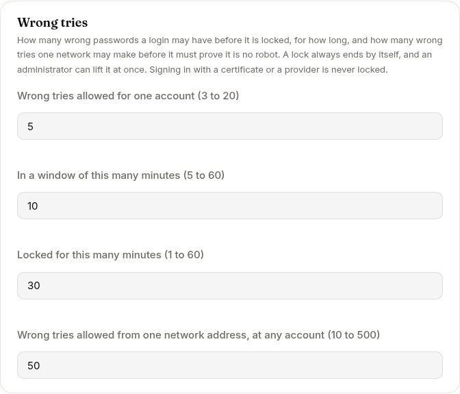
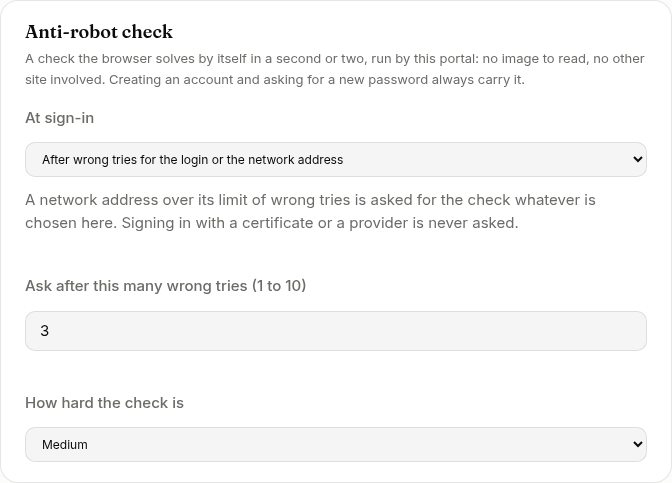
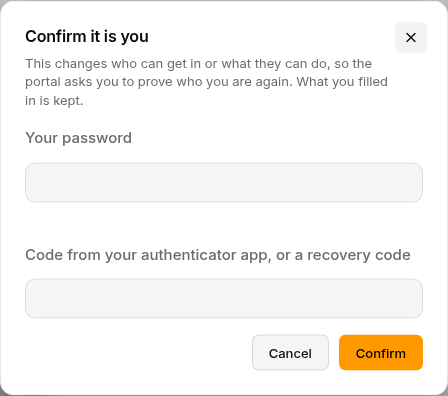

**Sign-in policy** sets how the portal's people sign in. It is for administrators.

## Two-step sign-in

**Who needs it** after a password:

| Choice | What it does |
|---|---|
| **Nobody (turned off)** | No second step, and nobody can set one up. |
| **Whoever sets it up** | People who set up an app or a passkey on [My account](/portal/console/account/#two-step-sign-in) are asked for it. |
| **Administrators** | Everyone with a role must have one; others as above. |
| **Everyone** | Everyone must have one. |

When it becomes required for someone who has none, they set it up at their next sign-in, within 14 days. Changing from **Administrators** to **Everyone** starts the 14 days again. After that, an administrator [resets](/portal/console/users/#two-step-sign-in) them so they can. Someone who knows only the password could set it up in their place during that time, so tell people to set it up as soon as you turn it on.

People who sign in through a sign-in provider, or with a certificate, are not asked: the provider and the card do their own checks.

## Passwords and sessions

- **Shortest password**: from 8 to 128 characters. New passwords must keep it.
- **A session ends after this many idle minutes**, and **after this many days at most**. Shorter times apply at once, to people already signed in too; longer ones apply from their next sign-in. A role can ask for less: see [Rules for each role](#rules-for-each-role).
- **Activation link works this many days** (1 to 7, 3 at first): how long the link mailed to a person with a new account lasts. See [Users](/portal/console/users/#add-a-user).
- **A confirmation of who you are stays valid this many minutes** (1 to 60, 10 at first): see [Confirming it is you again](#confirming-it-is-you-again).

## Password rules

**Password rules** says more of what a new password must keep. It applies wherever someone chooses a password of the portal's: [My account](/portal/console/account/#password), the link to set a new password, signing up, accepting an invitation, activating an account, and **New user** and **Set password** on [Users](/portal/console/users/). People whose password a directory, a sign-in provider or a certificate keeps are not held to it.

- **Characters a password must have**: tick any of an upper-case letter, a lower-case letter, a digit and a symbol (anything that is not a letter or a digit; a space counts). None is ticked at first.
- **May not contain a part of the person's name**: on at first. Parts of three letters or more are compared, ignoring capitals and accents, so Ștefan is found in `stefan`. A password that holds the person's whole email is refused whatever you tick.
- **Password expires after this many days**: 30 to 365, or 0 for never (the first value). After the term, the person's next sign-in takes them only to a page where they choose a new password; every other page of the console and of your sites sends them back there, and the API answers `password_expired`. Their other sessions end at that sign-in. Their API tokens keep working.
- **Warn this many days before**: 1 to 30, 14 at first. From then on, a banner on the console says how many days are left and links to [My account](/portal/console/account/#password).
- **May not reuse the last passwords**: 0 to 24, 0 at first. The portal keeps only the hashes of earlier passwords, never their text. The password a person has now always counts as one of them.

On the pages people open from a mailed link (creating an account, the new-password link, an invitation, an activation link), the rules are a list under the password field, ticked as the person types by a small script the portal serves itself; without the script the list is shown unticked. The portal checks them again when the password is sent.

A password an administrator sets starts its term again, like any other. When you make the rules stricter, nothing is forced at once: at each person's next sign-in, if the password they type does not keep the rules, they must choose a new one, as after the term. Passwords set before you last saved the policy are the ones checked.

## Wrong tries

**Wrong tries** holds back people who guess passwords. It counts the tries at signing in and at confirming who you are again, together for the same login; the codes of the second step have a count of their own, fixed at 10 in 15 minutes with a lock of 15 whatever the policy says, so wrong passwords from someone who does not have the password never lock out the person who has it, and a short window cannot let a guesser through. A person who signs in with a directory username has the same count under that username, which **Locked now** and **Unlock** follow. A login that does not exist is counted like any other, and the page says the same thing, **The login or the password is not right.**, so nobody learns which logins exist.

- **Wrong tries allowed for one account**: 3 to 20, 10 at first.
- **In a window of this many minutes**: 5 to 60, 15 at first.
- **Locked for this many minutes**: 1 to 60, 15 at first. A lock always ends by itself, never later than that after the last try, and tries refused during it do not renew it.
- **Wrong tries allowed from one network address, at any account**: 10 to 500, 50 at first. Past it, the tries from that address must pass the [anti-robot check](#anti-robot-check). An administrator's login from such an address is asked for the check like any other, so nothing tells it apart; once the check is passed, the try is refused. Because of that, a flood of junk checks from a shared address (a whole office behind one network address, say) can keep administrators out from that address while it lasts: they sign in from another address, or by a certificate or a provider, and an administrator can raise the limit.

A lock is kept for one login and one network address, so someone trying from elsewhere cannot lock a person out of their own network; tries from all addresses together are limited too, at ten times the allowed number. The count is kept in the database, so every server of the portal shares it. A lock does not stop signing in with a certificate or at a provider, which never count wrong passwords. Passkeys here are a second step after the password, not a way in on their own, so a locked person cannot sign in with a passkey alone: they use a certificate or a provider, or wait, or an administrator unlocks them. Signing in with a passkey only is not offered. It is noted in the [audit log](/portal/console/audit/) as **Was held back after too many wrong tries**, with the time the person can try again; an address held back, and a person unlocked, are noted too.

To let someone in at once, an administrator opens their page on [Users](/portal/console/users/#locked-out) and presses **Unlock**.

## Anti-robot check

The check is run by the portal itself: the browser solves a puzzle in a second or two, in the background, with no image to read and nothing for the person to do. No request leaves the portal, and no other site or cookie is involved. A solution works once, for the form it was made for, for five minutes.

- **At sign-in**: **Never**, **After wrong tries for the login or the network address** (the first value; choose **Ask after this many wrong tries**, 1 to 10, 3 at first) or **Always**.
- **How hard the check is**: **Low**, **Medium** (the first value) or **High**. A harder check takes the person's browser longer.

Whatever you choose at sign-in, **Create an account** and **Forgot your password?** always carry the check, a network address over its limit of wrong tries is asked for it, and so is every login after a lock (every login alike, so that nothing tells an administrator's from another). Tries made at once are held to the check too: the portal looks again inside the lock, so a burst cannot slip past a check that the first of its tries brought about. Public forms can ask visitors for the check too: see [Keep robots out of a public form](/portal/sites/forms/#keep-robots-out-of-a-public-form). The steps that check a login and password, or ask for a new account, follow the same limits and the same check: after the wrong tries you set, or always, a check of a login must come with a solved puzzle, and a visitor who asks for an account must have passed one. An administrator's login from a network address over its limit is refused, with the puzzle solved or not, as at sign-in. A check that fails counts against the network address, not against the person, and is noted as **Failed the anti-robot check**. The check does not apply to certificates or providers, nor to API tokens. Without JavaScript the check cannot run, and the page says so.

## Rules for each role

**Rules for each role** has one block for each role of the portal: the roles of the Roles page, the Administrator first, then the others by their codes, and on the default portal the Install administrator. A role you make yourself is there as soon as it exists, named as the Roles page names it. A role can ask for:

- **A second step is required.** It is ticked, and cannot be unticked, for every role that administers: the Administrator, the Install administrator and every role that opens a section of the console, such as a Supervisor that edits Users. The portal and its API refuse to change it. A role that opens no section of the console, such as a Greeter, may choose.
- **Idle minutes before a session ends**, **days a session lasts at most** and **days a password lives**. Empty means the general value above.

Whoever holds a role that opens the console is guarded as an administrator is: their second step is asked for, their sign-in from a network address over its limit is refused, and coming to hold such a role (given by hand, by a group mapping, or by the role being given its first section) starts the 14 days to set the second step up. The rules of a role that is deleted go with it; saving this page drops any that were left.

Someone with several roles gets the strictest value of each setting. When a person is given a role that needs a second step, they set it up at their next sign-in, within 14 days, as in [Two-step sign-in](#two-step-sign-in); the portal needs its secret key to keep the authenticator app's secret. Losing a role relaxes the rules from the next sign-in; making a rule stricter applies to open sessions at once. A person who signs in at a provider or with a certificate is not asked for the portal's second step: ask your provider to require its own for the roles that administer.

## Confirming it is you again

Some operations change who can get in or what they can do. Saving this page, changing a sign-in provider, directory or SCIM token, giving or taking roles, setting a password or resetting a second step, disabling or enabling someone, unlocking them, seeing the portal as them, changing their address, exporting or erasing a person, setting connector credentials, creating tokens or service accounts, approving an app or withdrawing its approval, an install administrator making a portal or adding an administrator to one, saving a SQL connector, downloading the audit log or running a data console query, undoing or promoting a version, and approving a proposed change: all ask the person to prove who they are again when they last did so more than the minutes you set under **A confirmation of who you are stays valid this many minutes**. Signing in counts as proof.

The window asks for what the account has: the portal's password, then a code from the authenticator app or a recovery code, or a passkey; the directory's password; or, for someone who only signs in at a provider, a button that goes back to the provider and makes it ask for the sign-in again. What was filled in stays, and the operation goes on when the proof is given; **Cancel** leaves everything as it was. Wrong tries count with the sign-in's and can lock the account. Forms and moves of states can ask for the same proof: see [Ask people to confirm who they are](/portal/sites/forms/#ask-people-to-confirm-who-they-are) and [Confirm a move](/portal/sites/forms/#confirm-a-move). The server asks every time, not only the page, and an API token is never asked: its rights are explicit. While seeing the portal as someone, these operations stay closed.

## Certificate sign-in

**Allow certificate sign-in** shows **Sign in with a certificate** on the sign-in page. People sign in with a certificate the server checks, such as a qualified electronic signature card; the team that runs the portal sets this up. Link each person's certificate on their [user page](/portal/console/users/#linked-accounts); a person has one linked certificate at a time.

**Also sign in a person whose email is in the certificate** signs in someone not linked yet, when their email is in the certificate. It never signs in an administrator, nor someone from a directory, this way.

Press **Save**. The change is in the [audit log](/portal/console/audit/). Saving this page asks you to [confirm it is you](#confirming-it-is-you-again) when you signed in a while ago.

## People's own accounts

Under **People's own accounts**, you can let people make their own account and set a new password when they forgot theirs. Both are off until you switch them on, and both need the portal to send mail.

**People may create their own account** adds **Create an account** to the sign-in page of each of your sites.

1. The person writes their email address and agrees that the portal keeps their name and address to let them in.
2. The portal mails them a link that works for 24 hours. It answers the same whether the address already has an account or not. An address that has one gets a mail saying so, with the sign-in page.
3. On the link's page they write their name and choose a password, and their account is made. Your apps' person hooks see it first, as for an account you make.

Choose **Groups people who sign up get**, and, to take only some addresses, **Email domains taken**, such as `primaria.ro`. When people also sign in with a provider or a directory, name the domains: accounts made by signing up are kept by the portal, outside the provider's or directory's offboarding and second steps. Required user fields are filled on the person's profile later.

**People may set a new password by a link mailed to them** adds **Forgot your password?** to the sign-in page. The portal mails a link that works for an hour, then ends every session the person had. Some people are never sent a link: administrators; anyone a directory, SCIM, a sign-in provider or a certificate also knows; people without a password; accounts that are turned off; and, when a second step is asked of everyone, people who have not set one up yet. They ask an administrator. The page answers the same for them, and for addresses without an account. A link stops working when it is used, when an hour passes, or when the password changes some other way.

Each address gets at most 3 links an hour, and each network 5. Turning either switch off ends the links already sent.
