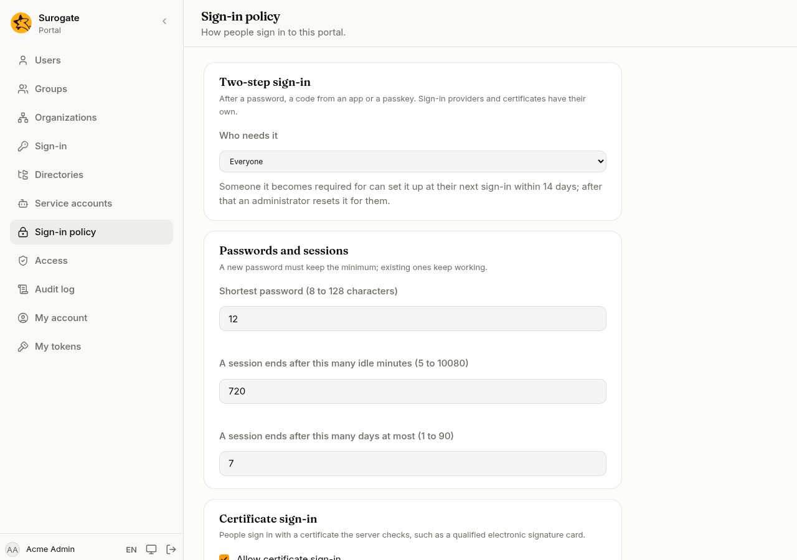

**Sign-in policy** sets how the portal's people sign in. It is for administrators.

## Two-step sign-in

**Who needs it** after a password:

| Choice | What it does |
|---|---|
| **Nobody (turned off)** | No second step, and nobody can set one up. |
| **Whoever sets it up** | People who set up an app or a passkey on [My account](/portal/console/account/#two-step-sign-in) are asked for it. |
| **Administrators** | Everyone with a role must have one; others as above. |
| **Everyone** | Everyone must have one. |

When it becomes required for someone who has none, they set it up at their next sign-in, within 14 days. Changing from **Administrators** to **Everyone** starts the 14 days again. After that, an administrator [resets](/portal/console/users/#two-step-sign-in) them so they can. Someone who knows only the password could set it up in their place during that time, so tell people to set it up as soon as you turn it on.

People who sign in through a sign-in provider, or with a certificate, are not asked: the provider and the card do their own checks.

## Passwords and sessions

- **Shortest password**: from 8 to 128 characters. New passwords must keep it; passwords already set keep working.
- **A session ends after this many idle minutes**, and **after this many days at most**. Shorter times apply at once, to people already signed in too; longer ones apply from their next sign-in.

## Certificate sign-in

**Allow certificate sign-in** shows **Sign in with a certificate** on the sign-in page. People sign in with a certificate the server checks, such as a qualified electronic signature card; the team that runs the portal sets this up. Link each person's certificate on their [user page](/portal/console/users/#linked-accounts); a person has one linked certificate at a time.

**Also sign in a person whose email is in the certificate** signs in someone not linked yet, when their email is in the certificate. It never signs in an administrator, nor someone from a directory, this way.

Press **Save**. The change is in the [audit log](/portal/console/audit/).
