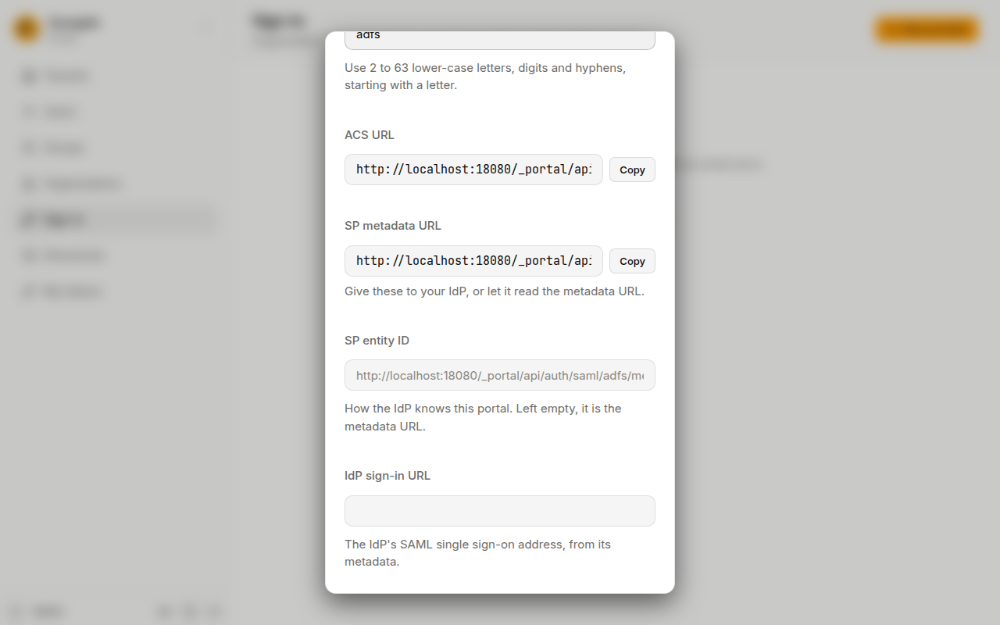
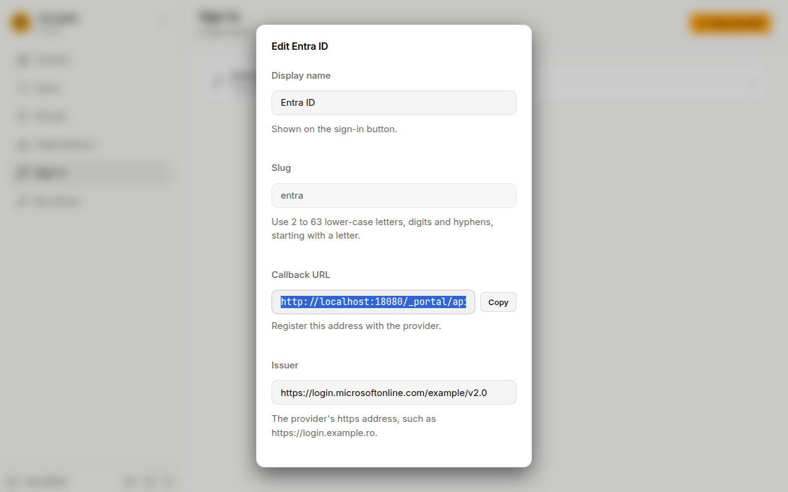

On **Sign-in**, an administrator connects the portal to your organisation's accounts, such as Microsoft Entra ID, ADFS, Keycloak or Google Workspace. People then sign in with the account they already have. The portal speaks OpenID Connect and SAML; most of these services offer both.

## Before you start

Register the portal as an application with your organisation's sign-in service. You need from it:

- the **issuer**: the service's https address, such as `https://login.microsoftonline.com/<your directory>/v2.0`;
- a **client ID** and a **client secret** for the portal.

The service asks you for the portal's **callback URL**. The console shows it while you add the provider (step 3 below), so you can copy it from there.

## Add a provider

1. On **Sign-in**, press **New provider**.
2. **Display name**: the name on the sign-in button, for example "Entra ID" for **Continue with Entra ID**.
3. **Slug**: a short name in lower-case letters, digits and hyphens, such as `entra`. As soon as you type it, the console shows the **Callback URL**. Press **Copy** and register it with your sign-in service.
4. **Issuer**, **Client ID** and **Client secret**: from your sign-in service.
5. **Scopes**: leave `openid email profile` unless your service asks for others. They must include `openid`.
6. **Create the account at first sign-in**: on, anyone your service lets in gets an account the first time they sign in. Off, only people you already added as [users](/portal/console/users/) can sign in.
7. **On**: untick it to keep the provider ready but hidden from the sign-in page.
8. Press **Add provider**.

People are matched by email: someone whose organisation email is already a user of the portal signs in as that user. This needs the provider to say the email is verified; when it does not, the person can still sign in, but only to an account the provider made or linked before, and no account is made for them.

## Add a SAML provider

1. Press **New provider** and choose **SAML**.
2. **Display name** and **Slug**, as for OpenID Connect.
3. The console now shows the portal's **ACS URL** and **SP metadata URL**. Register the portal with your IdP using these, or give it the metadata URL.
4. **SP entity ID**: how the IdP knows the portal. Leave it empty to use the metadata URL; enter another only if your IdP expects one.
5. You can save it now, with **On** unticked, and come back with the IdP's details.
6. **IdP sign-in URL** and **IdP signing certificate**: from the IdP's metadata. During a certificate change, paste both certificates.
7. **IdP entity ID**: the IdP's issuer, so only it is accepted.
8. **Email attribute**, **Name attribute** and **Groups attribute**: the names of the attributes your IdP sends. Leave the email empty to use the email the IdP names, or the NameID.
9. **ID attribute**: leave it empty to use the NameID. If your IdP sends a temporary (transient) NameID, set an attribute that stays the same.
10. **Trust the IdP's email**: only then can a sign-in link an existing user by email.
11. Tick **On** and press **Save**.

Sign-in always starts on the portal: a link on the IdP's own portal page that sends people straight here does not sign them in.

## Groups and existing users

- **Groups claim** (OpenID Connect) or **Groups attribute** (SAML): where the provider lists a person's groups, for [group mappings](/portal/console/group-mappings/).
- **Link existing users by email**: a person whose email is already a user signs in as that user. Administrators are never linked this way; link them on their user page.

A person who signed in once through a provider is recognised by the provider's own ID for them afterwards, even if their email changes.

## Change or delete a provider

Press a provider in the list to edit it.

 The **Client secret** field is empty: leave it empty to keep the saved secret, or type a new one to replace it. Press **Save**.

To delete it, press **Delete provider** in the same window and confirm. People can no longer sign in with it; their accounts stay, and they can still sign in with a password if they have one.

Deleting a provider also unlinks everyone who signed in through it, and a new provider does not take them back for administrators. Before you delete the provider you sign in with yourself, set yourself a password on your user page or link your account to another provider. Otherwise you cannot sign in again.
