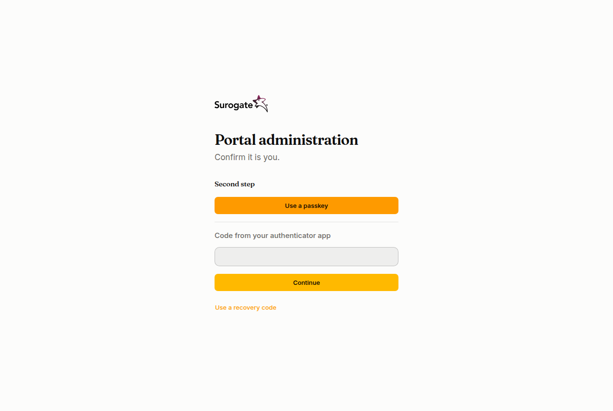

The console of a portal is at `/_portal/admin/` on any of the portal's addresses, for example `https://www.example.ro/_portal/admin/`. You sign in to the portal that owns that address: the same email can be a user in two portals, with two separate accounts.

## With an email and a password

The sign-in page is titled **Portal administration**: "Sign in to manage the portal."

1. Type your **Email** and your **Password**. When your portal has a [directory](/portal/console/directories/), the field is **Email or username**: you can type your work username instead.
2. Press **Sign in**.

If the login or the password is wrong, the page says **The login or the password is not right.** After 10 wrong attempts within 15 minutes, the account refuses sign-in for a while, with the same message, even with the right password. Wait 15 minutes, or ask an administrator to [set a new password](/portal/console/users/#password).

## The second step

When your portal asks for one, signing in has a second step after your password.

- **A code from your authenticator app:** type the six digits the app shows and press **Continue**.
- **A passkey:** press **Use a passkey** and confirm on your device, with your fingerprint, face or PIN.
- **Lost your phone?** Press **Use a recovery code** and type one of the codes you saved. Each code works once.

After five wrong codes, the sign-in starts again from the password. A passkey works only on the address you added it on: on another of the portal's addresses, use your app or a recovery code. If you have no way left in, ask an administrator to [reset your two-step sign-in](/portal/console/users/#two-step-sign-in).

### The first time

If your portal requires a second step and you have none yet, the first sign-in sets one up:

1. Open an authenticator app on your phone, such as Google Authenticator or Microsoft Authenticator, and scan the code on the page. If you cannot scan it, type the key shown under it.
2. Type the code the app shows and press **Confirm**.
3. The page shows ten **recovery codes**, once. Copy them and keep them somewhere safe, then press **I have saved them**.

You can set it up this way on your first sign-in, within 7 days after an administrator resets yours, or within 14 days after the portal begins to require it. Otherwise the page says the portal needs two-step sign-in and an administrator must reset yours. You manage it later on [My account](/portal/console/account/).

## With a certificate

When your portal allows it, the page shows **Sign in with a certificate**. Insert your card (for example a qualified electronic signature card), press the button, choose the certificate when the browser asks, and type its PIN. An administrator links your certificate to your account first. If it does not work, the page says **Sign-in with a certificate did not work**: check that the card is in the reader, and ask an administrator whether it is linked.

A certificate sign-in has no second step: the card and its PIN are already two.

## With your organisation account

When your portal has a sign-in provider, the page also shows a button for it, such as **Continue with Entra ID**.

1. Press the button. Your organisation's sign-in page opens.
2. Sign in there. You come back to the console, signed in.

If it does not work, the page says one of these:

| Message | What it means |
|---|---|
| **Sign-in did not work. Try again.** | The sign-in was interrupted or took too long. Start again from the button. |
| **This account has no access to this portal.** | Your organisation account is not a user of this portal, or the account is disabled. Ask an administrator to add you. |

## Who sees what

After you sign in, the left side of the console lists the pages your roles allow:

- An **install administrator** sees **Tenants**, and on the main portal also **Users**, **Groups**, **Organizations**, **Sign-in** and **Directories**.
- An **administrator** sees **Users**, **Groups**, **Organizations**, **Sign-in** and **Directories**.
- Everyone sees **My account** and **My tokens**.

A page your roles do not allow says **You have no access here**. See [Roles](/portal/reference/roles/).

## Language, theme and signing out

At the bottom of the left side are your name and three buttons: the language (**RO** or **EN**), the theme (system, light or dark) and **Sign out**.

You stay signed in while you use the console. After 12 hours without using it, or 7 days in all, you sign in again; your portal can set other times in its [sign-in policy](/portal/console/sign-in-policy/). When an administrator sets a new password for you, your other sessions end. You see and end your sessions on [My account](/portal/console/account/#sessions).
