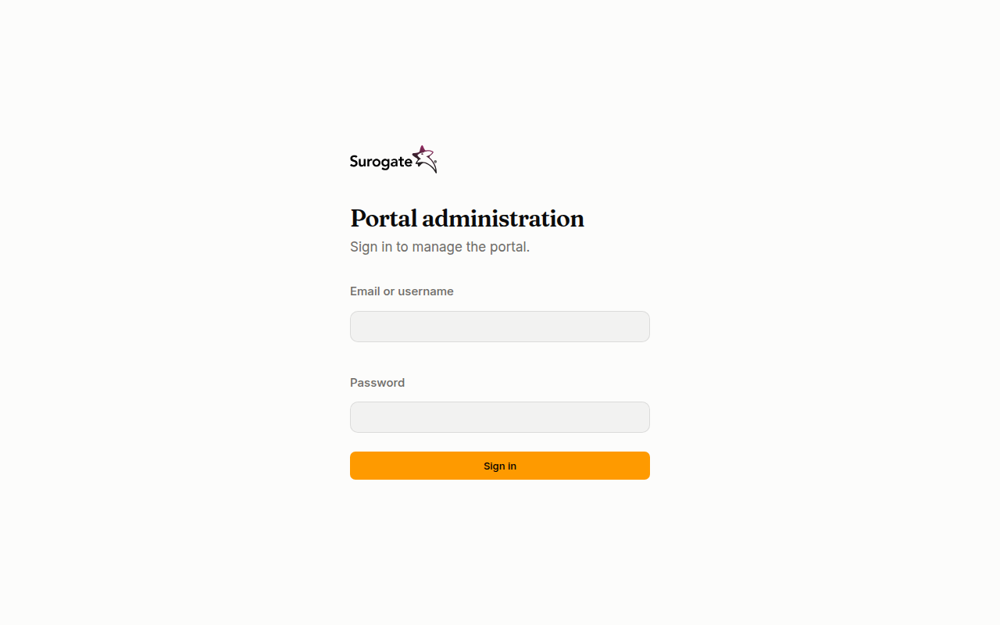

The console of a portal is at `/_portal/admin/` on any of the portal's addresses, for example `https://www.example.ro/_portal/admin/`. You sign in to the portal that owns that address: the same email can be a user in two portals, with two separate accounts.

## With an email and a password

The sign-in page is titled **Portal administration**: "Sign in to manage the portal."

1. Type your **Email** and your **Password**. When your portal has a [directory](/portal/console/directories/), the field is **Email or username**: you can type your work username instead.
2. Press **Sign in**.

If the login or the password is wrong, the page says **The login or the password is not right.** After 10 wrong attempts within 15 minutes, the account refuses sign-in for a while, with the same message, even with the right password. Wait 15 minutes, or ask an administrator to [set a new password](/portal/console/users/#password).

## With your organisation account

When your portal has a sign-in provider, the page also shows a button for it, such as **Continue with Entra ID**.

1. Press the button. Your organisation's sign-in page opens.
2. Sign in there. You come back to the console, signed in.

If it does not work, the page says one of these:

| Message | What it means |
|---|---|
| **Sign-in did not work. Try again.** | The sign-in was interrupted or took too long. Start again from the button. |
| **This account has no access to this portal.** | Your organisation account is not a user of this portal, or the account is disabled. Ask an administrator to add you. |

## Who sees what

After you sign in, the left side of the console lists the pages your roles allow:

- An **install administrator** sees **Tenants**, and on the main portal also **Users**, **Groups**, **Organizations**, **Sign-in** and **Directories**.
- An **administrator** sees **Users**, **Groups**, **Organizations**, **Sign-in** and **Directories**.
- Everyone sees **My tokens**.

A page your roles do not allow says **You have no access here**. See [Roles](/portal/reference/roles/).

## Language, theme and signing out

At the bottom of the left side are your name and three buttons: the language (**RO** or **EN**), the theme (system, light or dark) and **Sign out**.

You stay signed in while you use the console. After 12 hours without using it, or 7 days in all, you sign in again. When an administrator sets a new password for you, your other sessions end.
