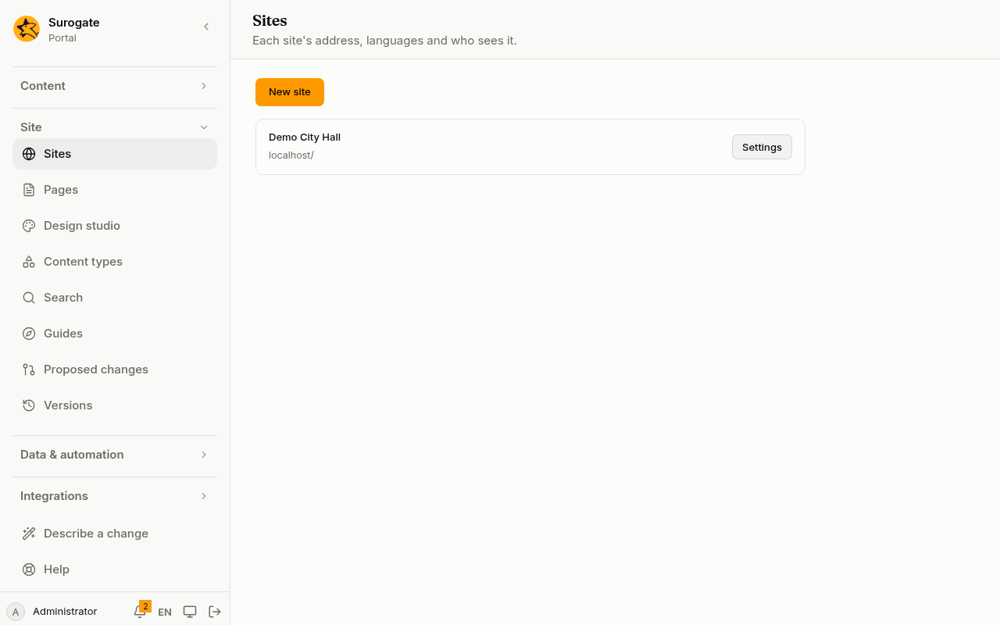
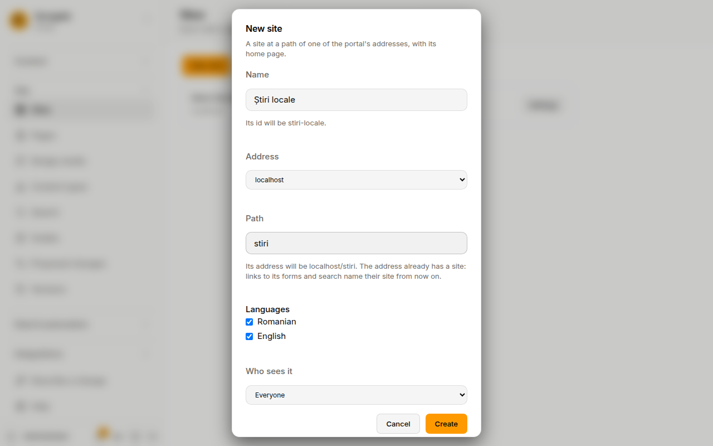
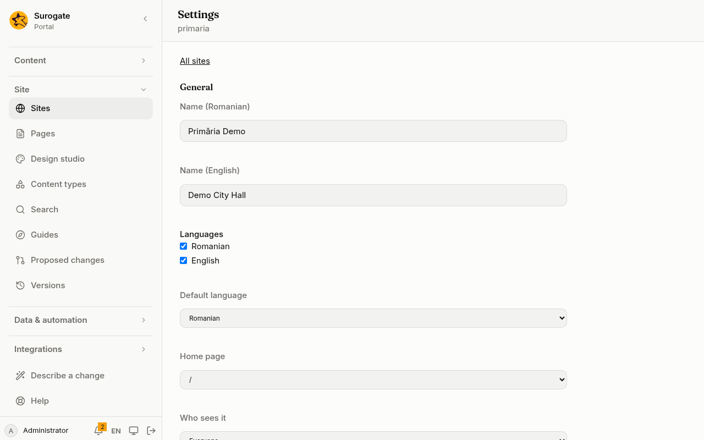
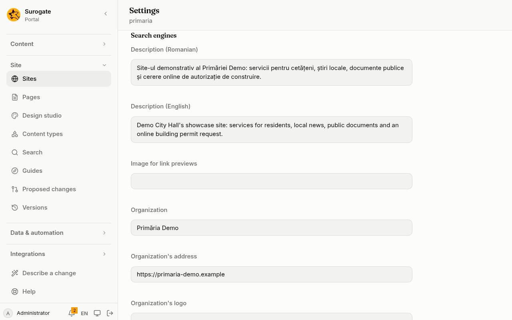

**Sites** lists the portal's sites. It makes a new one, and changes each site's settings: its name, its languages, its home page, who sees it, what search engines show, and who may be invited. Every save is a [version](/portal/console/versions/) you can undo.

**Sites** is for administrators, on a portal whose site files the portal keeps. It is not in the menu otherwise.

## The list

Each site shows its name and its addresses.

- **Settings** opens the site's settings.
- A site marked **Not set up** has an address but no settings yet: it was made by the installation's administrator. **Set up** gives it settings and a home page, and opens them.
- A site whose settings were written in a way the console cannot edit is marked **Cannot be read**. Ask whoever changed its files to put it right.

A portal has at most 50 sites. When it has 50, **New site** is off and the page says so.

## Make a site

1. Press **New site**.
2. Type the site's **Name**. The console shows the site's id under it, made from the name: "Știri locale" becomes `stiri-locale`. When another site has that id, the new one gets `-2`, `-3` and so on. The id is fixed once the site is made.
3. Choose its **Address**: one of the portal's own addresses.
4. Type its **Path**, or leave it empty:
   - **Empty**: the site is at the address itself, such as `www.example.ro/`. This works only when no site is there yet.
   - **A word**, such as `stiri`: the site is at `www.example.ro/stiri`. The word is lower-case letters, digits and hyphens; the console makes it so as you type, and shows the address the site will have. It cannot be a language (`ro`, `en`), and it cannot be where the site already at that address has pages: a site there would hide them.
5. Tick its **Languages**. The first one ticked is the site's default language.
6. Choose **Who sees it**: **Everyone**, or **People signed in**.
7. Press **Create**.

When the address already has a site, the dialog says so: once two sites share an address, links to forms and to search name the site they belong to.

The new site starts with its name in each of its languages and a home page at `/`, in one column, titled with its name. The console then opens its settings. Build its pages on [Pages](/portal/console/pages/).

When the portal has no address you may use, the page says to ask the installation's administrator, who adds addresses on [Tenants](/portal/console/tenants/#sites-and-addresses).

## Change a site's settings

Open **Settings** on a site. The settings are in three parts, saved together with **Save**.

**General**

- **Name**: one per language of the site.
- **Languages**: the languages the site is in. A language you add starts with the default language's name; change it to the name in that language. Removing a language removes the site's name and description in it.
- **Default language**: the language people see first.
- **Home page**: one of the site's pages.
- **Who sees it**: by default **Everyone**. Choose **Anyone signed in**, a group, an organization or a person instead, or **Only editors and administrators**.
- **Who edits it**: by default **Administrators only**. It says: "In addition to administrators and people added on Access." Choose the groups, organizations and people who may also edit the site. They can be added on [Access](/portal/console/access/#add-editors) too.
- **Who writes blog posts**: by default **The site's editors**. Choose the groups, organizations and people who may write their own [blog posts](/portal/sites/blogs/#name-the-bloggers) on the site.

Each is a picker: **Add…** opens the choices, and **Remove** takes one away. See [Choose who](/portal/sites/permissions/#choose-who) for how it works and what the defaults mean.

**Search engines**

What search engines and link previews show for the whole site. A page's own description and image win over the site's. See [Search engines and link previews](/portal/sites/seo/).

- **Description**: one per language of the site.
- **Image for link previews**: the address of an image shown when a link to the site is shared.
- **Organization**, **Organization's address** and **Organization's logo**: who is behind the site. The address and the logo are kept only with the organization's name.
- **Search engines may list the site**: untick it to ask search engines to leave the whole site out.

**Invitations**

Who may invite people to the site. See [Invitations](/portal/console/invitations/#let-a-sites-editors-invite).

- **The site's editors may invite people**: when it is not ticked, only administrators invite.
- **Groups people are invited into**: 10 at most.
- **Email domains people may be invited from**: one per line, such as `primarie.ro`. Editors may then invite only those domains, matched exactly. When there are none, they may invite any address.

## When a save is refused

The portal checks the settings before it keeps them.

- A problem with a setting shows under it.
- A problem in one of the site's other files shows under the settings with that file's name. For example, adding a language the site's pages have no titles in yet: give each page its title in that language on [Pages](/portal/console/pages/) first.
- When someone else saved a change in the meantime, the page says so. Press **Load the newest version**, then **Save** again. What you typed stays.

## What the console does not do yet

A new domain name is added by the installation's administrator, on [Tenants](/portal/console/tenants/#sites-and-addresses). The console does not yet remove a site, change its id or give it more addresses.

The settings are kept in the site's files, which developers can also change: see [For developers](/portal/developer/).
