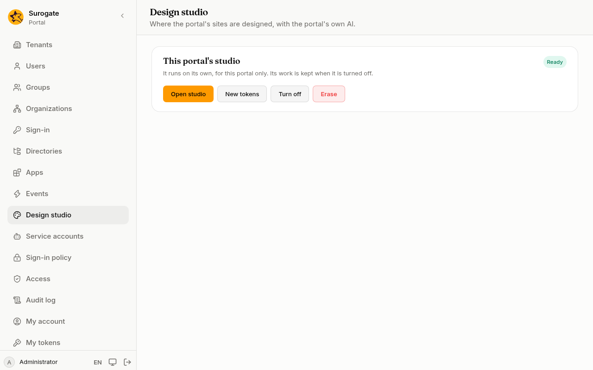

The design studio is an AI design tool for the portal's sites. You describe a page, a layout or a whole brand, and it designs it with the portal's own AI model, showing the result as it goes. Each portal has a studio of its own, with its own projects; no other portal sees them. **Design studio** is for administrators.

The studio appears only on installs where your implementation team has turned design studios on. Otherwise the page says **This portal has no design studio**.

## Turn it on

1. Open **Design studio**.
2. Press **Turn on**. The studio shows **Starting** while it gets ready, which takes a minute or two the first time. The page updates by itself.
3. When it shows **Ready**, press **Open studio**.

If it shows **Not running**, the reason is under it; **Start again** tries once more. If it stays that way, tell your implementation team.

The studio opens on its own address, already signed in as you. Only the portal's administrators can open it; anyone else who reaches its address is sent to sign in to the console.

## Design in the studio

The studio is where you explore designs: describe what you want, look at what it makes, and ask for changes. It designs with the portal's own model, so you need no account or key of your own, and it cannot be pointed at another one.

Nothing in the studio reaches visitors by itself. A page you like becomes part of a site when you [use it in a site](#use-a-design-in-a-site). The site's colours and fonts still come from its [design package](/portal/sites/design/).

For pages that go into a site whole, ask for a **Portal page**: the studio then marks where the page's content goes and leaves out what a site cannot hold.

## Use a design in a site

When the studio is **Ready** and the portal keeps your sites' files, the page lists the studio's pages under **Use a design in a site**, newest first.

1. Press **Use in a site** beside a page.
2. Choose the **Site**, and give the **Layout name** and the **Page address**. Both start from the page's names. Add a **Page title** if the design's own heading is not the one you want.
3. Press **Preview**. It shows:
   - **New files**: the site's layout, its stylesheet and the page;
   - **Replaced** and **Removed**: files of the site the change writes over or takes out, such as an earlier version of the same layout;
   - **Left out**: what the design held that a site cannot, such as scripts, forms, buttons or styles written on single elements, and how many;
   - **Problems**, if the result cannot be used as it is.
4. Press **Save as a version**. The change is a new [version](/portal/console/versions/), named "From the design studio: …", and goes live like any other. To take it back, undo that version.

The design's frame, its header, navigation and footer, becomes the site's [layout](/portal/sites/layouts/); its content becomes the page's text, the same in each of the site's languages until you translate it. **Back** returns to the form; nothing is saved until you press **Save as a version**.

## Turn it off

**Turn off** stops the studio. Its projects and files are kept, and **Turn on** brings it back as it was.

## New tokens

The studio talks to the portal with tokens of its own, which nobody needs to see. **New tokens** replaces them, for example after a security review. The studio starts again with the new ones; anyone working in it is out for a moment.

## Erase

**Erase** removes the studio with every project, design and file in it, whether it is on or off. Type `erase` to confirm. This can't be undone. While it goes, the studio shows **Being erased**; if that lasts, press **Erase** again. You can turn on a new, empty studio afterwards.

Turning the studio on and off, opening it, new tokens and erasing are in the [audit log](/portal/console/audit/), and so is each saved version.
