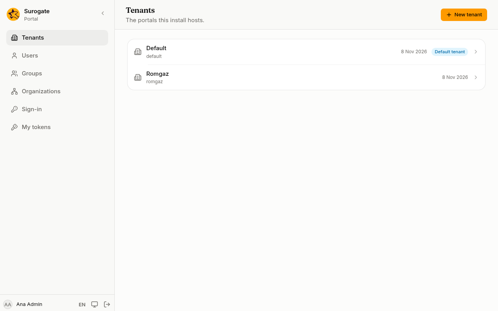

A tenant is a separate portal in the same install, with its own addresses, users, sign-in and settings. **Tenants** is for **install administrators**, on the main portal's console.



The list shows every tenant. The one marked **Default tenant** is the main portal: it answers on every address no other tenant has claimed.

## Create a tenant

1. Press **New tenant**.
2. **Slug**: a short name in lower-case letters, digits and hyphens, starting with a letter, such as `primaria-sector-1`.
3. **Name**: the tenant's name, as people know it.
4. Press **Create tenant**.

## Sites and addresses

Open a tenant to see its **Sites**. A site answers at one or more addresses: a domain name and, optionally, a path such as `/intranet`.

1. Press **New site** and give it a **Slug** and a **Name**.
2. Under the addresses, type a **Host** such as `www.example.ro` and, if you need one, a **Path prefix**. Press **Add address** for more.
3. Press **Create site**.

The tenant's console is then at `/_portal/admin/` on these addresses, and its administrators sign in there.

## Config

The **Config** card connects the tenant to the place its pages and apps are kept. Your implementation team gives you the **Repository address** and the **Branch or tag**. Press **Sync now** to bring in their latest changes: the card says whether the new config is live or what is wrong with it. A sync also asks each app what it offers. If an app cannot be reached, or offers something wrong, the sync is refused and the pages stay as they were.

### A private repository

If the repository is private, your implementation team also gives you a **User name** and an **Access token** that can read it. Type them under **Private repository** and press **Save**.

- A saved token is never shown again, not even here. To replace it, type a new one and press **Save**; leave the field empty to keep it.
- **Remove credential** forgets it.
- The token is only sent to an `https` address. If you change the repository to another server, type the token again.

From the command line, the token comes on standard input so it stays out of your shell history:

```
portal config source <tenant> <repository address> --username <user name> --token-stdin
```

## Give a tenant an administrator

A new tenant has no users yet. Give it its first administrator from its page:

1. Open the tenant and press **Add administrator**.
2. Type their **Email** and **Name** and press **Add administrator**.
3. For a new person, the console shows a **First password**, once. Press **Copy** and give it to them over a safe channel. They sign in on the tenant's console and an administrator can set another one from [Users](/portal/console/users/#password).

If the email is already a user of the tenant, they become an administrator and keep their password; a disabled account is enabled again.

The main portal (the default tenant) has no **Add administrator**: its administrators are install administrators, made on its own [Users](/portal/console/users/#roles) page.

The same works from the command line with an install administrator's [token](/portal/console/tokens/):

```
portal tenants add-admin <tenant> <email> --name "<name>"
```
