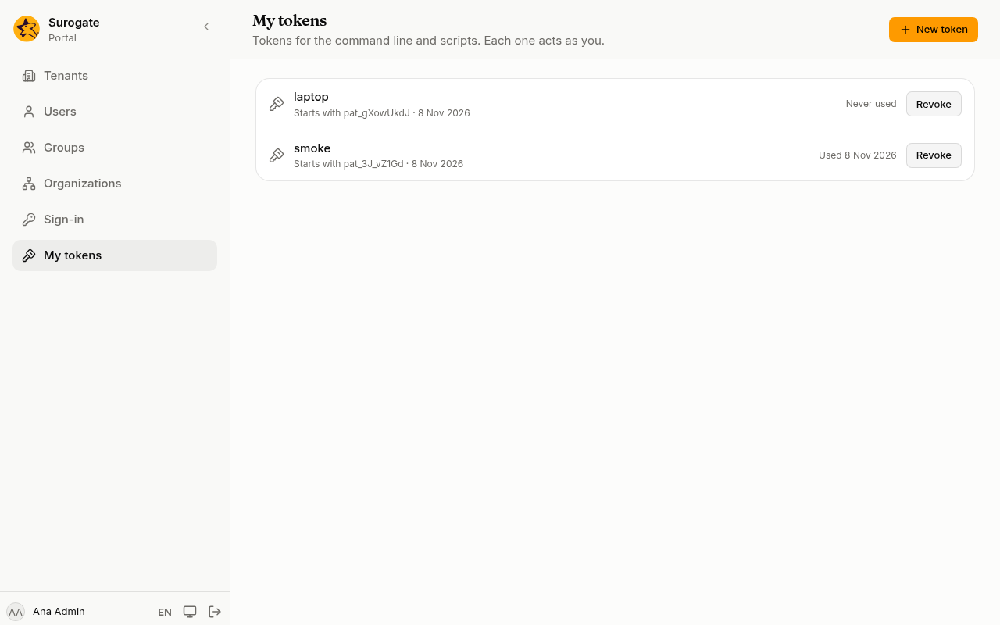

A token lets the command line or a script act as you, without your password. For a program that is not you, make a [service account](/portal/console/service-accounts/) instead. Everyone who signs in to the console has **My tokens**. A token can do what you can do in the console, no more.

## Create a token

1. Press **New token**.
2. Name it so you know it later, such as "laptop" or "nightly backup".
3. Tick its **Scopes**: what the token may do. **Your own account** is ticked to start with.
4. Press **Create token**.
5. Press **Copy** and keep the token somewhere safe. The console shows it this once: "Copy it now. You won't be able to see it again."
6. Press **Close**.



A token starts with `pat_`. The list shows the first characters after it, so you can tell your tokens apart, with its scopes and when it was created and last used.

## Scopes

A token can only do what its scopes allow, and never more than you can do in the console. Give a token only the scopes it needs:

| Scope | What the token may do |
|---|---|
| **Your own account** | Read your details and permissions |
| **Read users, groups and settings** | Read the tenant's users, groups, organizations and sign-in settings |
| **Read how the portal is built** | Read the sites, pages, apps, events, and group and organization names, never people; for a [coding agent](/portal/sites/agents/) |
| **Change users, groups and settings** | Change them too |
| **Roles, passwords and other tokens** | Give roles, set passwords, link accounts, and make SCIM tokens and service accounts |
| **Read the audit log** | Read and export the [audit log](/portal/console/audit/) |
| **Export and erase personal data** | Answer [personal data](/portal/console/users/#personal-data) requests |
| **Manage tenants** | Create and change [tenants](/portal/console/tenants/), for install administrators |
| **Make preview environments** | Make, sync and delete [previews](/portal/sites/previews/) with fake people, and sign in to them; nothing of the portal itself. Given by name only, by an administrator |
| **Full access** | All of the above, but making previews |

A token made before scopes existed has **Full access**. A token asked to do something its scopes do not allow is refused: "This token is not allowed to do this."

From the command line:

```
portal tokens create <name> --scope tenant:read
```

## Revoke a token

Press **Revoke** beside it, then **Revoke** again to confirm. Whatever uses it can no longer connect. Revoked tokens stay in the list, marked **Revoked**.

Revoke a token you no longer use, or one that may have been seen by someone else, and create a new one.
