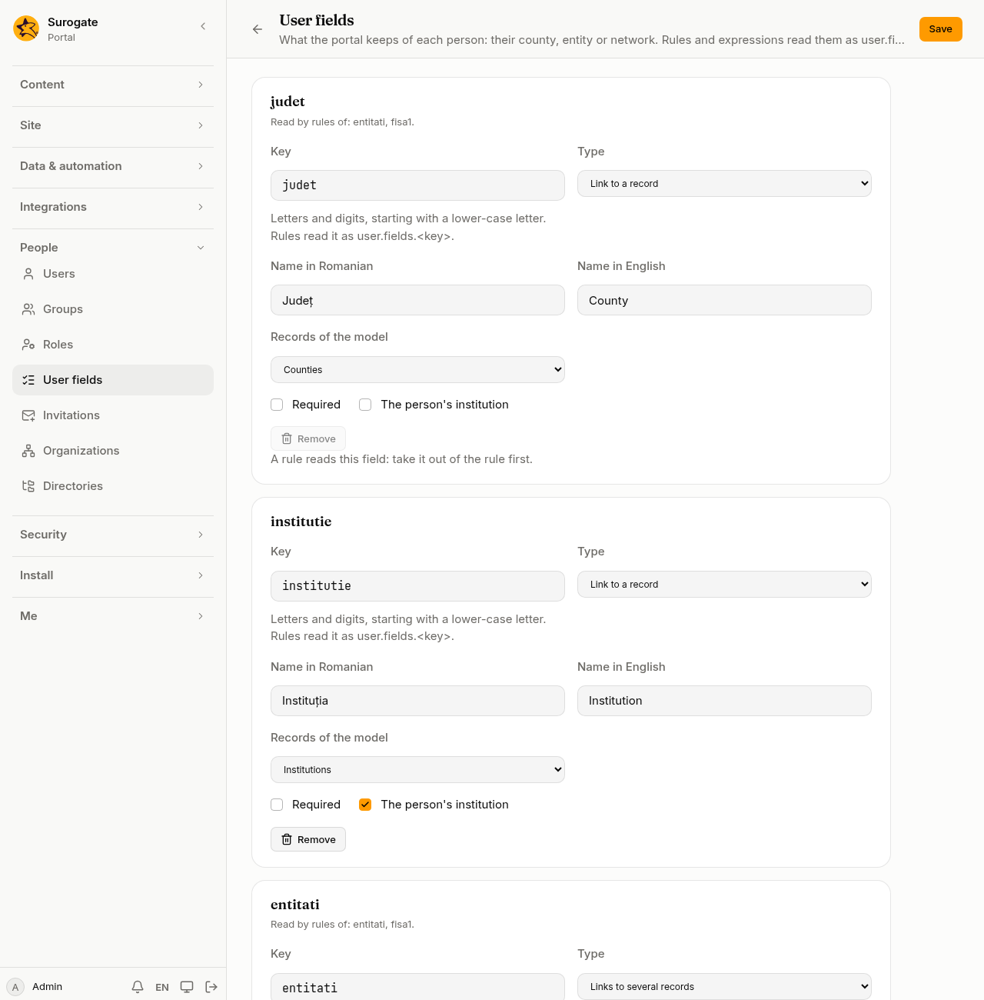
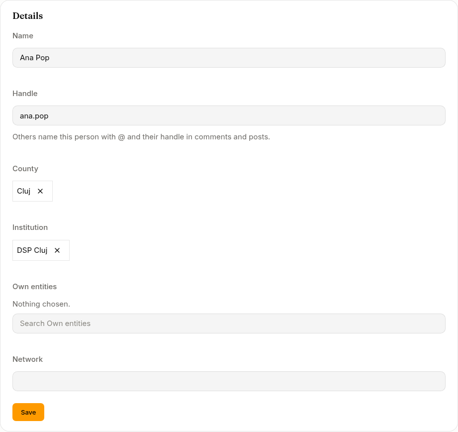

A user field is something the portal keeps of each person, besides their name and email: a department, a phone number, a county, the entities they work for. You define the fields on **User fields**, and fill them on each person's page. Access rules and expressions read them as `user.fields.<key>`: see [Access to records by condition](/portal/sites/row-access/). You need the **Administrator** role, or a [role](/portal/console/roles/) that opens **Users**.

## Define the fields

**User fields** is under **People**, and a button on **Users** opens it too. Each field is a card:

1. Press **Add a field**.
2. **Key**: letters and digits, starting with a lower-case letter, such as `judet`. Rules read the field by this key.
3. **Name in Romanian** and **Name in English**.
4. **Type**: **Text**, **Number**, **Yes or no**, **Date**, **Email**, **Phone**, **Link to a record** or **Links to several records**.
5. For a link, choose **Records of the model** it points at, such as Counties.
6. Tick **Required** if every person must have it.
7. Press **Save**.

A link holds one record (a county); links hold several (the entities a person works for).

Two fields can have a job of their own:

- **The person's institution**, on a link: the institution the person acts for. It is kept with each change they make on behalf of an entity.
- **The person's own entities**, on links: the entities the person belongs to. A change to a record of one of them is the person's own work; a change to a record of any other is made [on behalf of that entity](/portal/sites/row-access/#working-on-behalf-of-an-entity).

Only one field is each. The console refuses a link with no model, a link to a model that does not exist, and a second institution or a second list of own entities.

## A field that rules read

Under a field's name the card says which models' rules read it. That field cannot be removed until you take it out of those rules: its **Remove** button is off, and a save that would take it away is refused with the model and the rule named.

## Give a person their values

On a person's page, the portal's own fields are under **Details**. A link field is a search: type part of a title, press **Add** beside the record, and press **Save**. The record shows by its title with a **×** to remove it.

The values can be set for people a directory or SCIM keeps too: they are the portal's own, not the directory's. A change counts from the person's next request: they do not sign in again. Every change is in the [audit log](/portal/console/audit/), with the old and the new value.

A person with no value for a field has none: a rule that reads it is false for them, never an error. So a DSP user with no county sees no records until you set one.

Developers can also write the fields as a file: see [Developer: Data models](/portal/developer/data-models/#user-fields).
