**Users** lists the people who can sign in to this portal. You need the **Administrator** role (on the main portal, **Install administrator**), or a [role](/portal/console/roles/) that opens **Users**. To let people make their own account, [invite them](/portal/console/invitations/).

## Find a user

Type part of a name or an email in **Search by name or email**. The list follows as you type. When nothing matches, the page says **No user matches.**; press **Clear the search** to see everyone.

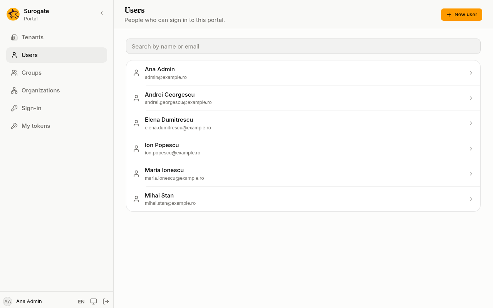

**People** and **Deleted people** switch the list between the people who can sign in and those an automation job deleted. A deleted person keeps their records and their name in history, and cannot sign in. Open one and press **Restore** to bring the account back.

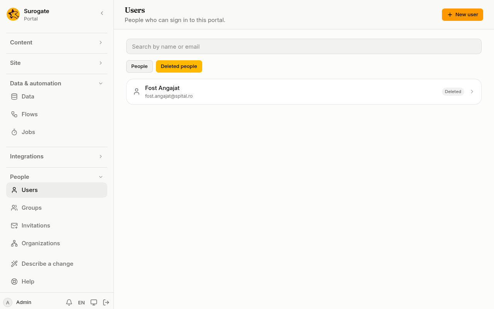

To see the people who hold one role, choose it under **Role**. **Any role** shows everyone again.

The list shows 50 users at a time. Use **Previous** and **Next** to move between pages. A disabled account carries the label **Disabled**, an account waiting for its link **Unconfirmed**, and one locked out by wrong tries **Locked until** a time. Tick **Unconfirmed** or **Locked now** to list only those.

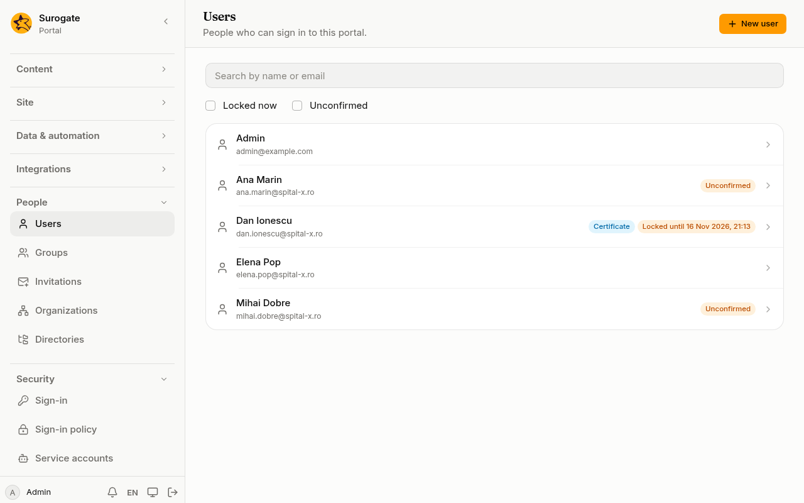

## Add a user

1. Press **New user**.
2. Type their **Email** and **Name**. They sign in with this email.
3. Choose **How they sign in**:
   - **A local account** (the first choice): the portal emails them an activation link, and they choose their own password on its page. You never type or see it.
   - **An account at a sign-in provider**, **an account in a directory** or **a client certificate**: choose the source and type the person's id there (for a certificate, its issuer and serial number). The other side vouches for the address, so the account is active at once and no mail is sent.
4. Under **Roles**, tick at least one. **User** is ticked to begin with. The person has the rights of every role ticked.
5. Fill in the portal's own fields, if it has any (a badge number, a department, a county, the entities they work for). Fields marked **Required** must be filled in. A tick box left alone counts as unticked. See [User fields](/portal/console/user-fields/).
6. Press **Create user**.

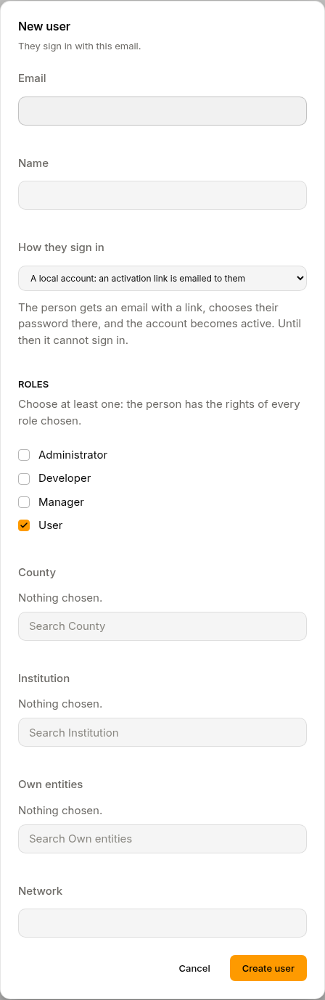

A local account starts **Unconfirmed**: it has no password and cannot sign in, and its tokens do not work, until its owner proves the address is theirs by opening the link. The link works once, for the days set in the [sign-in policy](/portal/console/sign-in-policy/#passwords-and-sessions) (3 at first), and its page asks for a password that keeps the [password rules](/portal/console/sign-in-policy/#password-rules).

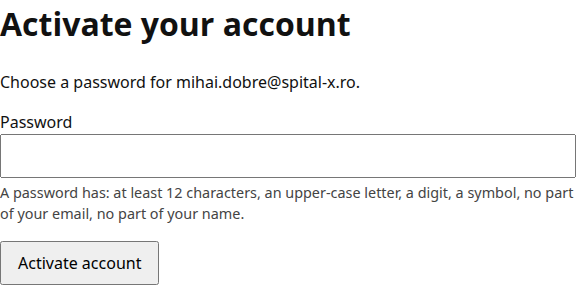

When the portal sends no email, a local account cannot be verified, so the console refuses it: **The portal does not send email, so a local account cannot be verified. Link the account to a directory or a sign-in provider.** Linked accounts can still be made.

If you untick every role, the console says **Choose at least one role.**

If the email is already used, the console says **A user with this email already exists.**

An [app](/portal/console/apps/) can check, or tidy, each person created or changed here. When it refuses, its message shows under the field it names, such as the name; change it and press **Create user** again. When an app's check cannot run, the console says so, and an administrator can revoke the app's approval if it keeps happening.

## A user's page

Press a user in the list to open their page. The top shows their name, email, the date they were added, and **Active** or **Disabled**.

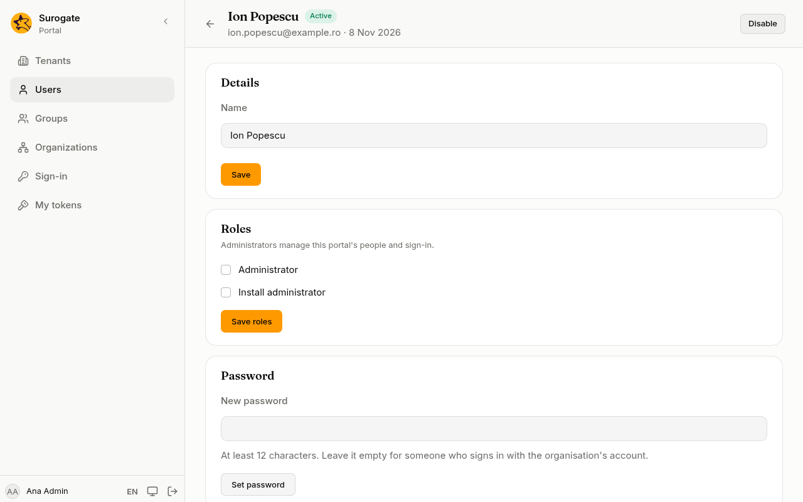

### Details

Change the **Name** or the portal's own fields and press **Save**. A field that points at records, such as a county or the entities a person works for, is filled by searching the records and choosing them: see [User fields](/portal/console/user-fields/). A change counts from the person's next request; they do not sign in again. The fields decide what a person may reach, so only an administrator changes their own: a person with a role that opens **Users** changes other people's fields and name, and their own name, but not their own fields (**You cannot change your own fields.**). They also cannot act on a person who holds more than they do: see [Who may give which role](/portal/console/roles/#who-may-give-which-role).

### Handle

Each person has a **Handle**, the name others use to [mention them](/portal/sites/comments/#name-someone) with `@` in comments and posts. The portal makes it from their name when they are added: the Latin letters without accents, words joined by dots, so Ștefan Țepeș is `stefan.tepes` and Łukasz Ørsted is `lukasz.orsted`. When someone already has it, a number is added: `ana.pop2` up to `ana.pop9`, then a longer number. A name with no Latin letters gives `person`, `person2` and so on.

To change it, type a new **Handle** under **Details** and press **Save**. A handle starts with a letter, then letters and digits, joined by single dots or hyphens, 40 characters at most, in lower case. Two people of a tenant never share one. A handle can be changed for someone a directory or SCIM keeps too: it is the portal's own. Service accounts have no handle.

Mentions already written keep their words: a changed handle no longer names the person in them. The handle of someone erased can be given to someone else.

### Roles

Tick every role the person should hold and press **Save roles**. A person can hold several: they have the rights of each. On the main portal there is also **Install administrator**. See [Roles](/portal/console/roles/) and [the roles of a portal](/portal/reference/roles/).

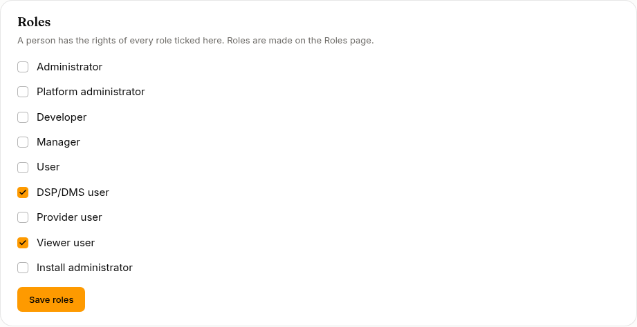

Someone who is not an administrator cannot give or take the **Administrator** role, or a role with a section they do not have themselves, and cannot change their own roles.

A portal always keeps at least one active administrator. Removing the role from the last one says **This is the portal's last active administrator. Give the role to someone else first.**

### Password

Type a **New password** and press **Set password**. It must keep the [password rules](/portal/console/sign-in-policy/#password-rules): the list under the field ticks off what it has so far. The person's other sessions end: they sign in again with the new password. Their tokens keep working. A new password also lets in someone the console locked out after too many wrong passwords, starts its term again, and counts among the passwords they may not reuse. Setting a password asks you to [confirm it is you](/portal/console/sign-in-policy/#confirming-it-is-you-again) when you signed in a while ago.

When you set your own password here, you stay signed in on this browser.

### Email address

The **Email address** card is for local accounts. Type a **New address** and press **Send the confirmation link**: the link goes to the new address, and until its owner opens it the old address stays in force and the person keeps signing in with it. The card says **New email waiting for confirmation** while one is waiting; a newer request replaces it. The change is in the audit log when it is asked and when it is confirmed.

### An account waiting to be activated

An **Unconfirmed** person has **Resend the activation link** at the top of their page. The new link ends the earlier one, and a new one can be sent once an hour at most. A link works only while the account is **Unconfirmed**: once it is switched off, or the account is activated, an old link no longer does anything. When the person says they never got the link, check the address you typed. An unconfirmed account never counts as an active administrator, so the portal still keeps at least one active administrator.

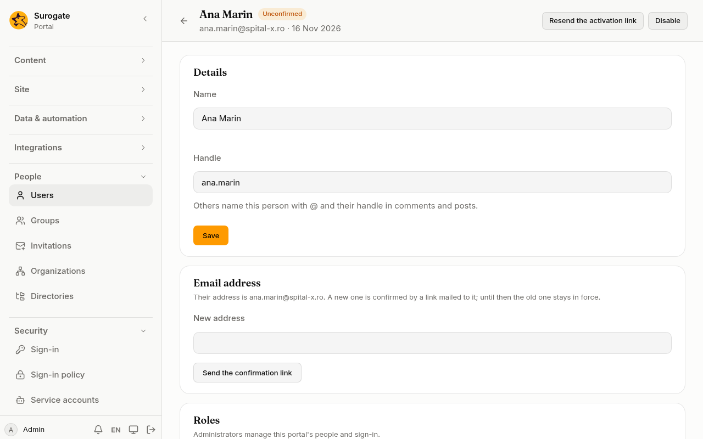

An account that was disabled before its owner ever opened the link waits for the link again when you enable it, and **Enable** or adding the person as an administrator never activates an unconfirmed account in the owner's place: only the link does.

To correct the address of an **Unconfirmed** account, type the right one in **New address**: it changes at once (nobody had proved the old one), the old link stops working, and a new link goes to the new address.

### Locked out

A person locked out by too many wrong passwords shows **Locked until** a time. Press **Unlock** at the top of their page to let them in at once; the lock would end by itself at that time. See [Wrong tries](/portal/console/sign-in-policy/#wrong-tries).

### Disable and enable

Press **Disable** at the top, then **Disable** again in the question **Disable** *name***?** A disabled person can no longer sign in, and their tokens stop working. Press **Enable** to let them back in.

You cannot disable the last active administrator.

### Impersonate

To see the portal exactly as a person sees it, for example to check what a page shows them, press **Impersonate** at the top of their page and confirm. The console takes you to the portal's home page, signed in as them.

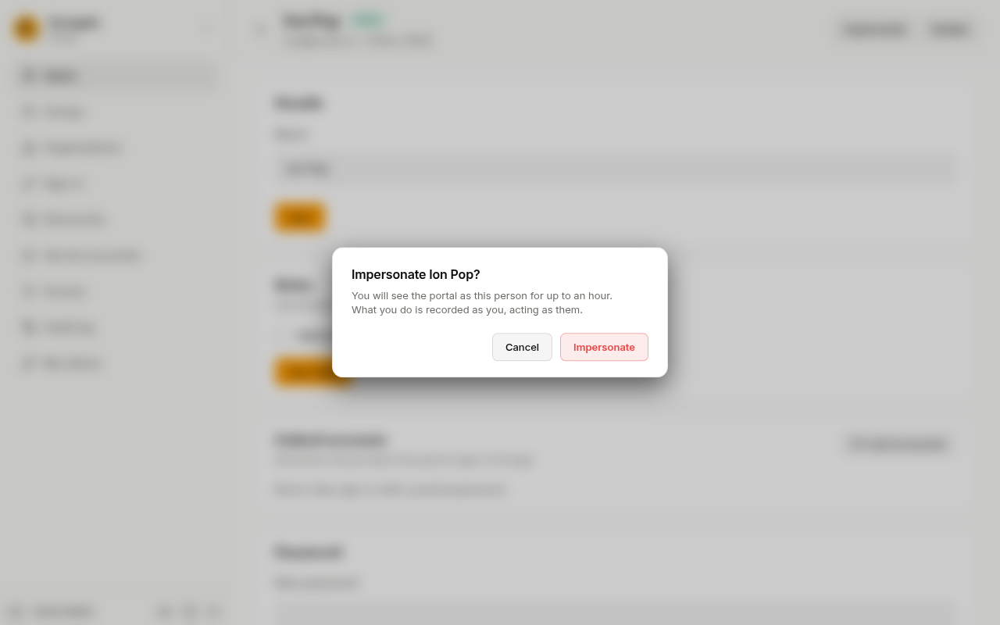

- It lasts at most an hour. The console shows "You are acting as" *name* at the top; press **Stop** to come back to your own account.
- While you impersonate someone, the console's administration pages, their password and their tokens are closed to you.
- Everything you do meanwhile is in the [audit log](/portal/console/audit/) as you acting as them.
- You can impersonate an active person who is not an administrator, and not yourself.

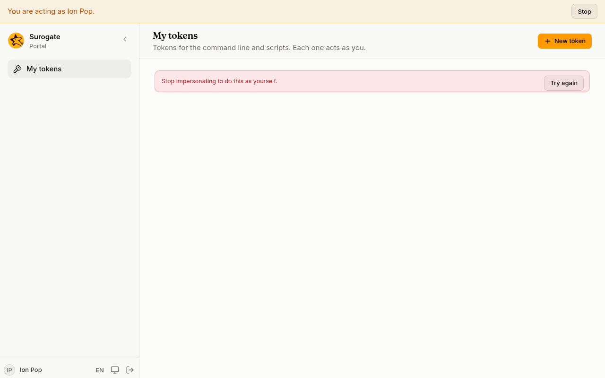

### Sessions

The **Sessions** card lists where the person is signed in now, with the browser, the address and when it was last used. **End** signs one out; **End all sessions** signs them out everywhere.

### Two-step sign-in

If the person lost their phone, press **Reset two-step sign-in** and confirm. Their authenticator app, passkeys and recovery codes are removed. They sign in with their password and set up a new one, within 7 days.

### Profile

**Show the profile** lists the segments the person is in (or may be, when a segment turns on the page or the device) and the pages they visited in the last 30 days, on sites that remember them. Each look is kept in the audit log. See [Personalization](/portal/sites/personalization/#remembered-pages).

## People from a directory or an identity system

A user who comes from a [directory](/portal/console/directories/) or from [SCIM](/portal/console/scim/) carries its name in the list. On their page:

- **Details** says **Managed by** the directory or system: their name and fields come from there, and are changed there.
- A directory user has no **Password** card: they use their directory password.
- **Roles** shows the roles given by hand as tick boxes, and lists below them each role a directory or provider gives through [group mappings](/portal/console/group-mappings/), with that source's name.

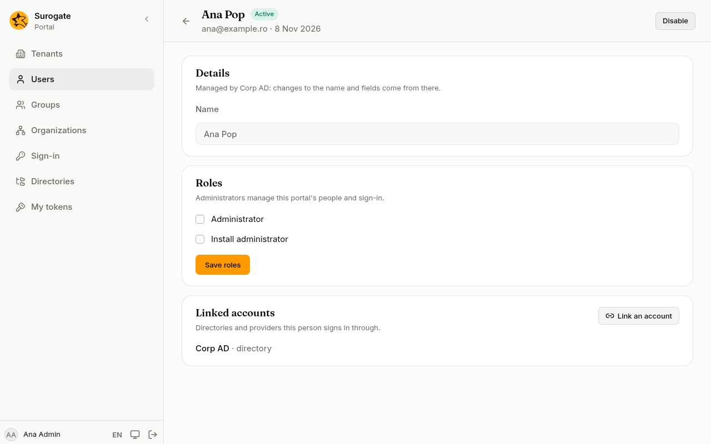

## Linked accounts

The **Linked accounts** card lists the directories and providers a person signs in through. Administrators are never linked by email, so link them here:

1. Press **Link an account**.
2. Choose the **Sign-in source** and type **Their ID at the source**: the NameID or subject the provider sends, or the ID of their directory entry.
3. Press **Link**.

To link a **certificate**, choose **Certificate** as the source and type the **Certificate issuer** and the **Subject serial number**, as the certificate shows them; the issuer's parts can be in any order. The person can then [sign in with it](/portal/console/sign-in/#with-a-certificate).

## Personal data

Under **Personal data** on a person's page, an administrator answers a data protection (GDPR) request.

- **Export data** saves, as one file, everything the portal holds on the person: their details, roles, groups, organizations, linked accounts, tokens, sessions, audit events, how they arranged their personal dashboards and which content entries they wrote or published, and what each of the portal's apps holds. If an app does not answer, the console says the file is incomplete.
- **Erase person** removes them everywhere. Type their email to confirm and press **Erase**.

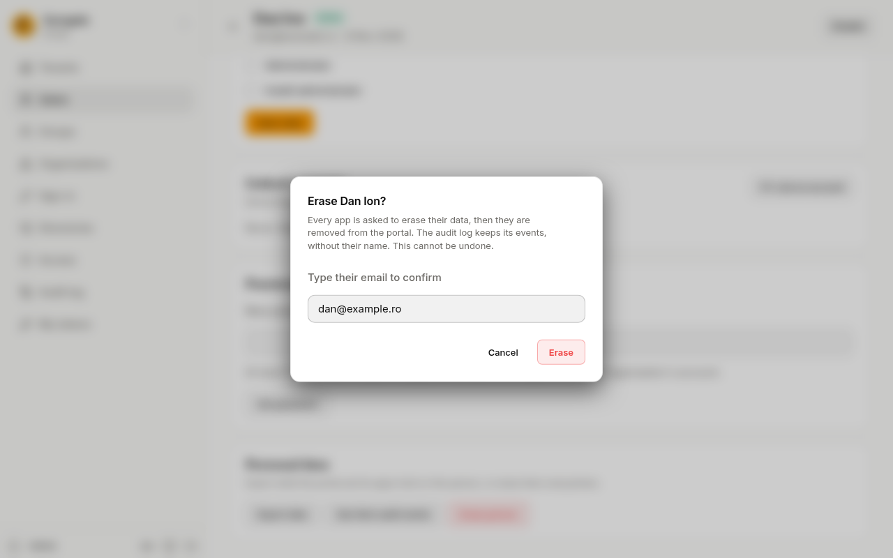

Where data models [keep their history](/portal/sites/data-models/#history-and-archiving), the person's name and email stay in the versions they made, so that what was reported can always be traced. Before you confirm, the dialog says how many versions keep them, and in which models. The history shows such an author as "(account deleted)".

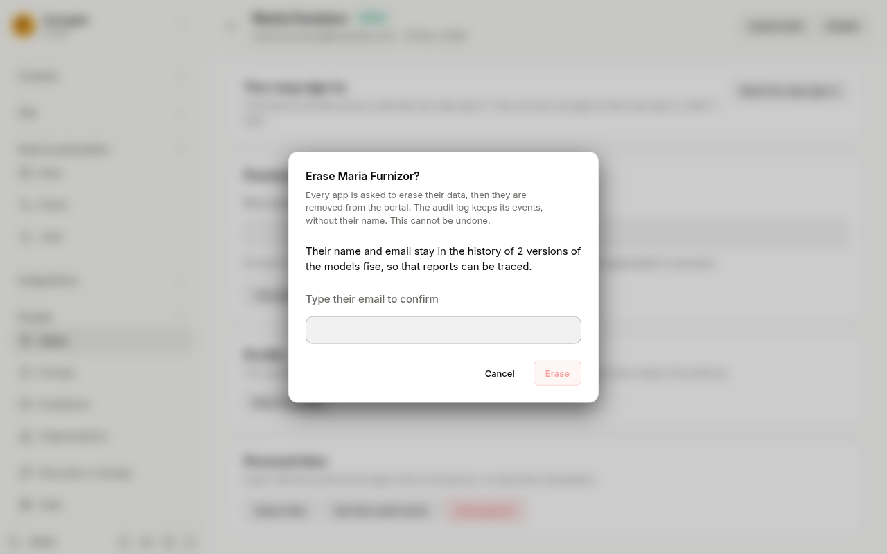

Erasing asks every app to erase the person first. If an app cannot, the console names it, and the person stays disabled until you try again. If an app has not been set up to erase people, nothing is done and the console names it. When every app has erased them, they are removed from the portal, and their name and email are removed from the audit log.

You cannot erase yourself, nor the last active administrator. A person who comes from a directory or from SCIM can come back on the next sync: remove them there as well. If the site's files name the person, the console says so; remove them from the files too.
