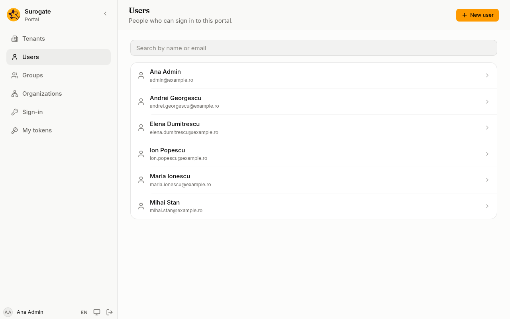
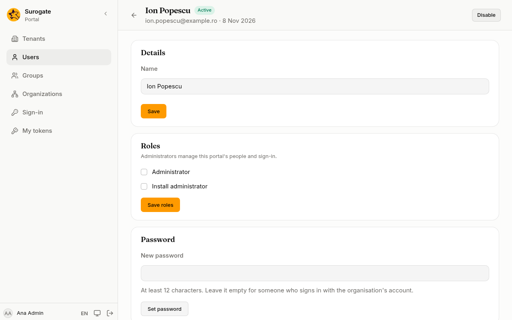
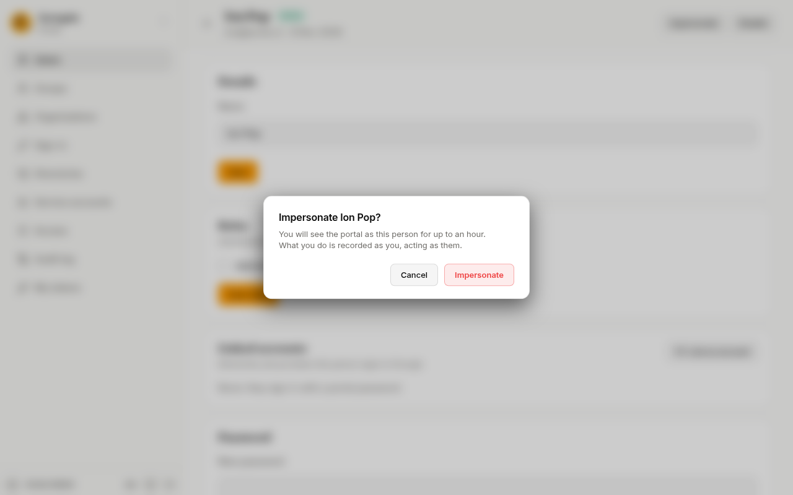
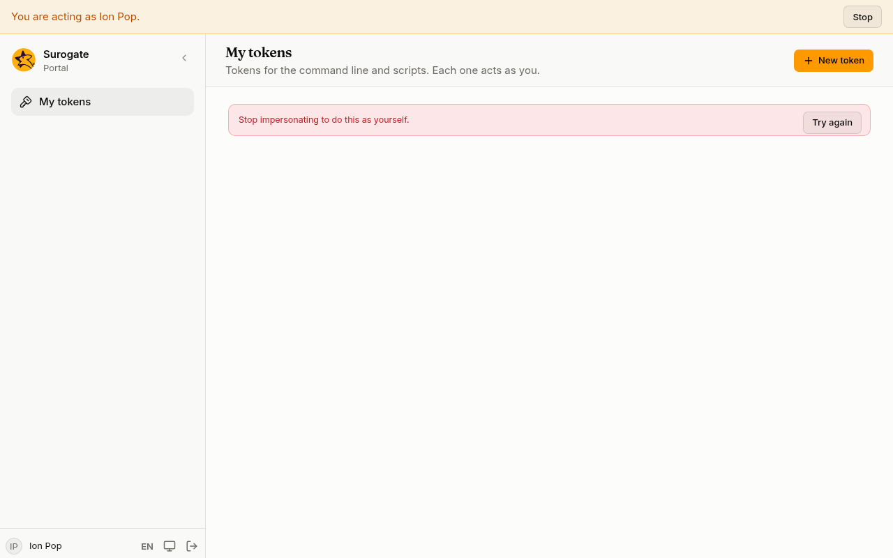
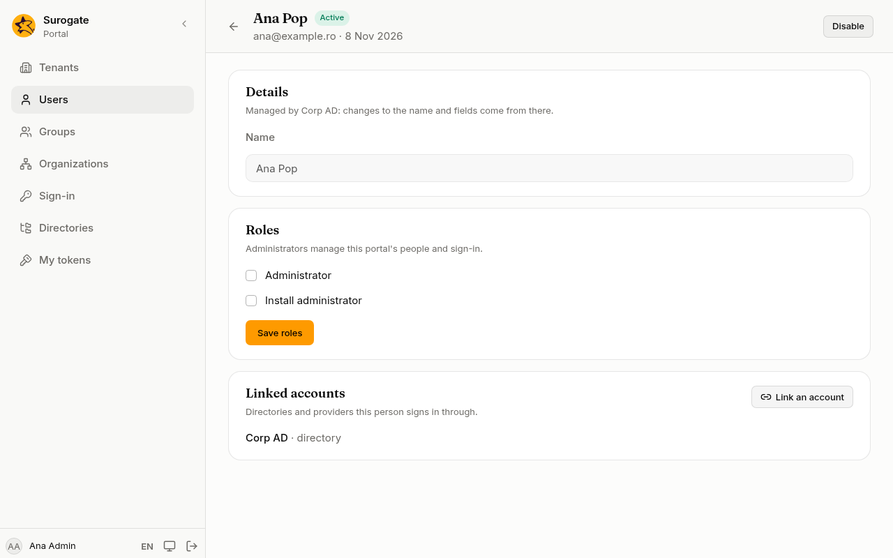
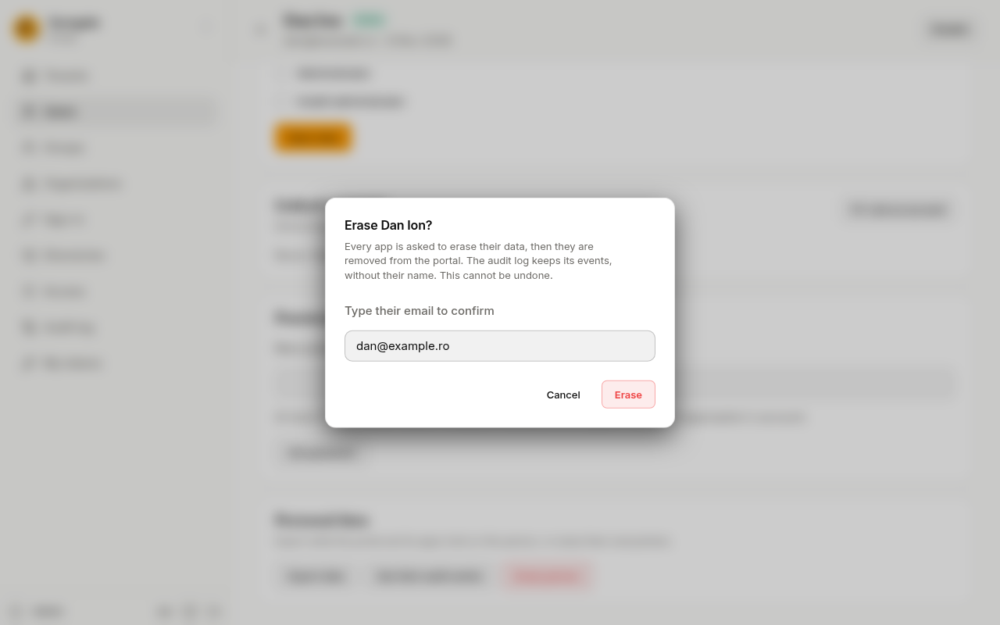

**Users** lists the people who can sign in to this portal. You need the **Administrator** role (on the main portal, **Install administrator**).

## Find a user

Type part of a name or an email in **Search by name or email**. The list follows as you type. When nothing matches, the page says **No user matches.**; press **Clear the search** to see everyone.

The list shows 50 users at a time. Use **Previous** and **Next** to move between pages. A disabled account carries the label **Disabled**.

## Add a user

1. Press **New user**.
2. Type their **Email** and **Name**. They sign in with this email.
3. **Password (optional)**: at least 12 characters. Leave it empty for someone who signs in with your organisation's account.
4. Fill in the portal's own fields, if it has any (a badge number, a department, a phone). Fields marked **Required** must be filled in. A tick box left alone counts as unticked.
5. Press **Create user**.

If the email is already used, the console says **A user with this email already exists.**

An [app](/portal/console/apps/) can check, or tidy, each person created or changed here. When it refuses, its message shows under the field it names, such as the name; change it and press **Create user** again. When an app's check cannot run, the console says so, and an administrator can revoke the app's approval if it keeps happening.

## A user's page

Press a user in the list to open their page. The top shows their name, email, the date they were added, and **Active** or **Disabled**.

### Details

Change the **Name** or the portal's own fields and press **Save**.

### Roles

Tick or untick **Administrator** and press **Save roles**. On the main portal there is also **Install administrator**. See [Roles](/portal/reference/roles/).

A portal always keeps at least one active administrator. Removing the role from the last one says **This is the portal's last active administrator. Give the role to someone else first.**

### Password

Type a **New password** of at least 12 characters and press **Set password**. The person's other sessions end: they sign in again with the new password. Their tokens keep working. A new password also lets in someone the console locked out after too many wrong passwords.

When you set your own password here, you stay signed in on this browser.

### Disable and enable

Press **Disable** at the top, then **Disable** again in the question **Disable** *name***?** A disabled person can no longer sign in, and their tokens stop working. Press **Enable** to let them back in.

You cannot disable the last active administrator.

### Impersonate

To see the portal exactly as a person sees it, for example to check what a page shows them, press **Impersonate** at the top of their page and confirm. The console takes you to the portal's home page, signed in as them.

- It lasts at most an hour. The console shows "You are acting as" *name* at the top; press **Stop** to come back to your own account.
- While you impersonate someone, the console's administration pages, their password and their tokens are closed to you.
- Everything you do meanwhile is in the [audit log](/portal/console/audit/) as you acting as them.
- You can impersonate an active person who is not an administrator, and not yourself.

### Sessions

The **Sessions** card lists where the person is signed in now, with the browser, the address and when it was last used. **End** signs one out; **End all sessions** signs them out everywhere.

### Two-step sign-in

If the person lost their phone, press **Reset two-step sign-in** and confirm. Their authenticator app, passkeys and recovery codes are removed. They sign in with their password and set up a new one, within 7 days.

## People from a directory or an identity system

A user who comes from a [directory](/portal/console/directories/) or from [SCIM](/portal/console/scim/) carries its name in the list. On their page:

- **Details** says **Managed by** the directory or system: their name and fields come from there, and are changed there.
- A directory user has no **Password** card: they use their directory password.
- **Roles** shows the roles given by hand as tick boxes, and lists below them each role a directory or provider gives through [group mappings](/portal/console/group-mappings/), with that source's name.

## Linked accounts

The **Linked accounts** card lists the directories and providers a person signs in through. Administrators are never linked by email, so link them here:

1. Press **Link an account**.
2. Choose the **Sign-in source** and type **Their ID at the source**: the NameID or subject the provider sends, or the ID of their directory entry.
3. Press **Link**.

To link a **certificate**, choose **Certificate** as the source and type the **Certificate issuer** and the **Subject serial number**, as the certificate shows them; the issuer's parts can be in any order. The person can then [sign in with it](/portal/console/sign-in/#with-a-certificate).

## Personal data

Under **Personal data** on a person's page, an administrator answers a data protection (GDPR) request.

- **Export data** saves, as one file, everything the portal holds on the person: their details, roles, groups, organizations, linked accounts, tokens, sessions, audit events, how they arranged their personal dashboards and which content entries they wrote or published, and what each of the portal's apps holds. If an app does not answer, the console says the file is incomplete.
- **Erase person** removes them everywhere. Type their email to confirm and press **Erase**.

Erasing asks every app to erase the person first. If an app cannot, the console names it, and the person stays disabled until you try again. If an app has not been set up to erase people, nothing is done and the console names it. When every app has erased them, they are removed from the portal, and their name and email are removed from the audit log.

You cannot erase yourself, nor the last active administrator. A person who comes from a directory or from SCIM can come back on the next sync: remove them there as well. If the site's files name the person, the console says so; remove them from the files too.
