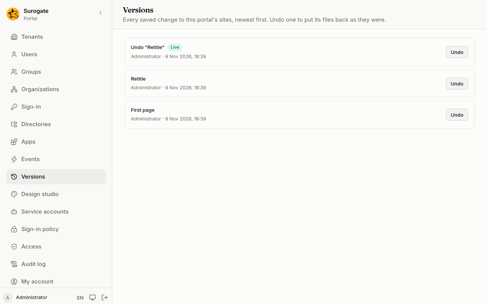

Every time a change to the portal's sites is saved, the portal keeps it as a version: what changed, who saved it and when. **Versions** lists them, newest first, and lets you undo one. **Versions** is for administrators.

## What the list shows

- Each version's description, who saved it and when.
- **Live** marks the version visitors see now. Usually it is the newest; if the newest could not go live, the one marked **Live** is still what visitors see.
- **Moved into the portal** is the version the portal started from, when your implementation team moved the sites in.
- **Changed outside the console** is a change your implementation team made directly.

If the page says **This site's versions are not kept in the console**, your sites' files are kept elsewhere: ask the install's operators to move them into the portal.

## Undo a change

1. Press **Undo** beside the version.
2. The portal says what undoing it will do. If later changes touched the same files, it names them: undoing puts them back to what they were before this change too.
3. Press **Undo** to confirm.

Undoing never deletes history. The files that version changed go back to what they were before it, as a new version, which you can undo in turn.

If someone saved a change while you were deciding, the portal asks you to look at the newest versions first, then try again.

Saving, undoing and moving into the portal are all in the [audit log](/portal/console/audit/).
