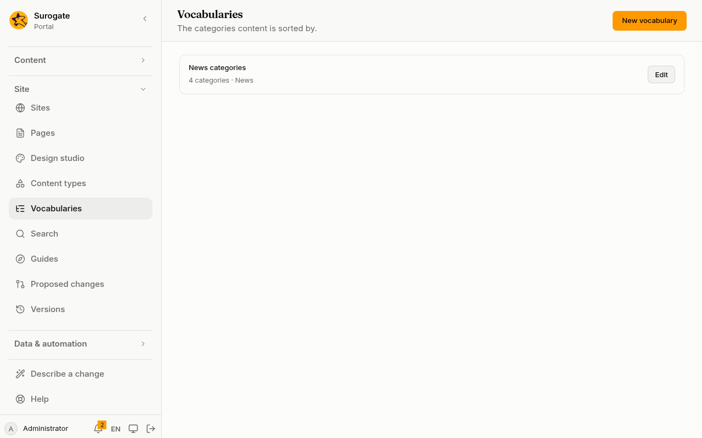
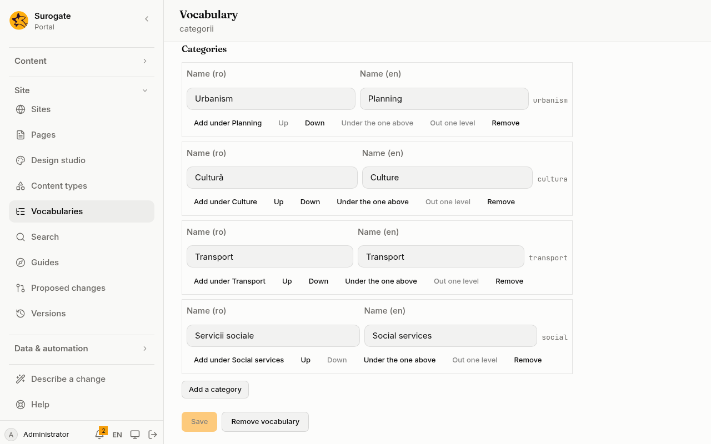

A vocabulary sorts content into categories, such as Topics or Area. **Vocabularies** makes and changes them. Every save is a [version](/portal/console/versions/) you can undo.

**Vocabularies** is for administrators, on a portal whose site files the portal keeps.

## The list

Each vocabulary shows its name, how many categories it has, and the content types it sorts.

- **Edit** opens it.
- A vocabulary written in a way the console cannot edit is marked **Cannot be read**. **Remove vocabulary** is the only thing offered for it.
- A portal has at most 20 vocabularies. When it has 20, **New vocabulary** is off.

## Make a vocabulary

1. Press **New vocabulary**.
2. Type its **Name** in Romanian and in English. Its **Id** is made from the English name, and you can change it before the first save. It is fixed after that.
3. Under **Sorts**, choose **All content types**, or **Only these content types** and tick them.
4. Tick **An entry may take several categories**, or leave it off so that an entry takes one category at most.
5. Add its categories, then press **Save**.

## Categories

- **Add a category** adds one at the top level, and **Add under** adds one under a category.
- Give each category its name in Romanian and in English. Its id, shown beside it, is made from its English name. It is unique in the vocabulary and fixed once saved: entries name their categories by id, so renaming a category never changes them.
- **Up** and **Down** move a category among the ones beside it. **Under the one above** puts it under the category above it, and **Out one level** takes it out of its parent. What is under a category always moves with it.
- Categories nest at most five levels deep, and a vocabulary holds at most 500 of them.

## Removing

**Remove** takes a category away, with the ones under it. **Remove vocabulary** takes the whole vocabulary away. Both ask first.

- A page whose list shows the entries of a category must be changed first. The console names those pages and saves nothing until then. The same holds for collections.
- Entries keep a removed category until they are next saved or published. Then they lose it.
- Turning off **An entry may take several categories**, or no longer sorting a content type, also changes entries the next time they are saved or published.

## When a save is refused

The portal checks a vocabulary before it keeps it. A problem with a category is listed with the category's names from the top, such as "Roads › Repairs".

When someone else saved a change in the meantime, the console shows the newest version of the vocabulary, and your changes to it are not kept. Make them again. A new vocabulary is simply saved again.

Comments written in a vocabulary's file by hand are not kept when the console saves it.
