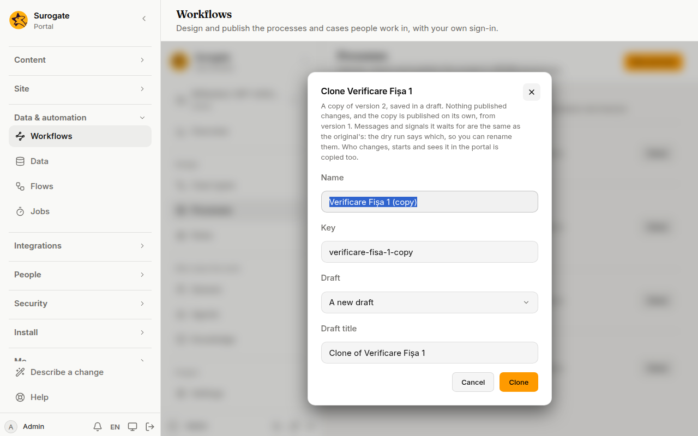
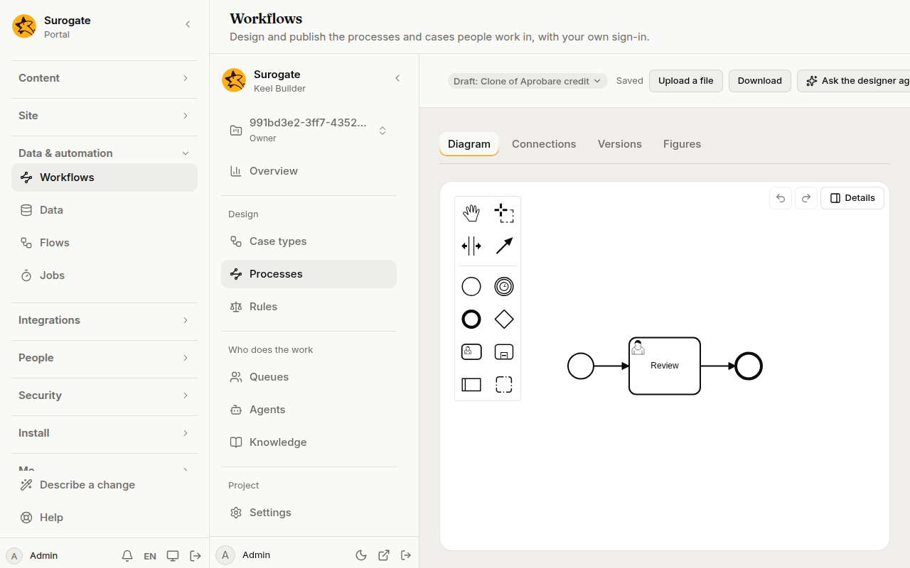

**Workflows** opens Keel's builder inside the console, on the Keel project the portal is connected to. You do not sign in a second time: the builder takes who you are from the portal, and what you may do there from the portal's lists.

It is in the menu under **Data & automation**, for the people the lists below name, and for administrators. It needs Keel to be connected: see [Integrations](/portal/console/integrations/#keel).

When Keel is not connected, or its builder has no address, the page says so and offers **Connect Keel**.

## What you see

The console's menu stays where it is, with the same person shown. The builder opens on the project, with the role the portal gives you. **Sign out** of the console ends the builder's session too: the builder asks the portal for a new sign-in every few minutes, and the portal gives one only to someone still signed in who still has the section.

Opening the section is recorded in the [audit log](/portal/console/audit/), as "Opened the Workflows section", with the role you opened it with.

## Who may open it, and at what level

Under **Integrations → Keel**, **Workflows section** has three lists. Each names groups, organizations or people. A person in several lists has the highest level.

| List | In the builder, the person is | They may |
|---|---|---|
| **Who sees workflows** | a Viewer | read every workflow and its drafts |
| **Who changes workflows** | an Editor | draw, upload, clone, test and publish |
| **Who administers workflows** | an Owner | also appoint supervisors, unbind people (below), and change every workflow |

Administrators of the portal always have the highest level. Someone in none of the lists does not see **Workflows**, and the address of the section answers "You have no access here".

**What the builder does not do under the portal's sign-in.** The portal's sign-in works the builder and nothing else: it opens none of the project's cases, and it is not a login of Studio. So, whatever the level:

- The designer agent, the agents and knowledge bases pickers, and the project's helpers need a Studio sign-in: with the portal's they are not offered.
- A workflow that names an agent or a knowledge base cannot be checked without Studio, so its draft cannot be tested or published from here: do it in the builder, signed in with Studio.
- Creating a service key is not offered: a key would outlive the portal's word about the person, and go past the lists below. Owners may still see and revoke keys.

**Builder address** is where Keel's builder is. The builder's own server must allow the portal's address to frame it; see [Developer: Keel](/portal/developer/keel/#the-workflows-section).

## Who works in workflows

- **Who works in workflows:** these people work cases and processes in Keel with their portal sign-in. They are not invited in Keel, and they have no password there.
- **Who supervises workflows:** these are the project's supervisors in Keel.

Left empty, Keel keeps its own list of staff, as before. Once either list is filled, the portal tells Keel at each request who each person is, so taking someone out of a list takes effect on their next request.

**Who stays staff.** The portal makes someone staff, or a supervisor, only while it names them. When it stops naming them, the staff row it made goes at their next request, with the queues it put them in, and they are refused. Staff and supervisors Keel itself named are never taken away or demoted by the portal: they stay as Keel has them, though the portal may refuse them the work app.

**Who the person is.** Keel knows a portal person by their portal id, not by their email. At a person's first sign-in, Keel finds the user in its runtime who has the email the portal gives, and ties that user to the portal id. From then on the id is who they are: when the email changes in the portal, they stay the same user in Keel, with the same steps, the same queues and the same history. The email and name Keel shows are copies of the portal's, kept up to date.

- A person whose email no Keel user has, at the first sign-in, is refused until a user with that email exists.
- A user is tied to one person of each portal. Another person who takes the same email in the same portal does not become them, and the first person keeps their place. When two portals are trusted for one Keel project, the same user is one person of each, and each portal takes away only the queues it gave.
- A person tied to a Keel user who has since left the project's organisation is refused, within a minute.

**Unbinding.** When an administrator disables a person in the portal, or erases them, the portal tells Keel, which unbinds them: their tie to the Keel user, the queues the portal gave them and the staff row it made go. Without this, a person added again later with the same email would be refused, since the Keel user would still be tied to the old id. People the portal disabled by another way (a directory sync, SCIM) are not unbound by the portal: an owner of the project does it through Keel's API, which lists the portal's people and unbinds one: see [Developer: Keel](/portal/developer/keel/#the-workflows-section). The builder has no screen for it yet.

## Who is in each queue

Under **Who is in each queue**, press **Add queue**, choose a queue by the key Keel gives it, and name the groups, organizations or people of the portal who are in it. They are in the queue besides the people Keel itself names.

A person is in the queue while the portal names them: at the next sign-in after you take them out, they are out of it. The portal takes out only the places it gave, never those a Keel administrator gave by hand.

## Each workflow

Under **Each workflow**, press **Add workflow** and choose one from the list of the project's case types and processes, as Keel gives them; **A key Keel does not list yet** takes a key by hand, for a workflow you will publish later. For each one, the lists say:

- **Who changes it:** only these people may change it in the builder: save, revert, upload, or restore its files, and those of its scenarios, connections and move mappings; retire or reinstate a case type; move the running instances of a process; set or delete a connection's credentials; and update, publish or discard a draft that changes it. Everyone else who changes workflows sees it and cannot change it. Administrators of workflows change every workflow. Left empty, everyone who changes workflows may change it.
- **Who starts it:** only these people may start it through the portal: a form, a job or an endpoint that runs for a person and starts the workflow with **Start a case** or **Start a process** fails with "You may not start the workflow …" for anyone else. A run with no person behind it, such as a public form, is refused too: it is no one the list names. Only a job of the portal's own, with no one to run as, starts it with the portal's key for the project; a job that runs as a person is held to the list as that person is.
- **Who sees it:** only these people see its cases or its processes' instances. Left empty, all staff do.

**Who sees it** is kept by Keel, wherever the work is listed, counted, streamed or opened: Keel's work app, and the portal's own views of Keel's work (**My work**, the Keel overview). A person the list does not name:

- does not find its cases or instances in any list, and gets "not found" if they open one by its address;
- is not told when one changes, in the live updates the work app listens to, nor in the updates of the cases they follow;
- sees none of its items in the queues, their figures and counts, nor in **Get next**, which never hands out one of them;
- is not offered it among the case types and processes they may start, and sees no case it started in a process's list of cases.

- Supervisors always see every workflow.
- A person who holds a step of a case or an instance still sees that one, so they can finish what they were given.
- A builder, in the Workflows section, sees every workflow's definition: **Who sees it** is about the work, not the design. Who sees the section at all is **Who sees workflows**.

## Cloning a workflow

In the builder, **Processes** and **Case types** show **Clone** at the end of each row, for editors and owners. It copies a process or a case type as the version published now holds it. A workflow that is only in a draft has **Clone** too: it then copies the draft's file.

**Clone** asks for:

- **Name** of the copy.
- **Key**, which is the original's with `-copy` and must be free.
- **Draft**: a new one, or one that is open.
- For a case type, a **Number prefix** of its own, so its cases are numbered apart from the original's.

It saves the copy in the draft, with the scenarios and connections of the original; a connection's credentials are not copied, so set them on the copy. It then opens the copy there.

Nothing published changes. The copy is published on its own, from version 1, and changing it never changes the original.

**The rules are copied.** The dialog says "Who changes, starts and sees it in the portal is copied too." When the copy is made, the portal copies the workflow's lists under **Each workflow** to the copy's key, so the people who may change, start and see the original may do the same with the copy. The console says so: "The rules of … were copied to …." The save is a version of the portal's configuration, as any other. The rules are copied only from a workflow the person may change, and only to a copy Keel has not published: a clone onto the key of a published workflow copies nothing, whatever the builder says. If the original has no rules, or the copy's key already has rules of its own, nothing is copied too. If Keel cannot say what it has published, nothing is copied and the console says so: set the rules under **Integrations → Keel**. Change the copy's lists in **Integrations → Keel** if they should differ.

**A message two processes wait for.** A copy of a process waits for the same messages and signals as the original. When you test or publish, the check warns: "the message … is also awaited by the process …: rename it in one of them if both should not receive it". It is a warning, not a refusal: rename the message in the copy if only one process should take it.

## What is not covered yet

- The builder has no Permissions tab: who changes, starts and sees each workflow is set in the console, under **Integrations → Keel**.
- People the portal disables by a directory sync or SCIM are not unbound in Keel by the portal: see **Unbinding**.
- Review and publish does not yet say that a publish changes who sees a workflow.
- The designer agent, and the agents and knowledge bases pickers, need a Studio sign-in: with the portal's sign-in they offer none.
- Steps a person claimed go back to their queue when Keel next sees them leave; taking someone out of a list does not move their steps by itself.
