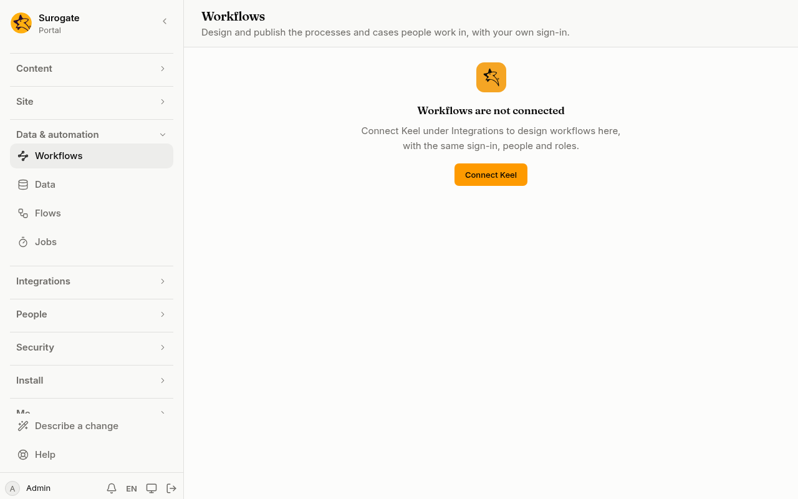
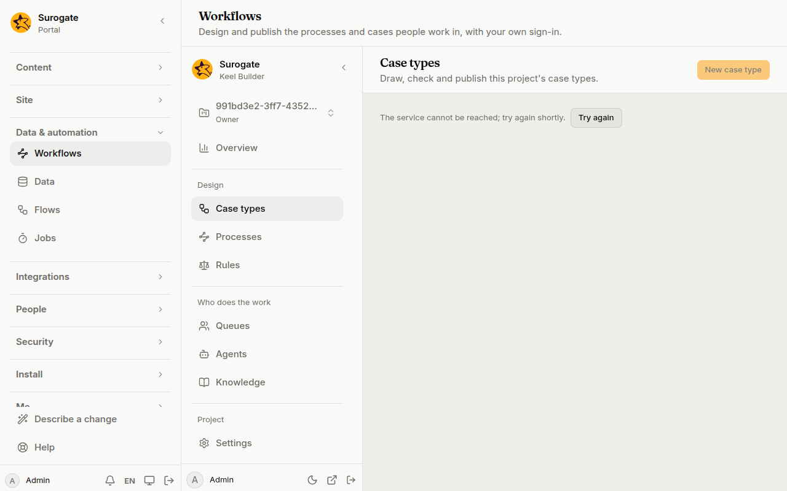
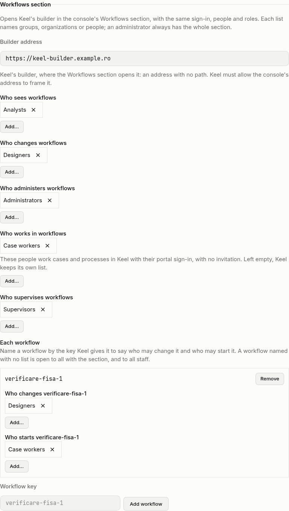

**Workflows** opens Keel's builder inside the console, on the Keel project the portal is connected to. You do not sign in a second time: the builder takes who you are from the portal, and what you may do there from the portal's lists.

It is in the menu under **Data & automation**, for the people the lists below name, and for administrators. It needs Keel to be connected: see [Integrations](/portal/console/integrations/#keel).

When Keel is not connected, or its builder has no address, the page says so and offers **Connect Keel**.

## What you see

The console's menu stays where it is, with the same person shown. The builder opens on the project, with the role the portal gives you. **Sign out** of the console ends the builder's session too: the builder asks the portal for a new sign-in every few minutes, and the portal gives one only to someone still signed in who still has the section.

Opening the section is recorded in the [audit log](/portal/console/audit/), as "Opened the Workflows section", with the role you opened it with.

## Who may open it, and at what level

Under **Integrations → Keel**, **Workflows section** has three lists. Each names groups, organizations or people. A person in several lists has the highest level.

| List | In the builder, the person is | They may |
|---|---|---|
| **Who sees workflows** | a Viewer | read every workflow and its drafts |
| **Who changes workflows** | an Editor | draw, upload, clone, test and publish |
| **Who administers workflows** | an Owner | also appoint supervisors and manage the project's service keys |

Administrators of the portal always have the highest level. Someone in none of the lists does not see **Workflows**, and the address of the section answers "You have no access here".

**Builder address** is where Keel's builder is. The builder's own server must allow the portal's address to frame it; see [Developer: Keel](/portal/developer/keel/#the-workflows-section).

## Who works in workflows

- **Who works in workflows:** these people work cases and processes in Keel with their portal sign-in. They are not invited in Keel, and they have no password there.
- **Who supervises workflows:** these are the project's supervisors in Keel.

Left empty, Keel keeps its own list of staff, as before. Once either list is filled, the portal tells Keel at each request who each person is, so taking someone out of a list takes effect on their next request. The person must have the same email in Keel's runtime as in the portal.

## Each workflow

**Each workflow** names a process or a case type by the key Keel gives it, and says:

- **Who changes it:** only these people may change it in the builder: save, revert, upload, or restore its files, and those of its scenarios, connections and move mappings. Everyone else who changes workflows sees it and cannot change it. Administrators of workflows change every workflow. Left empty, everyone who changes workflows may change it.
- **Who starts it:** only these people may start it through the portal: a form, a job or an endpoint that runs for a person and starts the workflow with **Start a case** or **Start a process** fails with "You may not start the workflow …" for anyone else. Runs with no person behind them, such as a public form, still start it with the portal's key for the project.

## Cloning a workflow

In the builder, **Processes** shows **Clone** at the end of each published process's row, for editors and owners. **Clone** asks for a **Name**, a **Key** (the original's with `-copy`, which must be free) and a **Draft** (a new one, or one that is open), and saves a copy of the published file there. Nothing published changes. The copy is published on its own, from version 1, and changing it never changes the original. The copy waits for the same messages and signals as the original; rename them in the copy if you do not want both to receive them.

Cloning a case type is not in the builder yet.

## What is not covered yet

- Who may see a workflow's cases in the work app is still Keel's own: supervisors see all, other staff see what Keel's queues and assignments give them.
- The designer agent, and the agents and knowledge bases pickers, need a Studio sign-in: with the portal's sign-in they offer none.
- Steps a person claimed go back to their queue when Keel next sees them leave; taking someone out of a list does not move their steps by itself.
