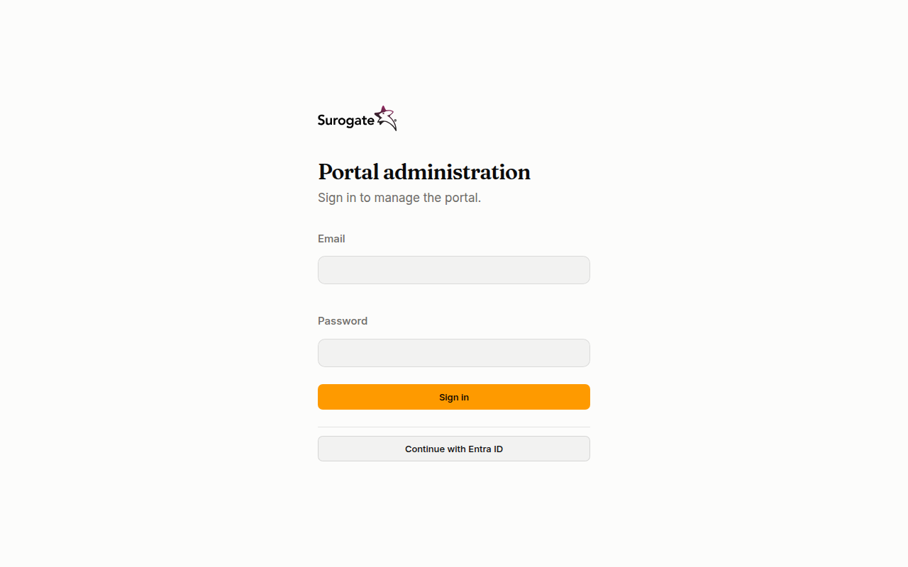
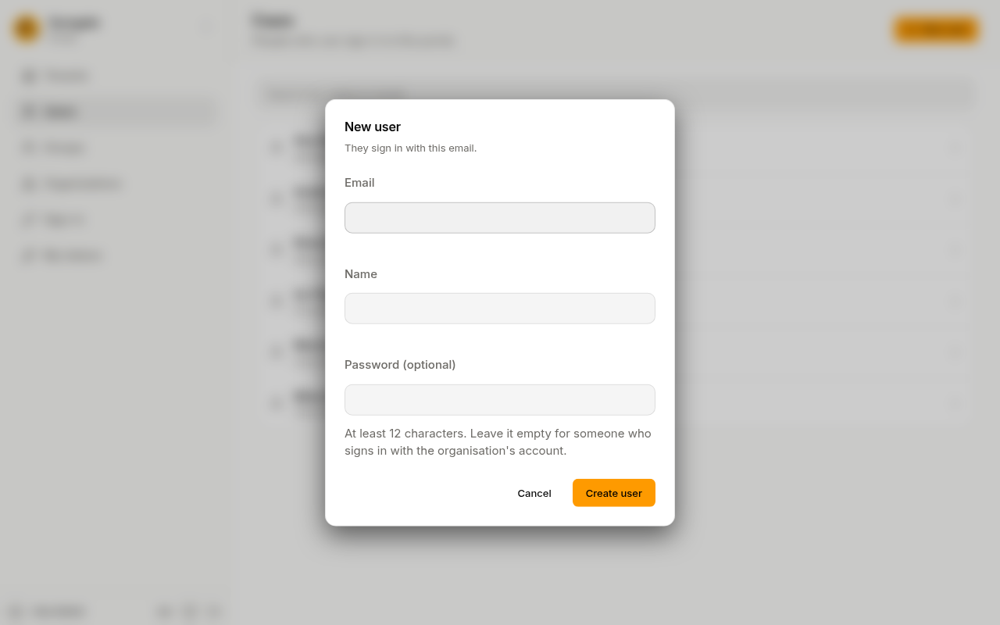

In this quickstart you sign in to your portal's console, add a colleague, make them an administrator, and create a token for yourself. It takes about five minutes.

You need the address of your portal and an administrator account. Whoever set up the portal gives you both.

## 1. Sign in

1. Open your portal's address followed by `/_portal/admin/`, for example `https://www.example.ro/_portal/admin/`.
2. The page is titled **Portal administration**: "Sign in to manage the portal."
3. Type your **Email** and **Password** and press **Sign in**.

If your portal signs in with an organisation account, press **Continue with** and the account's name instead. See [Sign in to the console](/portal/console/sign-in/).

The console opens on **Users**. An install administrator lands on **Tenants** instead.

## 2. Add a user

1. On **Users**, press **New user**.
2. Type their **Email** and **Name**.
3. Type a **Password** of at least 12 characters, or leave it empty if they will sign in with your organisation's account.
4. Fill in any other fields your portal asks for. Fields marked **Required** must be filled in.
5. Press **Create user**.

The console opens the new user's page.

## 3. Make them an administrator

1. On the user's page, under **Roles**, tick **Administrator**.
2. Press **Save roles**. The console says **Roles saved.**

They can now sign in to the console and manage the portal's people and sign-in.

## 4. Create a token for yourself

1. Open **My tokens** and press **New token**.
2. Name it, for example "laptop", and press **Create token**.
3. Copy the token now: the console shows it once. Then press **Close**.

## Next

- [Let people sign in with their organisation account](/portal/console/sign-in-providers/)
- [Build your organisation chart](/portal/console/organizations/)
- [Put people in groups](/portal/console/groups/)
