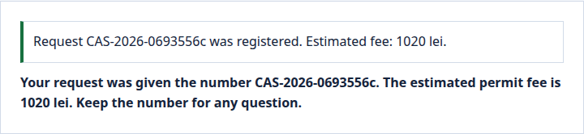
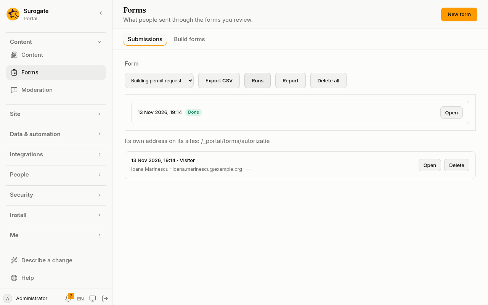

An action list is a short program written in the portal's files. It runs when something happens. For now that is a form being sent ([After it is sent](/portal/sites/forms/#after-it-is-sent)), or a [logic flow](/portal/sites/flows/) being called; later, endpoints and scheduled jobs run them too. Each action does one thing: works out a value, logs a line, tells the person something, sends them elsewhere.

## What people see

A person who sends a form sees what its actions tell them. Here a resident has filed a building permit request. The form's actions worked out the fee with a [logic flow](/portal/sites/flows/), gave the request a number, kept it as a record, and told the person:



- The notice at the top is a `notify` action ([UI actions](#ui-actions)). The text under it is a `message` action, which tells the person something and ends the run.
- `{{ vars.name }}` in a notice or a message puts in a value an earlier action set: here the request's number and the fee.
- A `redirect` action would have sent the person to another page instead.

**In the console,** the form's reviewers see each run of its actions under **Runs** on [Forms](/portal/console/forms/#runs): when it ran and whether it is done, failed or waiting.



## An action list

An action list is written under a form's `actions` (see the [config example](#config-example)); a flow, a job and an endpoint have lists of their own. Every action has a `type`, and may also have:
- `description`: a note for whoever reads the file;
- `condition`: an expression that must be true for the action to run;
- `onSuccess`: actions run after it succeeds;
- `onError`: actions run when it fails; the list then goes on;
- `then: stop`: the run ends after this action; `then: continue` lets a `message` or `redirect` go on;
- `errorMessage`: what the person is told if the run fails at this action, in each language.

## Expressions

Values are worked out with [CEL](https://cel.dev), the expression language Keel uses too. An expression can read:

| Name | What it holds |
|---|---|
| `form` | What was sent, by field key |
| `submission` | `id`: the submission's id |
| `user` | The person who sent it (`id`, `name`, `email`, `roles`), or `null` for a visitor |
| `site`, `locale` | The site and the language |
| `now` | When the run started |
| `vars` | The values earlier actions set |
| `values` | The portal's [named values](/portal/sites/values/), as `values.<name>` |

Whole numbers are integers, the others decimals; the two mix in arithmetic, so `form.price * 1.19` works whatever was typed. Reading a field that was not sent is an error; check it first with `has(form.phone)`. A name that is not in the table above is refused when the file is saved. Beside CEL's own functions there are `replace(text, a, b)`, `urlEncode(text)`, `slice(list or text, from, to)`, `sort(list)`, `round`, `floor` and `ceil`.

## The actions

Extensions add more: the [document actions](/portal/sites/document-actions/) make and read PDF, Word, Excel and CSV files and barcode images, and the [file management actions](/portal/sites/file-management/) copy, move and rename files and make and unpack ZIP archives.

| Type | What it does | Takes |
|---|---|---|
| `set` | Works out values into `vars` | `values: { name: expression }` |
| `group` | Runs actions together; its `onError` catches theirs | `actions` |
| `each` | Runs actions for each item of a list | `list`, `as`, `actions` |
| `repeat` | Runs actions a number of times | `times`, `as` (the count), `actions` |
| `throw` | Fails with a message | `message` |
| `stop` | Ends the run | |
| `log` | Writes a line in the run's log | `level` (`info` or `warn`), `message` |
| `wait` | Waits up to 5 seconds | `ms` |
| `parseJson` | Reads JSON text into a value | `from`, `into` |
| `toJson` | Writes a value as JSON text | `from`, `into` |
| `message` | Tells the person something, and ends the run; `{{ vars.name }}` puts in a value an action set | `text`, in each language |
| `redirect` | Sends the person to another page, and ends the run | `to` |
| `callFlow` | Runs a [logic flow](/portal/sites/flows/#call-a-flow) and keeps its outputs | `flow`, or `contract` and `pick`; `inputs`, `into` |
| `callEndpoint` | Runs one of the portal's [endpoints](/portal/sites/endpoints/#private-endpoints) and keeps its answer | `endpoint`, `params`, `okStatus`, `into` |
| `appAction` | Runs an [app's action](#app-actions) and keeps its outputs | `app`, `action`, `inputs`, `connector`, `into` |
| `startCase`, `startProcess`, `sendMessage`, `sendSignal` | Start a case or process in [Keel](/portal/sites/keel/#start-cases-from-the-portal), or send it a message or signal | see Keel |
| `askAgent` | Asks one of your [agents](/portal/sites/assistants/) for an answer, a summary or a knowledge-base article, and keeps it | `agent`, `task`, `prompt`, `into` |
| `http` | Calls a service through a [connector](/portal/sites/connectors/#call-a-service) | `connector`, `method`, `path`, `query`, `headers`, `body`, `okStatus`, `into` |
| `email` | Sends an [email](/portal/sites/connectors/#email) once the run ends well | `to`, `subject`, `text` |
| `sendNotification` | Sends a [notification](/portal/sites/notifications/) to people of the portal once the run ends well | `to`, `title`, `body`, `link` |
| `hash`, `hmac`, `randomToken`, `uuid` | [Hashes, signatures and random values](/portal/sites/connectors/#hashes-signatures-and-random-values) | |
| `listFiles` | Lists a [folder](#files)'s files | `folder`, `into` |
| `readFile` | Reads a file | `folder`, `name`, `encoding` (`text` or `base64`), `into` |
| `writeFile` | Writes a file | `folder`, `name`, `content`, `encoding` (`text`, `base64`, or `dataUrl` to [save a signature](/portal/sites/form-fields/#save-a-signature-as-a-file)) |
| `deleteFile` | Deletes a file | `folder`, `name` |

A `redirect` goes to a page of the same site, or to another https site the form names under `redirects`.

## Ask an agent

`askAgent` asks one of the agents in `agents.yaml` (an agent with its key) and keeps the answer. Only a [job](/portal/sites/jobs/) asks an agent: an agent's answer takes longer than a form, an endpoint or a [flow](/portal/sites/flows/) waits. To summarize what a form receives, have the form create a record, and ask the agent from a job that starts when that record is created: see the [config example](#ask-an-agent-from-a-job).

- `task`: `chat` (when left out) answers the prompt; `summary` summarizes it; `article` writes a knowledge-base article from it, with a title and sections. The answer comes in the prompt's language.
- `prompt`: an expression giving the words, up to 50,000 characters.
- `into`: where the answer is kept, as `{ text }`.

Each ask is a conversation of its own, and its use is billed to the agent's project. A run asks agents at most 5 times. It waits at most 90 seconds for an answer, and stops waiting ten seconds before the run's own time is up, so that an `onError` can still run. An answer is at most 256 KB. When the agent cannot answer, or stops to ask a question of its own, the run fails there, and an `onError` sees why. A failed run is not run again.

## Files

The file actions work on a folder of the portal's files, one written in `content/folders/`.

- **Who may do what:**
  - Someone who edits the folder does what they could under Files in the console.
  - Anyone else, a visitor too, may only make a new file, and never in a public folder. A file of the same name already there makes the action fail.
- **Names:** a file's name is lower-case letters, digits, dots, `-` and `_`, with an extension the portal keeps.
- **Limits:**
  - a file is at most 700 KB;
  - a run reads at most 50 times and changes files at most 20 times;
  - a listing gives at most 1,000 names.

A file written stays written, even if a later action fails. See [a file written by a form](#write-a-file) in the config example.

## Records

These actions work on the records of a [data model](/portal/sites/data-models/). They act as the person whose run it is, a visitor too, with the model's permissions.

| Type | What it does | Takes |
|---|---|---|
| `createRecord` | Adds a record | `model`, `values` (field: expression), `into` |
| `updateRecord` | Changes the fields given | `model`, `id`, `values` |
| `deleteRecord` | Deletes a record | `model`, `id` |
| `getRecord` | Reads one record | `model`, `id`, `into` |
| `findRecords` | Finds records by filterable fields | `model`, `where` (field: expression), `sort`, `limit` (at most 100), `into` |

Each change is made at once: when a later action fails, what was changed stays. A run makes at most 20 changes and 50 reads. A [named value](/portal/sites/values/) never reaches records. A flow's test uses its own records: `records: { <model>: [ { ... } ] }`.

## UI actions

A form's actions can tell the page what to do once everything else is done. These do not end the run, and at most 10 count:

| Type | What the page does | Takes |
|---|---|---|
| `notify` | Shows a notice above the thanks; `{{ vars.name }}` puts in a value an action set | `text`, in each language; `tone`: `info`, `success` or `warning` |
| `startGuide` | Starts a [user guide](/portal/sites/guides/) that applies to this page | `guide` |
| `reload` | Reloads the page after a moment | |

A `redirect` wins over them: the person goes elsewhere first. A form sent again answers what it answered the first time; one sent from an offline device shows none of them.

## When something fails

An action that fails runs its `onError` actions, and the list goes on. Without them, the failure goes up to the enclosing group's `onError`, and otherwise ends the run. Inside `onError`, `vars.error.message` says what went wrong.

A run stops after 10 seconds or 10,000 steps, a loop goes over at most 1,000 items, and a value is at most 1 MB. When the portal is very busy, a run may not start; the form is still kept, and the person is told that what follows could not be done. Each run is kept for 30 days, with its log; reviewers see them under **Runs** on [Forms](/portal/console/forms/#runs).

## App actions

An approved app can give actions of its own, such as sending an SMS: see [an app's action](#an-apps-action) in the config example.

- **What it takes:** the inputs the app's manifest declares; the portal checks them when the files are published. `connector` names a connector of the app's type, when the action needs one: an administrator sets its credentials under **Connectors**.
- **What it gives:** `vars.sent` holds the action's outputs.
- **Where:** in a form, flow, job or endpoint that may change records, never in a GET endpoint or one anyone may call, and never in a flow's tests. A run calls at most 10.
- **When it fails:** the app is not approved, it does not answer in time, or it answers what its manifest does not say. The run's `onError` reads why.

To write one, see [Build an app](/portal/sites/build-an-app/#actions).

## Config example

### An action list

A form's actions sit in its file, `forms/<id>.yaml`, under `actions`, in the list for the moment they run (`submitted`, once the form is sent and kept):

```yaml
actions:
  submitted:
    - type: set
      values:
        reference: '"REQ-" + string(now.getFullYear()) + "-" + form.county'
    - type: log
      level: info
      message: '"Request " + vars.reference'
    - type: message
      text:
        ro: "Cererea {{ vars.reference }} a fost primită."
        en: "Request {{ vars.reference }} was received."
```

- `set` works out `reference` from the year and the form's `county` field, and keeps it in `vars`.
- `log` writes a line in the run's log.
- `message` tells the person the request was received, with the reference put in, in each language, and ends the run.

### Ask an agent from a job

In a job (`jobs/<id>.yaml`):

```yaml
trigger:
  record:
    model: requests
    on: [created]
site: main
runAs: user:clerk@primaria.ro
actions:
  - type: askAgent
    agent: helper
    task: summary
    prompt: '"Request: " + string(trigger.after.subject) + ". " + string(trigger.after.description)'
    into: summary
  - type: updateRecord
    model: requests
    id: trigger.id
    values: { summary: vars.summary.text }
```

- `agent`: an agent `agents.yaml` names.
- `task`, `prompt` and `into` are described under [Ask an agent](#ask-an-agent).
- `updateRecord` writes the answer into the request's `summary` field.

### Write a file

In an action list, here a form's:

```yaml
- type: writeFile
  folder: requests
  name: '"request-" + submission.id + ".txt"'
  content: '"From " + form.name + ": " + form.message'
```

- `folder`: a folder of the portal's files, one written in `content/folders/`.
- `name`: an expression giving the file's name, such as `request-<the submission's id>.txt`.
- `content`: an expression giving the text written.

### An app's action

In a form, flow, job or endpoint:

```yaml
- type: appAction
  app: sms
  action: send
  inputs:
    to: form.phone
    text: '"Cererea dvs. a fost înregistrată."'
  connector: sms-gateway
  into: sent
```

- `app` and `action`: the approved app and the action its manifest declares.
- `inputs`, `connector` and `into` are described under [App actions](#app-actions).

