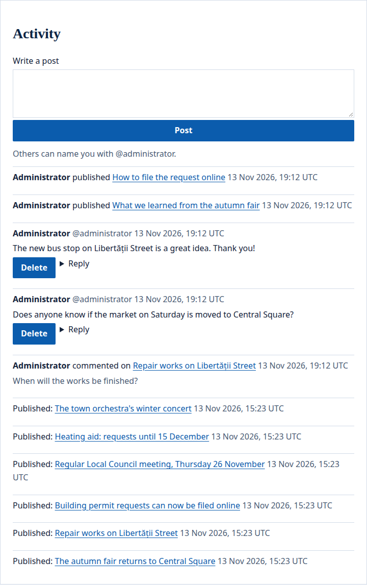

The portal's `activity` widget shows what happens on a site, newest first. People signed in write short posts there and answer each other. Between the posts, the widget lists the [comments](/portal/sites/comments/) written on the site's pages and entries, and the entries published on it. Each person sees only what they may see.

## What people see

The widget has a form to write a post, then the site's activity, newest first:



- **Posts** are what people wrote here. The author can **Delete** theirs; everyone signed in can **Reply**.
- **A comment line** says who commented, on which page or entry, and how the comment starts.
- **An entry line** names a published entry and links to it.
- Under the form, the widget shows how others name the person writing: their handle, such as `@ana.pop`.

A page with the widget is made for each person and never kept in a cache. The widget is placed on a page with `moderation`, `limit` and `show`: see the [config example](#config-example).

## Posts

Visitors read the posts and are asked to sign in. People signed in who may see the widget write a post of up to 1,000 characters, shown as plain text with its line breaks. They answer a post with **Reply**, delete their own, and flag someone else's, as with [comments](/portal/sites/comments/#delete-and-flag). Posts that name someone with `@` tell them, as [comments do](/portal/sites/comments/#name-someone).

The posts belong to the widget. Two `activity` widgets have their own posts each, and who may read and write them is who may [see the widget](/portal/sites/permissions/). An `activity` widget on a page that shows an entry keeps its posts for the widget, not for the entry. A widget whose `show` leaves out `posts` takes none.

By default a post shows as soon as it is written, and moderators hide or delete it later. With `moderation: before`, a post waits until a moderator approves it. Posts that wait for a moderator, are flagged and are decided on in the [moderation queue](/portal/console/moderation/), where they show as **Activity on** and the page's path. They keep the comments' limits: 10 a minute and 20 a day on one widget for each person. A widget holds as many posts as people write, and shows the newest.

## Comments and entries

A comment line says who wrote it and on which page or entry, links to the comment and shows how it starts. A viewer sees a comment line only when they may see the page and a `comments` widget on it. A comment that waits for a moderator, or that a moderator hid, is not listed, and neither are the answers to it.

An entry line names the published entry and links to it, on the site's page that [shows its type](/portal/sites/content-types/). Entries of a type that no page of the site shows, and entries of a page the viewer may not see, are not listed. An entry shows again each time it is published, and no line names who published it.

## Who is told what

Posts and comments that name someone follow the rules in [Name someone](/portal/sites/comments/#name-someone). When a person is erased from the portal, their posts go as their comments do.

## Config example

### The widget on a page

In a page's file (`sites/<site>/pages/<page>.yaml`):

```yaml
regions:
  main:
    - id: activity
      app: portal
      widget: activity
      preferences: { moderation: after, limit: 20, show: [posts, comments, entries] }
```

- `moderation`: `after` (when left out) publishes a post as soon as it is written; moderators hide or delete it later. `before` keeps it waiting until a moderator approves it.
- `limit`: how many things the widget shows, newest first (1 to 50; 20 when left out). Older ones are not shown.
- `show`: what it shows, each named once (all three when left out):
  - `posts`: what people write on this widget, with a form to write;
  - `comments`: comments written on the site;
  - `entries`: entries published on the site.
