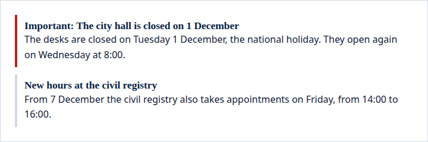
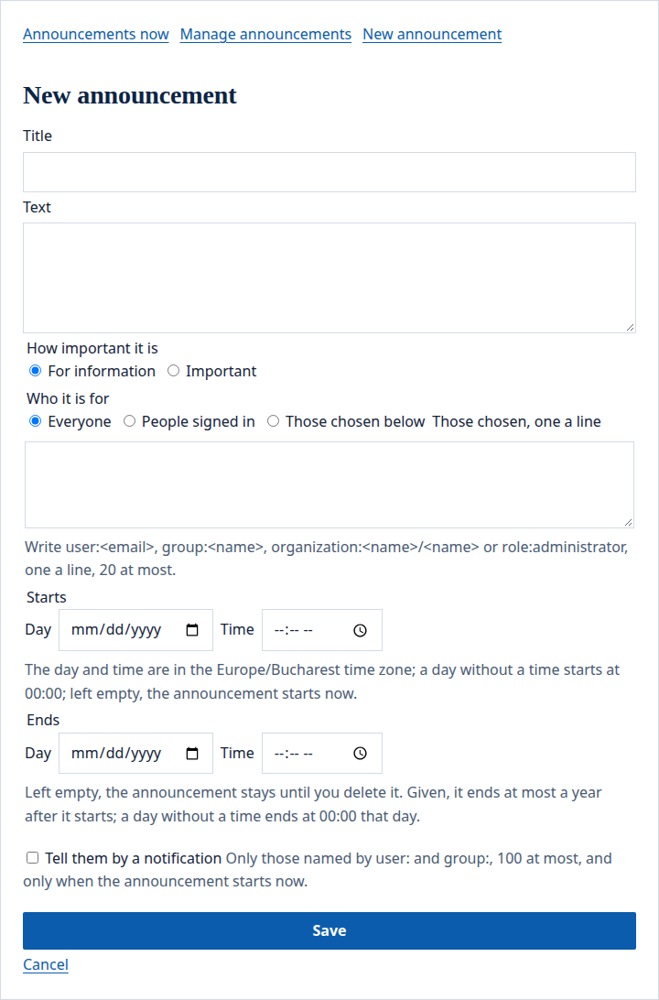
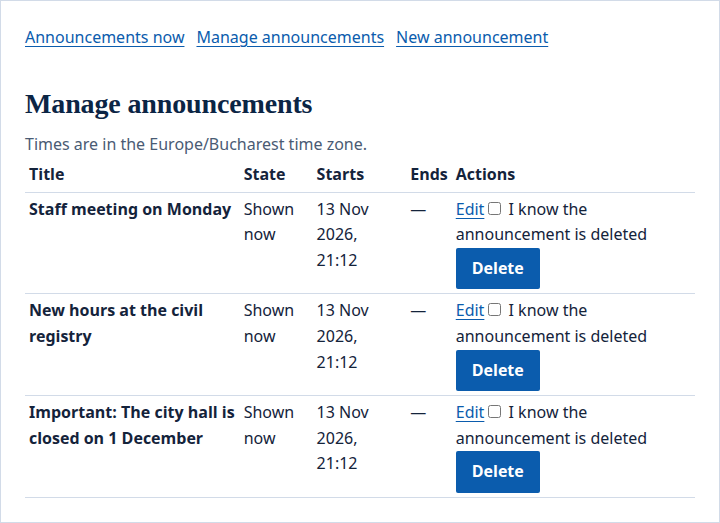

The portal's announcements widget shows a site's announcements: what its editors want people to know for a while, such as a closed office or a change of hours. Each reader sees the announcements meant for them, the important ones first.

## What people see

A visitor sees the announcements meant for everyone. The important one is marked and shown first:

- On [Pages](/portal/console/pages/#the-portals-widgets), add **Announcements** with **Add a widget…**, then set its settings in its row. **Announcements shown** is how many it shows at once: up to 3, or any number from 1 to 10. Editors' days and times are read in the widget's **Time zone**: Europe/Bucharest unless you choose another. Developers: see [Developer: Announcements](/portal/developer/announcements/#the-widget-on-a-page).
- Announcements belong to the site, not to the widget: every announcements widget on the site shows the same ones, so a site can place it on its home page and on any other.
- A page with the widget is made for each reader and never kept in a cache, visitors' pages included.

## Read and dismiss

Readers see the current announcements meant for them, up to the widget's limit. People signed in can **Dismiss** one: it is no longer shown to them, and still shown to others. Visitors cannot dismiss announcements. Changing an announcement does not bring it back to those who dismissed it.

## Write an announcement

The site's editors see **New announcement** and **Manage announcements** in the widget. **New announcement** opens the form:

An announcement has:

- a title of up to 200 characters, and a text of up to 2,000, its line breaks kept;
- how important it is: **For information**, or **Important**, which is marked as such and shown first;
- who it is for: **Everyone**, visitors included; **People signed in**; or **Those chosen below**, one a line, up to 20: `user:<email>`, `group:<name>`, `organization:<name>/<name>` or `role:administrator`, as [permissions](/portal/sites/permissions/) name them. A group or an organization the portal does not have is refused;
- when it starts and, if it should stop by itself, when it ends, as a day and a time in the widget's **Time zone** (Europe/Bucharest unless you choose another); a day given without a time means 00:00 that day. Left empty, it starts at once and stays until an editor deletes it. An end, when given, is in the future and at most a year after the start.

**Manage announcements** lists every announcement of the site, 50 a page, with its state: **Scheduled**, **Shown now** or **Ended**; it is the only place an editor sees announcements meant for others.

From there the editors change or delete one; deleting asks them to tick that they know it goes. A site keeps at most 500 announcements that have not ended, and an ended one given a new end counts again.

When a save is refused, the widget says what was wrong and the form opens again with what was written, kept as the editor's draft for a week. When two editors change the same announcement, the second save is refused and kept the same way; when the announcement was deleted meanwhile, the text waits as a new one.

## Tell them

A new announcement that starts at once can also be sent as a notification: tick **Tell them by a notification**. It reaches the people named by `user:` and the members of the groups named by `group:` who may see the page, and links to the page of the widget; everyone else sees the announcement only in the widget, and the widget says when no one was told. When those names reach more than 100 people, the save is refused: name fewer, or untick the box. When the portal has sent as many notifications as it may in the hour, the announcement is still saved and the widget says no one was told.

## What happens to them later

When a person is erased from the portal, the announcements they wrote stay, without their name, and what they dismissed is forgotten. Their address leaves every audience; an announcement that was for them alone is deleted. The announcements they wrote, and the titles of those they dismissed, are part of what they get when they ask for their data.
