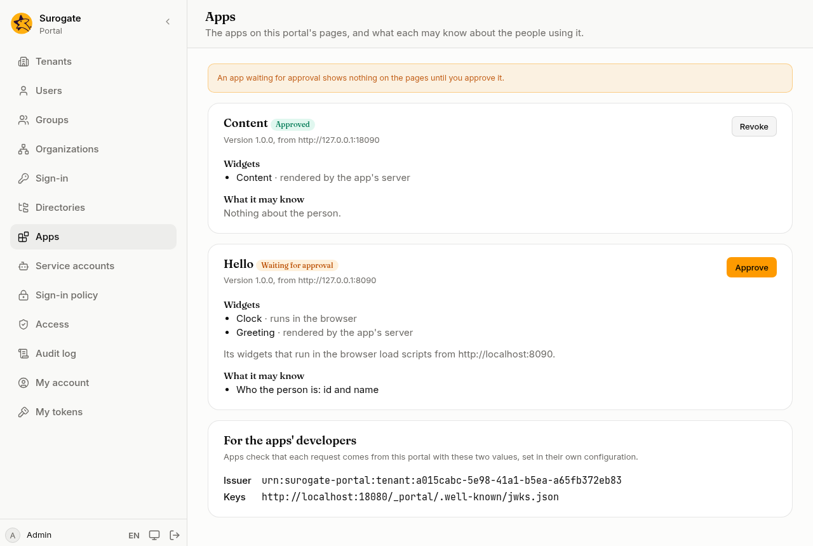
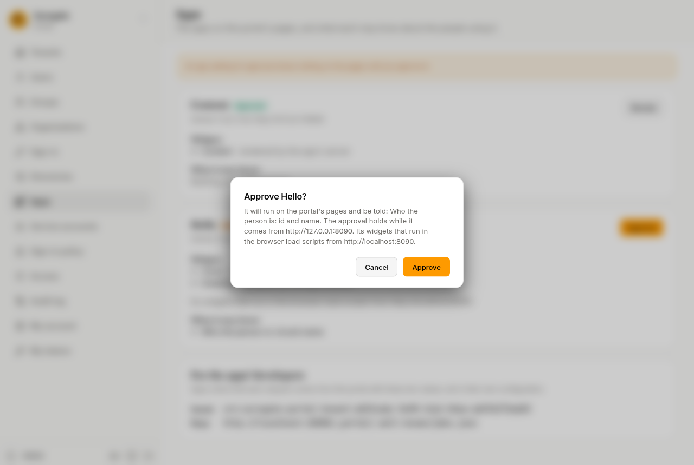

An app is a program deployed on its own, next to the portal. It tells the portal what it offers in a **manifest**: a small JSON file at an address of its own. The portal is told where the app is, and its **widgets** are placed on pages. An administrator then [approves](/portal/console/apps/) it before it shows.

## What people see

**Visitors and people signed in** see an app's widgets as parts of the page, next to the portal's own. A widget that answers late, or with an error, shows **This section is not available right now.**, and the rest of the page still shows. [Who sees a page](/portal/sites/permissions/) also applies to the widgets placed on it.

**People who may edit a page** can change a widget's preferences with **Preferences** on the page (see [Preferences](#preferences)). Until an administrator approves the app, they see **This app is waiting for an administrator's approval.** where it would be; visitors see the page without it.

**An administrator** decides on the console's [Apps](/portal/console/apps/) page whether each app may run, and what it may know about the people using the portal:

Pressing **Approve** opens a dialog that lists what the app will be told:

The page also shows the tenant's **issuer** and **keys** address, which an app checks what the portal sends it against: see [For the apps' developers](/portal/console/apps/#for-the-apps-developers).

## Name an app

Each app the portal knows has a name and the address of its manifest. The address starts with `http:` or `https:` and holds no user name or password. Whoever may change the site's configuration decides which addresses the portal reads, inside your network too. The console does not add apps yet. For now, this is set in the site's configuration: see [Developer: Apps on a page](/portal/developer/apps/#name-an-app).

Each sync reads every app's manifest and checks it. If an app cannot be reached, or its manifest is wrong, the sync is refused and the pages stay as they were. When an app publishes a new manifest, the next sync brings it in, even with no change to the files.

## Place a widget

In the console, **Add a widget…** in the [page editor](/portal/console/pages/#edit-a-page) places one of an app's widgets in a part of the page. The apps' widgets are listed apart from [the portal's own](/portal/console/pages/#the-portals-widgets). When the widget needs a setting to work, the editor asks for it.

- A widget's preferences are checked against what the widget accepts. A value that does not fit is refused, with the field.
- Each widget has a name of its own on its page, in lower-case letters, digits and hyphens. It appears in the page's address when someone changes the widget.

[Who sees a page](/portal/sites/permissions/) also applies to placements.

Text a page holds itself needs no app: it is an [HTML block](/portal/sites/layouts/#an-html-block).

## Preferences

What a widget shows is set by its preferences, in this order, field by field:

1. the default from the app's manifest;
2. the value set where the widget was placed;
3. the value an editor saved with **Preferences** on the page, as long as it still fits. A field the editor leaves empty goes back to the site's value.

Preferences in a widget that runs in the browser reach the visitor's browser. Never put a secret in a preference.

## Build an app

An app tells the portal what it offers in its manifest: its widgets, the preferences each accepts, the events it sends and takes, and its hooks. What the portal asks of an app, and how it checks what the portal sends, is in [Developer: Apps on a page](/portal/developer/apps/#build-an-app). To start from a working app, see [Build an app](/portal/developer/build-an-app/).

## Events

An app can send events and take them. An administrator joins an event to an app that takes it on the console's [Events](/portal/console/events/) page, and the portal checks the two fit. How an app declares, sends and takes events is in [Developer: Apps on a page](/portal/developer/apps/#events).

## Hooks

An app can run small checks and changes on the portal's own server, in a sandbox: when someone creates or changes a person on the console or through the API, and when an editor saves the preferences of one of the app's widgets. A hook can refuse the change, with a message on the field it names, or change the person before they are saved.

Hooks run only for apps an administrator [approved](/portal/console/apps/), and an approval includes them. Disabling a person, or people added by a provisioning system, a directory or a sign-in provider, runs no hooks. How an app builds a hook is in [Developer: Apps on a page](/portal/developer/apps/#hooks).
