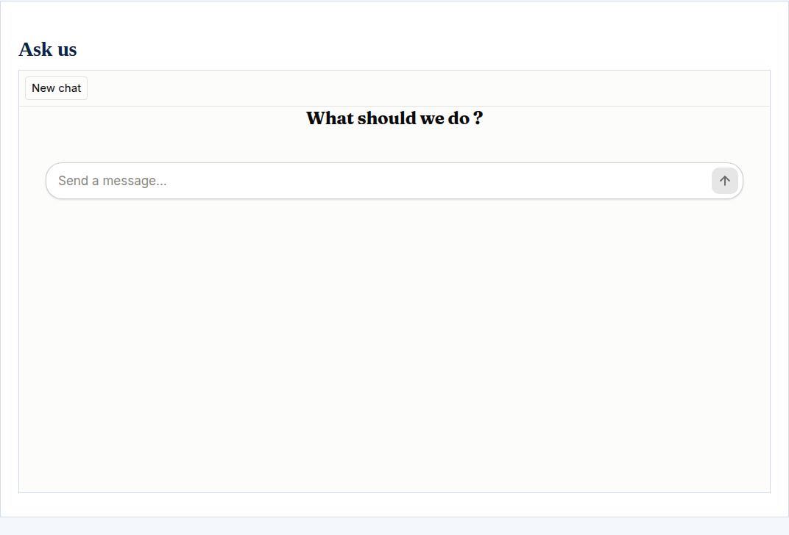
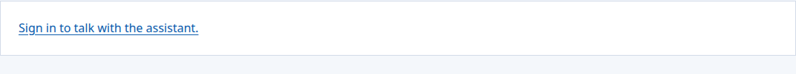
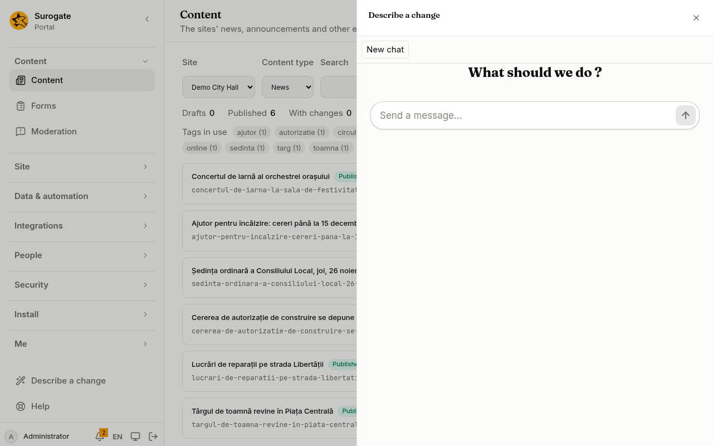

An assistant is a chat with one of your Surogate agents, on a page of the portal. A person signed in opens it and talks with the agent, which answers with everything it has: its skills, its tools and its knowledge. Each person sees only their own chats, and the agent keeps what it remembers of each person apart from everyone else.

## What people see

**A person signed in** sees the chat on the page, under its heading:

- The chat sits in a frame of its own, so neither the site's styles nor the chat's reach the other.
- People can start a new chat, go back to one of their earlier chats, or forget the one open. The first message names each chat.
- The portal's own words follow the page's language; the chat's own controls are in English.

**Visitors** see a link to sign in, which brings them back to the page:

**No chat** for people who may not see any page with the assistant: an agent is reachable only from the pages that place it, for the people who may see them. An administrator seeing the portal as someone else gets no chat either.

## Who the agent talks with

The agent is told the person's name and email when a chat starts. Its memory of what one person said stays with that person: no one else's chat reaches it.

Each person may start 20 chats in ten minutes and send 40 messages in five, so that no one holds the agent from everyone else.

If you make the agent a new key in Studio, everyone's memory with the agent starts afresh: it belongs to the key.

The agent's usage is billed to the agent's project, as all its work is. The portal keeps the list of each person's chats. The agent keeps the chats themselves, and records each turn.

When a person forgets a chat, it leaves their list in the portal. The agent still keeps the chat, with the person's name and email, as it keeps all its work.

## Connect your agents

The portal talks to an agent with the agent's own API key.

1. **Copy the agent's key in Studio.** Open the agent, then **Channels → Web → Manage**, and copy the key. It starts with `surg_sk_`. Studio shows it once.
2. **Name the agent in the portal's configuration:** a secret [connector](/portal/sites/connectors/) for the key, and the agent itself. The console has no screen for this yet. For now, this is set in the site's configuration: see [Developer: Assistants](/portal/developer/assistants/#the-agent-and-its-key).
3. **Publish the configuration.** Then, in the console under **Connectors**, set the key's value.

The key opens only for the agent and address the configuration names. If you change either, set the key again. No action can use the key.

Then place the assistant on a page. On [Pages](/portal/console/pages/#the-portals-widgets), add **Assistant** with **Add a widget…**, then set its settings in its row:

- **Agent**: the agent to talk with. It is required, and lists the agents the portal's configuration names for this. When none fits, the widget is listed as **needs an agent** and cannot be added.
- **Title**: the chat's heading, for each language. Without one, the heading is the agent's name; with neither, the chat has no heading.

The form warns that everyone who may see the page may chat with the agent and use what it can do. Developers: see [Developer: Assistants](/portal/developer/assistants/#the-assistant-on-a-page).

## A chat for visitors

A page can also carry a chat for its visitors, signed in or not: the agent's website channel, the chat Surogate draws on any website. It floats in a corner of the page, and opens when the visitor clicks it.

1. **Turn on the website channel in Studio.** Open the agent, then **Channels → Website**. Turn it on and add every address the portal serves the page on to its allowed origins.
   - Each origin is matched exactly, scheme, host and port: `https://portal.primaria.ro` and `https://www.portal.primaria.ro` are two.
   - The chat refuses a page on any address not in the list.
   - Set a limit on the messages of one chat there too: without one, a chat has none.
   - **Save.** Then copy the publishable key, which starts with `surg_wk_`, and the agent's address from the embed code.
2. **Give the agent its website** in the portal's configuration. The console has no screen for this yet. For now, this is set in the site's configuration: see [Developer: Assistants](/portal/developer/assistants/#the-chat-for-visitors).
3. **Place the website chat**, one on a page. On [Pages](/portal/console/pages/#the-portals-widgets), add **Website chat** with **Add a widget…**, then set its settings in its row:
   - **Agent**: the agent whose website the chat is. It is required, and lists the agents given a website.
   - **Title**: the chat's heading, for each language: the agent's name, or "Assistant", when none is given.
   - **Welcome message**: its greeting, of up to 500 characters, for each language.
   - **Colour**: **The agent's own colour**, unless you set one.
   - **Position**: its corner, bottom right or bottom left.

   When a page has a website chat, the widget is listed as **one per page** and cannot be added again. Developers: see [Developer: Assistants](/portal/developer/assistants/#the-chat-for-visitors).

**What visitors and the agent keep:**
- The chat runs on the agent's runtime, which stores each conversation as it stores all the agent's work.
- A visitor's chat lasts while they stay on the page. Going to another page starts a new chat.
- The agent's memory of a visitor stays with that visitor, through a cookie the agent's address sets in their browser for a year. Mention it in your cookie notice.
- Browsers that block cookies of other sites, as Safari does, may not keep that memory, or the chat, when the agent's address is not the portal's.

**The publishable key:**
- It is made to sit in a page.
- The allowed origins stop other websites' pages from using it, but not a program that calls the agent directly.
- All the chat's visitors share the agent's limit on how fast it answers.
- A key minted again, or the channel turned off, stops the chat until the portal's configuration has the new key.

The page is the same for every visitor, so it stays as fast as any public page.

## Help in the console

One agent can also be the console's help. The tenant's administrators then find **Help** at the bottom of the console's menu. It opens a chat with that agent over the page they are working on:

- **Who sees Help:** the tenant's administrators. On the default tenant, its install administrators. No page needs to place the agent for them.
- **Who does not:** everyone else, and an administrator seeing the portal as someone else.
- **Each administrator's chats are their own,** as on a page. Signing in again from the chat comes back to the same page of the console.
- **What the agent knows** is what you give it in Studio. To let it look things up in the portal, [give it the portal as a tool](#give-an-agent-the-portal-as-a-tool).
- **Keep the help agent for the console alone.** Anyone who reaches an agent reaches what its tools reach. So:
  - no page's assistant names it;
  - no job asks it;
  - it has no website chat;
  - no other agent in the portal's configuration is the same agent under another name.

Give the console its own agent, with its own key connector. For now, this is set in the site's configuration: see [Developer: Assistants](/portal/developer/assistants/#the-consoles-agents).

## Describe a change

One agent can be the console's **builder**. Everyone who writes content, and the tenant's administrators, then find **Describe a change** in the console's menu. They describe a page or an app in their own words:

The builder writes it as the portal's files and proposes it. An administrator approves it under [Proposed changes](/portal/console/proposals/) before anything goes live.

1. **Mark the agent** as the builder in the portal's configuration. One agent at most is the builder, and it needs its key. Like the help agent, the builder belongs to the console alone, and it is never the help agent too. For now, this is set in the site's configuration: see [Developer: Assistants](/portal/developer/assistants/#the-consoles-agents).
2. **Give it the portal as a tool,** below, with a token holding both **Use the portal as a tool of an agent** and **Propose changes**. Give it nothing else: everyone who writes content reaches what its tools reach.
3. **Tell it in Studio what it is for.** For example: describe the change back to the person, make it, propose it with a title and who asked for it, then say that an administrator will look at it.

The builder changes only what a proposal may hold: pages, layouts, designs, forms, flows, contracts, values, data models, endpoints, jobs, guides, content types, vocabularies and collections. Everything it proposes is checked, and waits for an administrator.

**What the builder reaches:**
- It works as its own account, for the whole portal. A person who writes one site's content can ask it to read, or to change, any of these files on any site. Nothing goes live until an administrator approves it.
- Its proposals name the builder's account, not the person who asked. Tell it to write who asked, and why, in each proposal's description.
- The limits of a proposer are the builder's: at most five proposals waiting, and thirty an hour, for everyone who asks it together. It can withdraw a proposal the person no longer wants.
- With **Propose changes**, the portal's tools never read records, whatever else its token holds.

## Suggest tags for content

One agent can suggest tags for the content people write. The content editor then shows **Suggest tags** under an entry's tags.

- One agent at most is the tagger, and it needs its key. The console's help agent cannot be the tagger. For now, this is set in the site's configuration: see [Developer: Assistants](/portal/developer/assistants/#the-consoles-agents).
- The agent is given the entry's title and text, and answers with tags. The portal keeps only what fits as a tag.
- **Give the tagger an agent with no tools.** Everyone who writes content can ask it, and its words come from what they write.
- **Who may ask:** the people who edit a site's or a library's content, signed in.
- **Its use:** each request is a conversation of its own, billed to the agent's project.

## Give an agent the portal as a tool

An agent can use the portal itself while it works. It can search a site and read the records of the data models its account may see, through the MCP server the portal serves.

1. **Make the agent an account.** Make a [service account](/portal/console/service-accounts/) for the agent. Give it the roles, and the data models' permissions, of what it may read. It reads nothing more.

2. **Give it a token.** Make it a token with the **Use the portal as a tool of an agent** scope. Copy the token.
   - When the agent should read records, add **Read and change records of the data models, as the person may**.
   - The tools only read, but with that scope the token can also change, through the portal's API, the records the account may change. Keep the token in Studio's vault alone.

3. **Add the server in Studio.**
   - First put the token in the vault, as a credential.
   - Then add an MCP server: its transport is HTTP, and its address is the portal's public one, such as `https://portal.primaria.ro/_portal/mcp`. The address names the tenant, so use the one people use.
   - For its authentication, choose **Bearer** and the credential.
   - Then give the server to the agent.

The agent then has these tools:

| Tool | What it does |
| --- | --- |
| `search_site` | Searches a site as a visitor would: its public pages, news and documents. |
| `list_records` | Lists the records of a data model the account may see, or those that match words or field values, a page at a time. |
| `get_record` | Reads one record. |
| `list_site_files` | Lists the files a proposal may change, their sizes, and the newest version. With **Propose changes** only. |
| `read_site_file` | Reads one of those files, 90,000 characters at a time. With **Propose changes** only. |
| `propose_change` | Proposes a change for an administrator to approve. Sent again, the same change is proposed once. With **Propose changes** only. |
| `get_proposal` | Reads where a proposal stands, the administrator's note included. With **Propose changes** only. |
| `withdraw_proposal` | Withdraws a proposal that still waits. With **Propose changes** only. |

A token with **Propose changes** gets `search_site` and the proposal tools; `list_records` and `get_record` are for agents that do not propose.

Each tool asks the portal as the agent's account, so the agent finds only what that account may see. The portal's audit log records each tool the agent uses, naming the account. An answer longer than 100 KB is cut, and the agent is told so.

The portal keeps these tools' names and descriptions the same from one version to the next: Surogate sets aside a tool whose description changes after it first met it.
