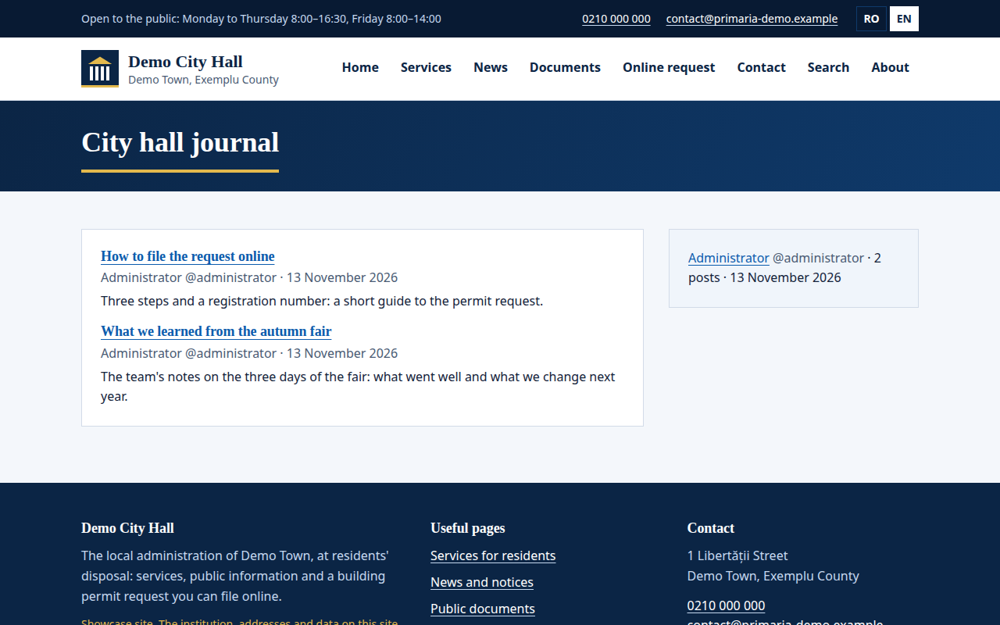
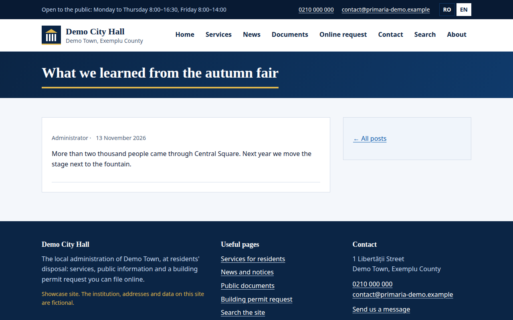
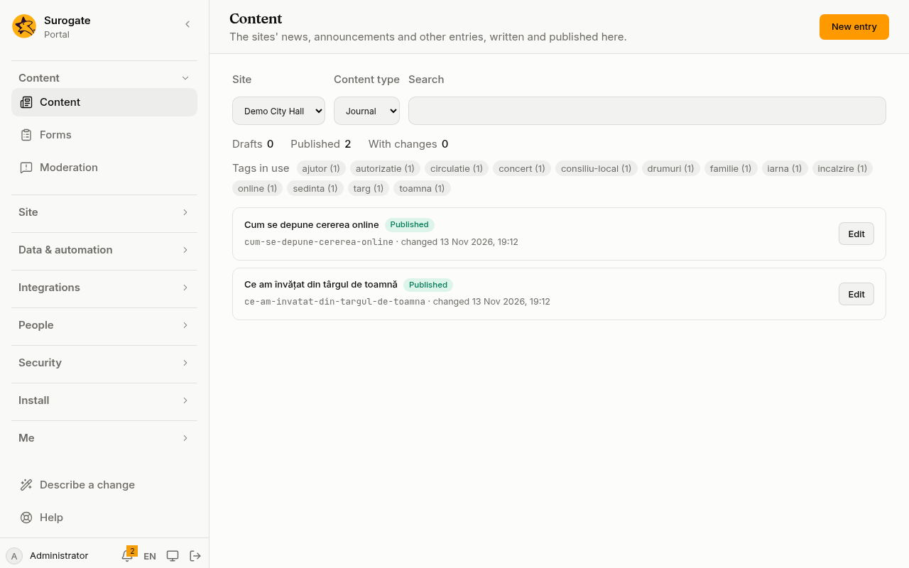

A blog is a [content type](/portal/sites/content-types/) whose entries are posts. Each post is written by one person, who is its author, and its date is the day it was first published. The people a site names as its bloggers write their own posts in the console; three widgets show them on pages.

## What people see

A blog page lists the newest posts. Each shows its title, linked to the post's own page, its author and its date, and a short text under it. Beside it, the recent bloggers: who first published posts lately, and how many posts each.

A post has a page of its own, with its author, its date and its text:

## Name the bloggers

A site, or a [library](/portal/sites/content-types/#libraries), names its bloggers, as it names its [editors](/portal/sites/permissions/#bloggers). Choose a site's bloggers in the console: open **Sites**, then **Settings** on the site, and under **Who writes blog posts** press **Add…**. By default it is **The site's editors**. The console's [Access](/portal/console/access/) page adds editors, not bloggers.

A library's bloggers are not set in the console yet. For now, this is set in the site's configuration: see [Developer: Blogs](/portal/developer/blogs/#the-bloggers).

Bloggers find **Content** in the console, with the site's blog types alone:

There they write, publish, unpublish and delete their own posts, and bring back an earlier version of them; they never see or change anyone else's posts or any other content. The site's editors see and change every post. A post is published as soon as its blogger publishes it: there is no review before it shows. Name as bloggers the people you trust to speak on the site.

Someone who stops being a blogger, or a type that stops being a blog, leaves the posts where they are: they stay published, with their author, and the site's editors look after them.

## Make a blog type

A blog is a content type marked as one. The console's content type builder does not mark one: it keeps the mark as the site's configuration says it. For now, this is set in the site's configuration: see [Developer: Blogs](/portal/developer/blogs/#a-blog-type).

A blog type's template, written under **Template** in the console's [content type builder](/portal/console/content-types/), may place two values a post has besides its fields: `_author`, the author's name, and `_published`, the day it was first published. Give the type a [display page](/portal/sites/content-types/#display-pages) on each site that shows its posts, so each post has its own address: the console's [page editor](/portal/console/pages/#display-pages) makes one.

The author of a post is the person who created it. Marking an existing type as a blog makes whoever created its entries their authors, administrators included. A post whose author was erased from the portal has no author.

## Show a blog

The portal's blog widget shows the posts of one blog type, newest first: the site's own, or those of a library the site may show. On [Pages](/portal/console/pages/#the-portals-widgets), add **Blog** with **Add a widget…**, then set its settings in its row:

- **Content type**: the blog type to show. It is required, and lists blog types only.
- **Library**: the library whose posts it shows. Left empty, it shows the site's own.
- **Posts shown**: 10 posts, or any number from 1 to 50.
- **Summary field**: a text or text area field of the type, shown as a summary under each post.
- **Image field**: an image field of the type, shown under each post.

Developers: see [Developer: Blogs](/portal/developer/blogs/#a-blog-on-a-page).

Each post shows its title, linked to its own page, its author with their [handle](/portal/console/users/#handle), and its date; the summary and the image show in the page's language when the field has one. A post published again keeps its first date and its place.

A blog lists a post only when its site has a display page for its type that the viewer may see: without one, the blog shows nothing.

Add `?author=` and a handle to the page's address, such as `/blog?author=ana.pop`, to show one author's posts; every blog on that page then shows only theirs, with a link back to all posts. A handle nobody has shows no posts.

## Show several blogs

The blog aggregator shows the newest posts of several sites and libraries together. On [Pages](/portal/console/pages/#the-portals-widgets), add **Blogs** with **Add a widget…**, then set its settings in its row:

- **Blogs of**: the sites and libraries to show, up to 20 of them. None ticked: this site alone.
- **Posts shown**: 10 posts, or any number from 1 to 50.

Developers: see [Developer: Blogs](/portal/developer/blogs/#several-blogs).

A post shows only when its site has a display page for its type that the viewer may see; it links to that page, on its own site's address, and says which site it is on. A post nobody may see from here is left out, and so are the posts of a site with no address of its own.

## Recent bloggers

The recent bloggers widget lists who first published posts lately, the latest first, with how many posts each. On [Pages](/portal/console/pages/#the-portals-widgets), add **Bloggers** with **Add a widget…**, then set its settings in its row:

- **Bloggers of**: the sites and libraries whose posts it counts, as the blog aggregator does. None ticked: this site's.
- **Days looked back**: 30 days, or any number from 1 to 365.
- **Bloggers shown**: 10 people, or any number from 1 to 50.
- **Blog page**: the page each name leads to.

Developers: see [Developer: Blogs](/portal/developer/blogs/#who-blogged-lately).

Each name leads to the page of this site holding a blog that the widget names under **Blog page**, with that person's posts. The row lists the pages of this site that hold a blog. Pick one with a blog of the same type and site as the posts counted, or a name may lead to an empty list.

It counts only posts the viewer may see, and lists only people whose account is active.

## Who sees what

A blog shows the same posts to everyone who may see its page, and may be kept in a cache like any other page; a post published, unpublished or deleted shows at once. The blog aggregator and the recent bloggers widget depend on who is looking, so a page with either is made for each person. Comments, ratings and the [activity](/portal/sites/activity/) work on posts as on any entry; the activity names a post's author.
