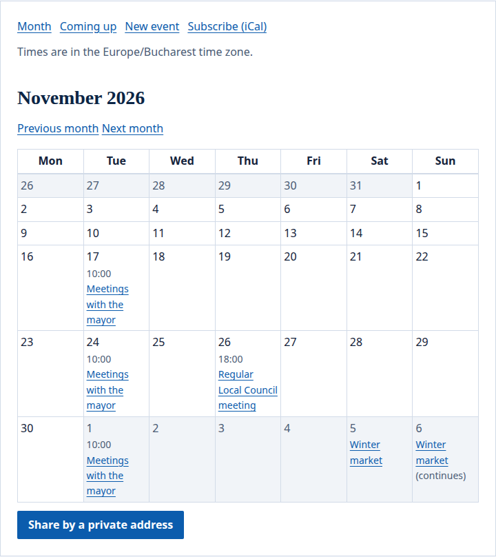
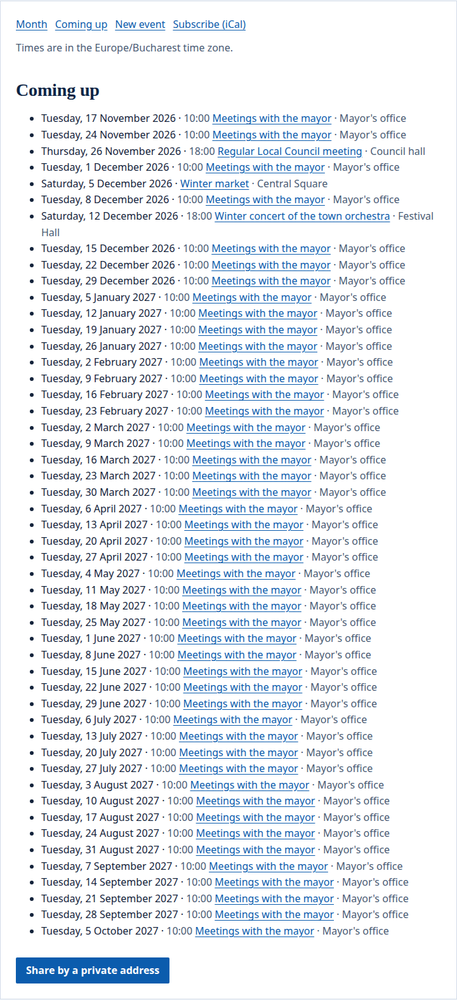
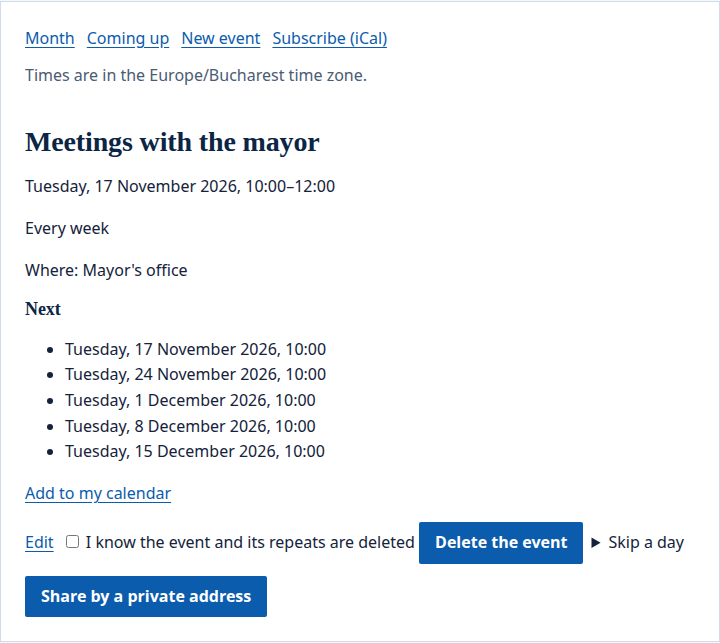
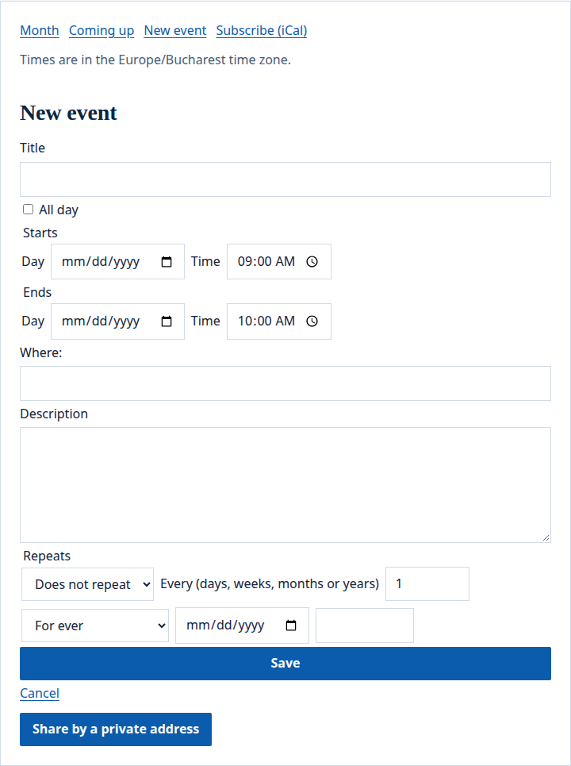

The portal's `calendar` widget is a calendar of events: a month at a time or a list of what is coming, each event with its own page, and a feed people add to their own calendar apps.

## What people see

The calendar opens on a month, as a grid of weeks with each event on its day:



- Each `calendar` widget is a calendar of its own. Its events belong to the widget: moving it to another page, or giving it another `id`, leaves them behind, and they come back if it returns.
- A page with a calendar is made for each person and never kept in a cache.
- Calendars are for the site's pages: a person's dashboard does not take one.
- The widget says in which time zone it shows its times, and the calendar opens on a month or on the list of what is coming: see the [config example](#config-example).

## Read it

**Month** shows a month as a grid of weeks, Monday first, with **Previous month** and **Next month**; an event that lasts several days shows on each of them. **Coming up** lists the next 50 events within a year, starting with any under way. Times are in the calendar's time zone, which the calendar names.



An event's page shows when it starts and ends, where it is, its description and how it repeats; for an event that repeats, it lists the next days it happens. An event keeps the time zone it was made in: if the calendar's zone changes later, the event's page says which zone its times are in. **Add to my calendar** downloads the event as a file calendar apps open; for an event that repeats, the file holds its days of the next two years, each as an entry of its own.



## Add events

Those who may add events see **New event**. By default these are the site's editors and those who [edit the page](/portal/sites/permissions/); a calendar can instead let everyone signed in who may see the widget add events, which makes it a calendar its members write.



An event has a title of up to 200 characters, a place of up to 200 and a description of up to 5,000; it starts and ends on a day and at a time, or lasts whole days with **All day**, and lasts at most a year. Events fall between 1970 and 2100.

An event can repeat daily, weekly, monthly or yearly, every 1 to 99 days, weeks, months or years: for ever, until a day, or a number of times, at most 1,000. It keeps its time of day when the clocks change. A monthly event on the 31st skips the months without one; a yearly one on 29 February happens in leap years.

On an event that repeats, its writer chooses a day under **Skip a day** to leave it out and keep the rest. The days skipped are listed under **Days skipped**, each with **Bring back**. Changing how often the event repeats brings every skipped day back.

On a calendar its members write, each person changes and deletes only the events they added; the editors change any. Deleting an event deletes all its repeats, once its writer ticks that they know it.

When a save is refused, the calendar says what was wrong and the form opens again with what its writer wrote, kept as their draft for a week. When two people change the same event and the second saves after the first, the second save is refused: the form shows the event as it is saved now next to their draft, so they can bring the two together. When the event was deleted meanwhile, their text waits as a new event. **Discard the draft** lets a draft go.

Each person adds at most 60 events an hour, and a calendar holds at most 5,000.

## Add it to a calendar app

**Subscribe (iCal)** links to the calendar's address for calendar apps: copy the link's address, then add it as a subscription in Google Calendar, Outlook or Apple Calendar. The subscription shows the calendar's events of the next two years and up to a thousand of the last year. The portal asks apps to check again every hour; some, such as Google Calendar, check less often. The address opens for everyone who may see the page: anyone at all on a public page.

On a page only some people may see, a calendar app cannot sign in. Its editors then use **Share by a private address**: the portal shows an address once, which opens the calendar for anyone who has it. Keep it as you would a password. **Make another private address** ends the old one, and **Stop sharing** ends it without a new one; both ask the editor to tick that they know the current address stops working, as every app subscribed with it stops getting the calendar.

## What happens to them later

When a person is erased from the portal, the events they added stay on the calendar, without their name, and their drafts go. The events they added, with their places and descriptions, are part of what they get when they ask for their data.

## Config example

### A calendar on a page

In a page's file (`sites/<site>/pages/<page>.yaml`):

```yaml
regions:
  main:
    - id: events
      app: portal
      widget: calendar
      preferences: { edit: editors, zone: Europe/Bucharest, view: month }
```

- `edit`: who adds events: `editors` (when left out), the site's editors and those who [edit the page](/portal/sites/permissions/), or `members`, everyone signed in who may see the widget.
- `zone`: the time zone the calendar shows its times in, such as `Europe/Bucharest` (when left out) or `UTC`.
- `view`: what the calendar opens on: `month` (when left out), or `agenda`, the list of what is coming.
