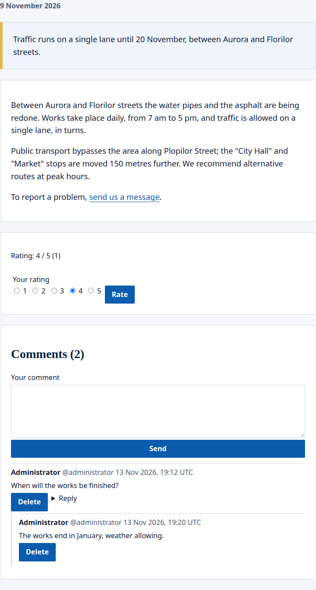

Two widgets of the portal open a page to its readers: comments, where people signed in write, answer each other and flag a comment, and rating, where they give from 1 to 5 stars. Both work on an ordinary page and on a page that [shows one entry](/portal/sites/content-types/) of a content type; there, the comments and the rating belong to the entry, not to the page. An entry shown on several sites has comments and a rating on each site apart, moderated by that site's moderators.

## What people see

On a page that shows a news entry, the widgets sit below its text. The rating shows the average of the stars and how many gave them, and a person's own stars. The comments have a form to write one, and each comment has **Reply** and, for its author, **Delete**:

- Visitors read the comments and are asked to sign in.
- A comment and its answers show who wrote them, with their handle, and when.
- Comments and rating belong to the page, or to the entry the page shows: see [Place the widgets](#place-the-widgets).

## Place the widgets

The two widgets are placed on a page, such as the display page of a content type. A comment shows as soon as it is written, and moderators hide or delete it later; a page can instead ask that a comment waits until a moderator approves it. The comments widget shows the newest comments first, each with its answers: 50 comments, or any number from 1 to 100 that the page asks for. Older comments are not shown.

The rating widget has no settings. A page with either widget is made for each person and never kept in a cache. On a page that shows an entry but was opened without one, the widgets offer nothing.

The console's page editor does not place these widgets yet. For now, this is set in the site's configuration: see [Developer: Comments and ratings](/portal/developer/comments/#comments-and-a-rating-on-a-page).

## Write and answer

Visitors read the comments and are asked to sign in. People signed in who may [see the page](/portal/sites/permissions/) write a comment of up to 4,000 characters, shown as plain text with its line breaks. They answer a comment with **Reply**; answers go one level deep, under the comment they answer, oldest first. An administrator seeing the portal as someone else reads the comments and cannot write.

When someone answers a comment, its author gets a [notification](/portal/sites/notifications/), in the site's language, that leads to the answer. When the answer waits for a moderator, they are told once it is approved. No one is told of their own answer, and no one is told of more than 10 answers an hour.

A comment that waits for a moderator shows to its author and to the moderators, marked as waiting; no one else sees it. Each person may have 5 comments waiting at a time.

## Name someone

People name someone with `@` and their handle, such as `@ana.pop`, in a comment or an [activity post](/portal/sites/activity/). Next to each author's name, the page shows their handle; an administrator sees and changes it on the person's [page in the console](/portal/console/users/#handle). In what the page shows, each `@handle` stands out.

Each person named gets a [notification](/portal/sites/notifications/), in the site's language, that leads to the comment, once:

- only people who may see the widget the comment was written in, and whose account is active; never the writer;
- the first 10 names written in a comment; names after those are not told;
- for a comment waiting for a moderator, only once it is approved;
- the author of the comment an answer replies to is told of the answer, not also of the mention;
- the people one person's comments and posts name are told at most 20 times an hour, and no one is told of more than 10 mentions an hour.

`@` inside a word or an email address, as in `ana@example.ro`, names no one.

## Delete and flag

People delete their own comments. A comment nobody answered is gone from the page; one that others answered stays in its place as **Comment removed**, with no words and no author, so the answers keep their place. A comment a moderator hid cannot be deleted by its author.

People flag a comment they think should not be there, and may say why. Each person flags a comment once, and never their own. A flagged comment goes to the [moderation queue](/portal/console/moderation/) and stays on the page until a moderator decides. Someone whose flag a moderator dismissed cannot flag that comment again.

## Rate

The rating widget shows the average of the stars people gave and how many gave them. A person signed in gives from 1 to 5 stars, sees the rating they gave, and may change it; each person counts once.

## Limits

Each person writes at most 10 comments a minute and 20 a day on one page or entry, and flags at most 20 comments an hour. Comments one deleted still count. A page or entry holds at most 500 published comments; past that, it takes no more. When someone writes too fast, the widget asks them to wait a moment.

## What happens to them later

- Deleting a content entry deletes its comments and ratings.
- Renaming a page or taking it off the site leaves its comments behind: they come back on a page at the same address.
- When a person is erased from the portal, their comments, flags and ratings go with them, and so do the notifications that told others of their answers or that they were named. Their comments that others answered stay with no words and no author: as **Comment removed**, or still hidden when a moderator hid them. A person's comments and ratings are part of what they get when they ask for their data.
