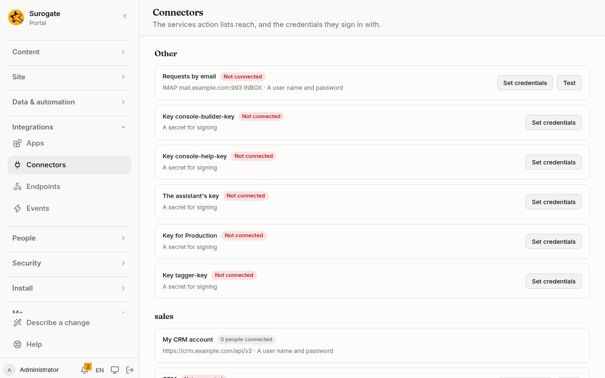
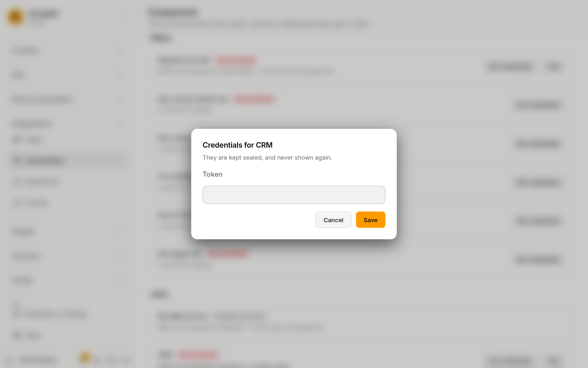
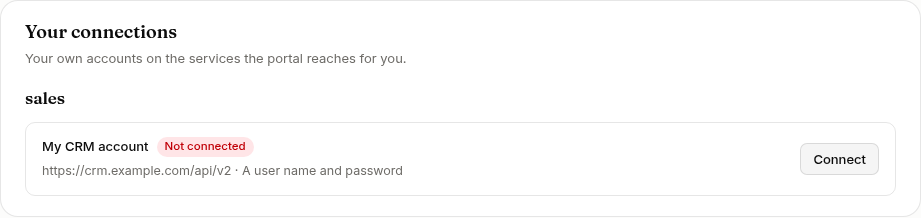
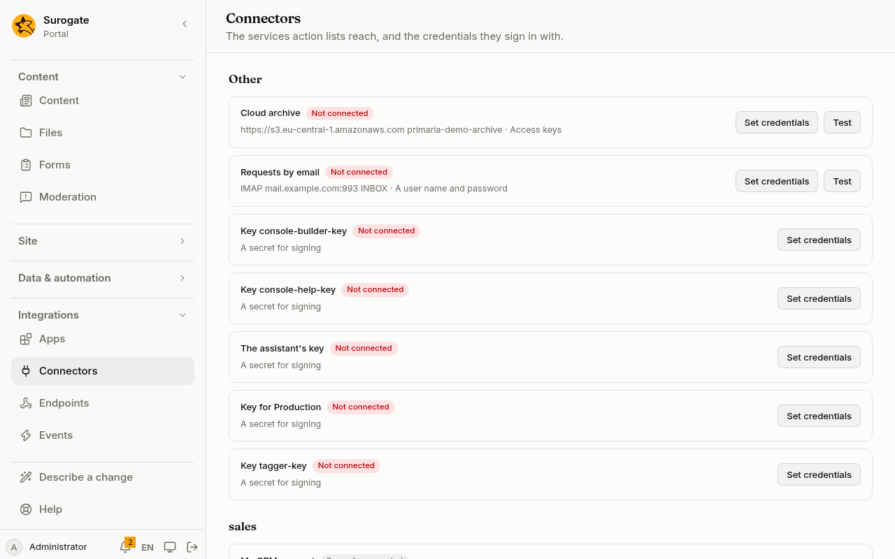

A connector is a named connection to a service outside the portal: a CRM, a payments provider, a public register. [Action lists](/portal/sites/actions/) and [logic flows](/portal/sites/flows/) use it by name. Where it goes and how it signs in are written in the portal's files. Its credentials are set in the console, and are never written in files.

## What people see

**Administrators** see the portal's connectors under [Connectors](/portal/console/connectors/) in the console, grouped by their `group`. Each shows its name, its address, how it signs in, and whether it is connected:



**Set credentials** asks for what the connector's sign-in needs. A token, here, for a connector that signs in with one:



**Each person** sees the connectors they connect themselves, under **Your connections** on their account:



## A connector

A connector lives in `connectors/<id>.yaml`: see the [config example](#a-connectors-file). Its `kind` says what it is:

- `http` is a service the portal calls;
- `secret` is a key the portal signs with, which makes no calls;
- `mailbox` is a mail address a [job](/portal/sites/jobs/#when-mail-arrives) reads (see [Mailboxes](#mailboxes)).

## Credentials

Administrators set a connector's credentials under [Connectors](/portal/console/connectors/). They are kept sealed, and they are never shown again or written in a run's log.

Credentials belong to the connector as it was when they were set. If the base address, the auth or the header changes in the files, the connector counts as not connected until its credentials are set again. A change to the files can never send them somewhere else.

Credentials go only over https, unless the portal is installed to reach private networks.

## Call a service

An action list calls a service with the `http` action: see the [config example](#call-a-service-from-an-action-list).

- **When it fails:**
  - An answer that is not 2xx is an error, unless its status is listed in `okStatus`. The answer is still kept, so `onError` can read it.
  - The portal does not follow redirects.
  - It does not reach private network addresses unless it is installed to.
- **Limits:**
  - a call stops at the connector's `timeoutMs`;
  - an answer or body is at most 1 MB;
  - a run makes at most 20 calls.

## Email

The `email` action sends an email: see the [config example](#send-an-email-from-an-action-list).

- **When it goes:** the email leaves only once the whole run ends well. If a later action fails, nothing is sent.
- **Limits:** a portal sends mail to at most 500 addresses an hour.
- **Your own mail account:** with `connector`, the email goes out through one of your [mail accounts](#mail-accounts) instead of the portal's mail server, as its sender.
- **Files:** `attachments` attaches up to 10 files of a [folder](/portal/console/files/), at most 10 MB together, or 2.5 MB through Microsoft 365. They go as they were when the run ended, even if they change before the email leaves. Only the folder's editors can attach its files: a form a visitor sends that attaches files fails, and sends nothing.
- **When nothing can be sent:** if the portal has no mail server and the action names no mail account, it fails with "The portal sends no email."

## Mail accounts

A mail account connector sends your forms' and jobs' email from your own address, through your own mail service (see the [config example](#a-mail-accounts-file)):

- **SMTP:** any mail server, with a user name and password.
- **Microsoft 365:** an app registered in your Microsoft Entra directory, with the **Mail.Send** application permission and a client secret. Email goes out from the sender's mailbox; it is not kept in its Sent Items.
- **Google Workspace:** a service account with domain-wide delegation for `https://www.googleapis.com/auth/gmail.send`. Paste its JSON key file whole; the portal checks it when you save it.

**Test** signs in to the service without sending anything, and says what is wrong: a secret Microsoft refuses, an app without Mail.Send, a key Google refuses. The credentials are kept for that service, sender and server alone; when one of them changes, set them again. An email already waiting goes out only through the account as it was when the email was queued; one that waits for an account not yet connected is tried again later.

## Hashes, signatures and random values

| Type | What it does | Takes |
|---|---|---|
| `hash` | A sha256, sha384 or sha512 hash | `algorithm`, `from`, `encoding` (`hex` or `base64`), `into` |
| `hmac` | A signature with a `secret` connector's key, at least 32 bytes long | `connector`, `algorithm`, `from`, `encoding`, `into` |
| `randomToken` | 16 to 64 random bytes, as text | `bytes` (32 when left out), `into` |
| `uuid` | A random id | `into` |

`hmac` signs whatever the list gives it. Do not sign what a visitor typed unless that is the point.

## Mailboxes

A mailbox connector lets a [job](/portal/sites/jobs/#when-mail-arrives) read the mail that arrives at an address: see the [config example](#a-mailboxs-file).

- **Credentials:** the mailbox's username and password, set under **Connectors**. They are kept for that server alone; when the host, port, protocol or security changes, set them again.
- **Test:** **Test** signs in and opens the folder.

The portal only reads. It never marks, moves or deletes a message, so keep the mailbox tidy yourself, and read each mailbox with one job. A POP3 mailbox of more than 10,000 messages is not read.

## Buckets

A bucket connector names a bucket of an S3-compatible storage service, such as Amazon S3, Cloudflare R2, MinIO or Garage. [Folders](/portal/console/files/#where-files-are-kept) keep their files in it: see the [config example](#a-buckets-file).

- **Credentials:** the bucket's access key ID and secret access key, set under **Connectors**. They are kept for that service, bucket and region alone; when one of them changes, set the keys again. Give the keys only what the folders need: listing, reading, writing and deleting under their prefixes.
- **Test:** **Test** reads the bucket's first file name, to show that it answers to the keys.


- **Addresses:** the service is reached at its `https:` address. An `http:` address, or one on your own network, works only where the portal allows that.

## File servers

A file server connector names an FTP, FTPS or SFTP server. The [file management actions](/portal/sites/file-management/#files-on-a-server) send files to it, fetch them from it, list its directories and remove files there: see the [config example](#a-file-servers-file).

- **Credentials:** a user name and a password, set under **Connectors**. An SFTP server can take a private key instead of a password: paste the private key, beginning `BEGIN OPENSSH PRIVATE KEY`, `BEGIN RSA PRIVATE KEY` or `BEGIN EC PRIVATE KEY`, without a passphrase. The portal checks the key when you save it, and refuses a public key or one it cannot read. A server that asks for the password as a question of its own (keyboard-interactive) gets it too. The credentials are kept for that server, port, protocol and key alone; when one of them changes, set them again.
- **Known servers:** an SFTP server is known by its key. Write its fingerprint in the connector, as `ssh-keygen -lf` prints it; a server with several keys can have up to five. A server showing another key is not used, and **Test** says which key it showed.
- **Encryption:** FTP goes over TLS (FTPS), and the server's certificate must be one the portal trusts. Plain FTP, without TLS, is only for a server on your own network, where the portal allows that: passwords would otherwise cross the internet in clear.
- **Test:** **Test** signs in and lists the connector's directory.

## Each person's own account

A connector with `perUser: true` signs in as each person, with the account they connected under **Your connections** on their [account](/portal/console/account/#your-connections). When nobody is signed in, or the person has not connected, the action fails with "The connector is not connected."

A [named value](/portal/sites/values/) kept for the whole portal or a site never uses a person's own connector. No named value sends email.

## In tests

A [flow's tests](/portal/sites/flows/#tests) never reach out. Each web call is answered by the test's `mocks`, and each email is listed in the result, never sent (see the [config example](#a-test-that-mocks-the-service)).

A mock matches the call's method and its path, without the query. A call that no mock answers fails the test. In a test, `hmac` signs with a fixed test key, never the connector's secret.

## Config example

### A connector's file

A connector lives in `connectors/<id>.yaml`:

```yaml
name:
  ro: CRM
  en: CRM
group: sales
kind: http
baseUrl: https://crm.example.ro/api/v2
auth:
  type: bearer
timeoutMs: 3000
test:
  method: GET
  path: /ping
```

- `kind`: `http` for a service the portal calls. `secret` for a key the portal signs with, which makes no calls.
- `baseUrl`: where every call starts, with http or https, and with no query or credentials in it.
- `auth`: how calls sign in:
  - `none`;
  - `bearer`: a token;
  - `basic`: a user name and password;
  - `{ type: header, name: X-Api-Key }`: a key in a header.
- `timeoutMs`: how long a call waits, at most 10,000 ms. It is 5,000 when left out.
- `group`: groups connectors in the console.
- `test`: the connection test, a GET or HEAD to a path under the base address.
- `perUser: true`: each person connects their own account. See [Each person's own account](#each-persons-own-account).

### Call a service from an action list

In an action list, such as a form's `actions`:

```yaml
- type: http
  connector: crm
  method: POST
  path: '"/clients/" + form.client'
  query:
    lang: locale
  body: "{'name': form.name, 'email': form.email}"
  into: answer
- type: message
  text:
    ro: "Client {{ vars.answer.body.id }}"
    en: "Client {{ vars.answer.body.id }}"
```

- **The call:**
  - `method` is GET (when left out), POST, PUT, PATCH or DELETE.
  - `path` is added under the base address. It can never climb above it or reach another site.
  - `query` values are text, numbers or true or false.
  - `headers` may add headers of your own, but not the sign-in header or the request's own.
  - `body` goes as JSON when it is an object or list, and as text when it is text. GET and DELETE send none.
- **The answer** lands in `vars.<into>` as `status`, `headers` and `body`. A JSON body is read into values.

### Send an email from an action list

```yaml
- type: email
  to: form.email
  subject: '"We received your request"'
  text: '"Your reference is " + vars.reference'
```

- `to` is an address or a list of them. A run sends to at most 10 addresses, or 2 when nobody is signed in.
- `subject` and `text` are expressions.

Through your own mail account, with a file:

```yaml
- type: email
  connector: town-mail
  to: form.email
  subject: '"Your certificate"'
  text: '"The certificate is attached."'
  attachments:
    folder: certificates
    names: '["adeverinta-" + vars.number + ".pdf"]'
```

- `connector`: a mail account connector.
- `attachments.folder`: the folder the files are in; `attachments.names`: an expression giving their names, as a list.

### A mail account's file

In `connectors/<id>.yaml`, a Microsoft 365 account:

```yaml
name: { ro: Poșta primăriei, en: Town mail }
kind: mail
provider: microsoft365
from: anunturi@primaria.ro
directory: 3f2a9c4e-0d1b-4e7a-9b5c-8d6e7f001122
clientId: 7c1e5a2b-4f3d-4c9e-8a7b-6d5e4f003344
```

- `provider`: `smtp`, `microsoft365` or `google`.
- `from`: the address the email is sent from.
- `directory` and `clientId`: Microsoft 365's directory (tenant) id and the app's id, as Microsoft Entra shows them.
- `fromName`: the sender's name, in Romanian and English (SMTP and Google).
- `timeoutMs`: how long the service may keep the portal waiting, up to 60,000 ms; 30,000 when left out.

An SMTP server takes `host`, `port` (587 when left out) and `security`: `starttls` (when left out), `tls` (port 465), or `none`, only for a server on your own network. Google Workspace takes only `provider` and `from`.

### A mailbox's file

In `connectors/<id>.yaml`:

```yaml
name: { ro: Cereri prin e-mail, en: Requests by email }
kind: mailbox
protocol: imap        # or pop3
host: mail.primaria.ro
folder: INBOX         # IMAP only; INBOX when left out
```

- `protocol`: `imap` or `pop3`.
- `host`: the mail server.
- `folder`: the folder to read; IMAP only, `INBOX` when left out.
- **Port:** 993 for IMAP and 995 for POP3 when left out.
- **Security:** `tls` by default. IMAP also takes `starttls`. The mail server needs a certificate the portal trusts, and `none` works only for a server on your own network when the portal allows that.

### A bucket's file

In `connectors/<id>.yaml`:

```yaml
name: { ro: Arhiva în cloud, en: Cloud archive }
kind: bucket
endpoint: https://s3.eu-central-1.amazonaws.com
bucket: primaria-archive
region: eu-central-1
```

- `endpoint`: the service's address, `https://` and a host, with no path. For Cloudflare R2: `https://<account id>.r2.cloudflarestorage.com`.
- `bucket`: the bucket's name, as the service shows it.
- `region`: the bucket's region; `auto` when left out, as R2 takes.
- `virtualHosted`: `true` to reach the bucket as a host of its own (`primaria-archive.s3.example.com`); left out, it is part of the path, which most services take.
- `timeoutMs`: how long one request waits, up to 60,000 ms; 30,000 when left out.

A bucket connector takes no `baseUrl`, `auth`, `test` or `perUser`: it is the portal's own.

### A file server's file

In `connectors/<id>.yaml`, an SFTP server:

```yaml
name: { ro: Server registratură, en: Registry server }
kind: ftp
protocol: sftp
host: sftp.primaria.ro
hostKey: SHA256:f2IO2+GZU5y3N8JriSY+2TfVUBjyih6+yr7OnJVUFt8
directory: /registratura
```

- `protocol`: `sftp`, or `ftp` for FTP and FTPS.
- `host`: the server's name or address, with no scheme or port.
- `hostKey`: the server's key fingerprint, as `ssh-keygen -lf` prints it, or a list of up to five.
- `directory`: where the actions' paths start; when left out, where the server signs in.
- `auth: key` signs in with a private key instead of a password.
- `port`: 22 for SFTP when left out.
- `timeoutMs`: how long the server may keep the portal waiting, up to 60,000 ms; 10,000 when left out.

An FTPS server:

```yaml
name: { ro: Server FTP, en: FTP server }
kind: ftp
protocol: ftp
host: ftp.primaria.ro
security: starttls
```

- `security`: `starttls` (when left out) secures the connection after it opens; `tls` secures it from the start, on port 990; `none` sends everything in clear, only to a server on your own network.

A file server connector takes no `baseUrl`, `test` or `perUser`: it is the portal's own.

### A test that mocks the service

In a flow's file (`flows/<id>.yaml`), under `tests`:

```yaml
tests:
  - name: finds the client
    inputs: { id: "7" }
    mocks:
      crm:
        - method: GET
          path: /clients/7
          body: { name: Ana }
    expect:
      outputs: { name: Ana }
```

- `mocks`: for each connector, the answers its web calls get, by `method` and `path`.
- `body`: what the mock answers.
- `expect`: what the test must see.
