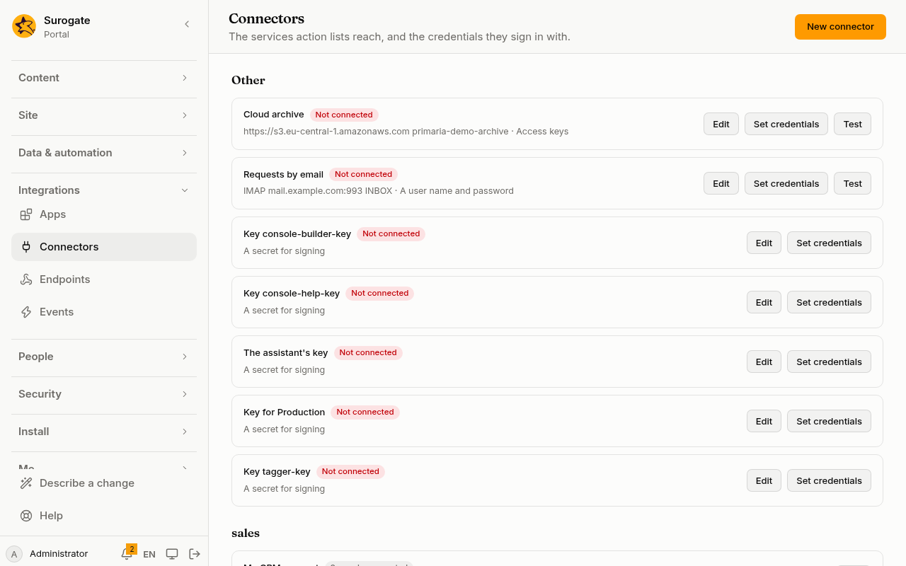
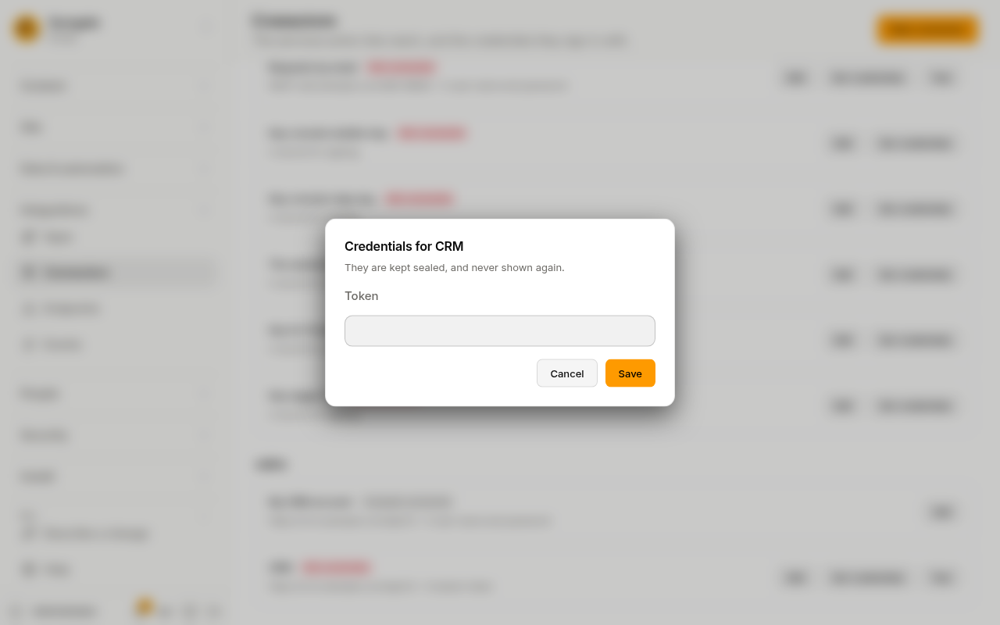
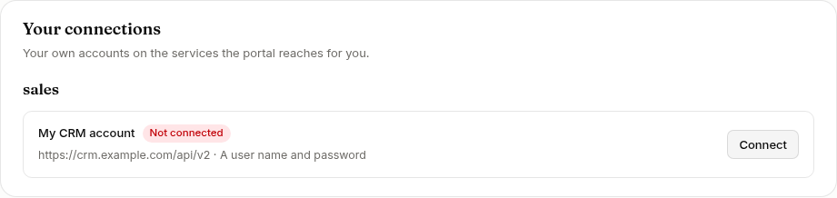

A connector is a named connection to a service outside the portal: a CRM, a payments provider, a public register. [Action lists](/portal/sites/actions/) and [logic flows](/portal/sites/flows/) use it by name. Where it goes and how it signs in belong to the portal's configuration. Its credentials are set in the console, and are never written there.

## What people see

**Administrators** see the portal's connectors under [Connectors](/portal/console/connectors/) in the console, grouped by the group each connector is given. Each shows its name, its address, how it signs in, and whether it is connected:

**Set credentials** asks for what the connector's sign-in needs. A token, here, for a connector that signs in with one:

**Each person** sees the connectors they connect themselves, under **Your connections** on their account:

## A connector

A connector is one of these kinds:

- an http connector is a service the portal calls;
- a secret connector is a key the portal signs with, which makes no calls;
- a mailbox connector is a mail address a [job](/portal/sites/jobs/#when-mail-arrives) reads (see [Mailboxes](#mailboxes)).

Connectors are made, changed and given their credentials in the console: see [Connectors](/portal/console/connectors/#make-or-change-a-connector). Developers can also write it in the site's configuration: see [Developer: Connectors](/portal/developer/connectors/#a-connectors-file).

## Credentials

Administrators set a connector's credentials under [Connectors](/portal/console/connectors/). They are kept sealed, and they are never shown again or written in a run's log.

Credentials belong to the connector as it was when they were set. If the connector's address, its way of signing in or its header changes in the portal's configuration, the connector counts as not connected until its credentials are set again. A change to the configuration can never send them somewhere else.

Credentials go only over https, unless the portal is installed to reach private networks.

## Call a service

An action list calls a service through a connector. A call has a method (GET when none is named, POST, PUT, PATCH or DELETE), a path under the connector's address, query values, a body and headers of its own. The answer's status, headers and body are kept under a name the list chooses, and a JSON body is read into values. In the console, it is the action **Call a web service** in any action list: a form's [steps](/portal/console/forms/#steps), an endpoint's, a job's or a flow's actions. Developers can also write it in the site's configuration: see [Developer: Connectors](/portal/developer/connectors/#call-a-service-from-an-action-list).

- **Where it goes:** a path is added under the connector's address. It can never climb above it or reach another site. A header of its own cannot replace the sign-in header or the request's own. A GET or DELETE sends no body.
- **When it fails:**
  - An answer that is not 2xx is an error, unless the call says its status is fine. The answer is still kept, so the list's error handling can read it.
  - The portal does not follow redirects.
  - It does not reach private network addresses unless it is installed to.
- **Limits:**
  - a call stops at the connector's time limit: at most 10,000 ms, and 5,000 when none is set;
  - an answer or body is at most 1 MB;
  - a run makes at most 20 calls.

## Google APIs

An http connector can sign in as a Google Cloud **service account**, to call Google's APIs: Sheets, Drive, Calendar, Gmail and the others on `googleapis.com`.

1. In the Google Cloud console, make a service account, turn on the APIs your steps call, and make a JSON key for the account.
2. On **Connectors**, make an http connector with the API's address, such as `https://sheets.googleapis.com/v4`. Under **Signs in with**, choose **A Google Cloud service account**, and write its **scopes**, one per line, such as `https://www.googleapis.com/auth/spreadsheets`.
3. To act as a person of your Google Workspace (their Gmail or Calendar), write them under **Acts as**. The Workspace's administrator must first delegate those scopes to the service account.
4. Set the credential: paste the key file whole.

**Test** asks Google for a token; no API is called. The steps then call the API as with any connector: the portal adds a token, kept until shortly before it ends, and no step ever sees it. Paths keep Google's colons, as in `/spreadsheets/{id}/values/A1:append`.

- The connector's address is on `googleapis.com`, so the token goes only to Google. Services that ask for an identity token, such as Cloud Run or Cloud Functions, are not called this way.
- Changing the scopes or the person it acts as asks for the key again.
- If Google refuses the key (revoked, a scope not delegated), the steps fail and say why, for a minute before the portal asks Google again; setting the key again, or a passing **Test**, asks at once.
- A connector acting as a person is never called from a form anyone may send, or an endpoint anyone may call.

To work with Drive files from steps without writing API calls, use a **Google Drive** connector and the [Google Drive actions](/portal/sites/google-drive/) instead. Files in OneDrive and SharePoint have their own connector too: see [Files in OneDrive and SharePoint](/portal/sites/microsoft-365/).

## Email

An action list sends an email. In the console, it is the action **Send an email** in an action list: a form's [steps](/portal/console/forms/#steps), or a job's or a flow's actions. Developers can also write it in the site's configuration: see [Developer: Connectors](/portal/developer/connectors/#send-an-email-from-an-action-list).

- **When it goes:** the email leaves only once the whole run ends well. If a later action fails, nothing is sent.
- **Limits:** a portal sends mail to at most 500 addresses an hour. A run sends to at most 10 addresses, or 2 when nobody is signed in.
- **Your own mail account:** an email can go out through one of your [mail accounts](#mail-accounts) instead of the portal's mail server, as its sender.
- **Files:** an email can attach up to 10 files of a [folder](/portal/console/files/), at most 10 MB together, or 2.5 MB through Microsoft 365. They go as they were when the run ended, even if they change before the email leaves. Only the folder's editors can attach its files: a form a visitor sends that attaches files fails, and sends nothing.
- **When nothing can be sent:** if the portal has no mail server and the email names no mail account, it fails with "The portal sends no email."

## Mail accounts

A mail account connector sends your forms' and jobs' email from your own address, through your own mail service:

- **SMTP:** any mail server, with a user name and password.
- **Microsoft 365:** an app registered in your Microsoft Entra directory, with the **Mail.Send** application permission and a client secret. Email goes out from the sender's mailbox; it is not kept in its Sent Items.
- **Google Workspace:** a service account with domain-wide delegation for `https://www.googleapis.com/auth/gmail.send`. Paste its JSON key file whole; the portal checks it when you save it.

A mail account is made in the console as a connector of the kind **A mail account**: see [Make or change a connector](/portal/console/connectors/#make-or-change-a-connector). Developers can also write it in the site's configuration: see [Developer: Connectors](/portal/developer/connectors/#a-mail-accounts-file).

**Test** signs in to the service without sending anything, and says what is wrong: a secret Microsoft refuses, an app without Mail.Send, a key Google refuses. The credentials are kept for that service, sender and server alone; when one of them changes, set them again. An email already waiting goes out only through the account as it was when the email was queued; one that waits for an account not yet connected is tried again later.

## Text messages and Slack

An action list can send a text message through Twilio or Clickatell, and post to a Slack channel, each through its connector. In the console, they are the actions **Send a text message** and **Post to Slack** in an action list: a form's [steps](/portal/console/forms/#steps), or a job's or a flow's actions. Developers can also write it in the site's configuration: see [Developer: Connectors](/portal/developer/connectors/#a-text-message-and-a-slack-post).

- **When they go:** as emails do, only once the whole run ends well, and then from a queue: a service that is busy or does not answer is tried again after 1, 2, 4… minutes. A message is never sent twice, and never through a connector that changed since.
- **Numbers:** international numbers, such as `+40712345678`; spaces, dots, dashes, brackets and a written `(0)` are taken out. A run texts at most 10 numbers, or 2 when nobody is signed in. A job texts as nobody unless it runs as someone.
- **Text:** a text message is 1 to 480 characters, or 160 when nobody is signed in, since text messages are paid by the piece: about 67 characters each with Romanian letters. A Slack message is 1 to 4,000 characters, and a run posts at most 5.
- **A visitor's words in Slack** are written as they are: a visitor cannot mention the whole channel or hide a link under other words.
- **Each hour:** a portal sends at most 200 text messages, 100 from one form or job and 5 to one number, and posts at most 100 Slack messages. Past these, none of the run's messages leave, and the run's log in the console says why.
- Neither can be used in an [endpoint](/portal/sites/endpoints/).

## Push notifications to a mobile app

An action list can send a push notification to a mobile app's devices through Firebase Cloud Messaging or Pushwoosh, through a mobile app connector. In the console, it is the action **Send a push notification** in an action list: a form's [steps](/portal/console/forms/#steps), or a job's or a flow's actions. Developers: see [Developer: Connectors](/portal/developer/connectors/#a-push-notification).

- **To:** the devices' push tokens, as your app gives them: Firebase's registration tokens, or Pushwoosh's device tokens. Your app keeps them; the portal does not know who uses which device.
- **What it says:** a title of 1 to 100 characters and a text; together at most 3,500 bytes (about 1,700 Romanian letters). A link is an https address: your app decides what it opens.
- **When they go:** as text messages do, only once the whole run ends well, then from a queue, tried again when the service is busy. A device Firebase says is gone is given up.
- **How many:** a run sends to at most 100 devices, or 5 when nobody is signed in. Each hour, a portal sends at most 1,000 push notifications, 500 from one form or job and 10 to one device.
- They cannot be used in an [endpoint](/portal/sites/endpoints/). These are the app's notifications, apart from the [notifications](/portal/sites/notifications/) people see on the portal and in their browsers.

## Messaging accounts

- **Text messages:** a text message connector names Twilio or Clickatell and the sender: a number, a Twilio Messaging Service, or a Clickatell sender name. Set Twilio's auth token or Clickatell's API key under **Connectors**; **Test** reads the account without sending anything. A job can also [start for each message the number receives](/portal/sites/jobs/#when-a-text-message-arrives).
- **A mobile app:** Firebase, with the project's id as Firebase's console shows it, or Pushwoosh, with the application's code, such as `ABCDE-12345`. Under **Connectors**, set Firebase's service account key (its JSON file, pasted whole; it must be the project's) or Pushwoosh's API access token. Give Firebase a service account of its own with only the Firebase Cloud Messaging role, not the Admin SDK's. **Test** asks Firebase to check a message without sending it; Pushwoosh has no such check, so it has no Test.
- **Slack:** a Slack connector is a Slack incoming webhook. Create one in Slack for the channel, and paste its address, `https://hooks.slack.com/services/…`, under **Connectors**. It has no Test: a test would show in the channel.

These are made in the console as connectors of the kinds **Text messages**, **A Slack channel** and **A mobile app's push notifications**: see [Make or change a connector](/portal/console/connectors/#make-or-change-a-connector). Developers can also write it in the site's configuration: see [Developer: Connectors](/portal/developer/connectors/#a-text-message-and-a-slack-post).

## Hashes, signatures and random values

An action list can work out a hash (sha256, sha384 or sha512), sign with a secret connector's key, which must be at least 32 bytes long, make 16 to 64 random bytes as text (32 when the list names no number), or make a random id. In the console, these are actions of the **Values** section of any action list. Developers can also write it in the site's configuration: see [Developer: Connectors](/portal/developer/connectors/#hashes-signatures-and-random-values).

A signature signs whatever the list gives it. Do not sign what a visitor typed unless that is the point.

## Mailboxes

A mailbox connector lets a [job](/portal/sites/jobs/#when-mail-arrives) read the mail that arrives at an address. It is made in the console as a connector of the kind **A mailbox**: see [Make or change a connector](/portal/console/connectors/#make-or-change-a-connector). Developers can also write it in the site's configuration: see [Developer: Connectors](/portal/developer/connectors/#a-mailboxs-file).

- **Credentials:** the mailbox's username and password, set under **Connectors**. They are kept for that server alone; when the host, port, protocol or security changes, set them again.
- **Test:** **Test** signs in and opens the folder.

The portal only reads. It never marks, moves or deletes a message, so keep the mailbox tidy yourself, and read each mailbox with one job. A POP3 mailbox of more than 10,000 messages is not read.

## Buckets

A bucket connector names a bucket of an S3-compatible storage service, such as Amazon S3, Cloudflare R2, MinIO or Garage. [Folders](/portal/console/files/#where-files-are-kept) keep their files in it. It is made in the console as a connector of the kind **A bucket (S3)**: see [Make or change a connector](/portal/console/connectors/#make-or-change-a-connector). Developers can also write it in the site's configuration: see [Developer: Connectors](/portal/developer/connectors/#a-buckets-file).

- **Credentials:** the bucket's access key ID and secret access key, set under **Connectors**. They are kept for that service, bucket and region alone; when one of them changes, set the keys again. Give the keys only what the folders need: listing, reading, writing and deleting under their prefixes.
- **Test:** **Test** reads the bucket's first file name, to show that it answers to the keys.
- **Addresses:** the service is reached at its `https:` address. An `http:` address, or one on your own network, works only where the portal allows that.

## File servers

A file server connector names an FTP, FTPS or SFTP server. The [file management actions](/portal/sites/file-management/#files-on-a-server) send files to it, fetch them from it, list its directories and remove files there. It is made in the console as a connector of the kind **An FTP or SFTP server**: see [Make or change a connector](/portal/console/connectors/#make-or-change-a-connector). Developers can also write it in the site's configuration: see [Developer: Connectors](/portal/developer/connectors/#a-file-servers-file).

- **Credentials:** a user name and a password, set under **Connectors**. An SFTP server can take a private key instead of a password: paste the private key, beginning `BEGIN OPENSSH PRIVATE KEY`, `BEGIN RSA PRIVATE KEY` or `BEGIN EC PRIVATE KEY`, without a passphrase. The portal checks the key when you save it, and refuses a public key or one it cannot read. A server that asks for the password as a question of its own (keyboard-interactive) gets it too. The credentials are kept for that server, port, protocol and key alone; when one of them changes, set them again.
- **Known servers:** an SFTP server is known by its key. Give the connector the server's fingerprint, as `ssh-keygen -lf` prints it; a server with several keys can have up to five. A server showing another key is not used, and **Test** says which key it showed.
- **Encryption:** FTP goes over TLS (FTPS), and the server's certificate must be one the portal trusts. Plain FTP, without TLS, is only for a server on your own network, where the portal allows that: passwords would otherwise cross the internet in clear.
- **Test:** **Test** signs in and lists the connector's directory.

## Each person's own account

A connector can sign in as each person, with the account they connected under **Your connections** on their [account](/portal/console/account/#your-connections). When nobody is signed in, or the person has not connected, the action fails with "The connector is not connected." Whether a connector works this way is set in the site's configuration: see [Developer: Connectors](/portal/developer/connectors/#a-connectors-file).

A [named value](/portal/sites/values/) kept for the whole portal or a site never uses a person's own connector. No named value sends email.

## In tests

A [flow's tests](/portal/sites/flows/#tests) never reach out. Each web call is answered by the answers the test gives for that connector, and each email is listed in the result, never sent. In the console, a test gives them under **More**, as **Answers to web calls**: see [Make or change a flow](/portal/console/flows/#make-or-change-a-flow). Developers can also write it in the site's configuration: see [Developer: Connectors](/portal/developer/connectors/#a-test-that-mocks-the-service).

A test's answer matches the call's method and its path, without the query. A call that no answer covers fails the test. In a test, signing uses a fixed test key, never the connector's secret.
