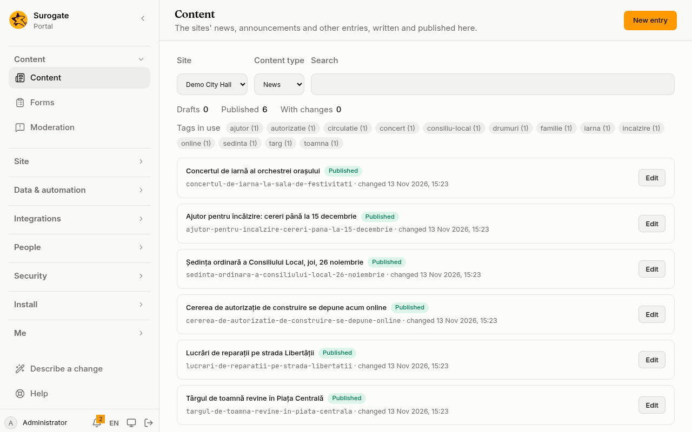
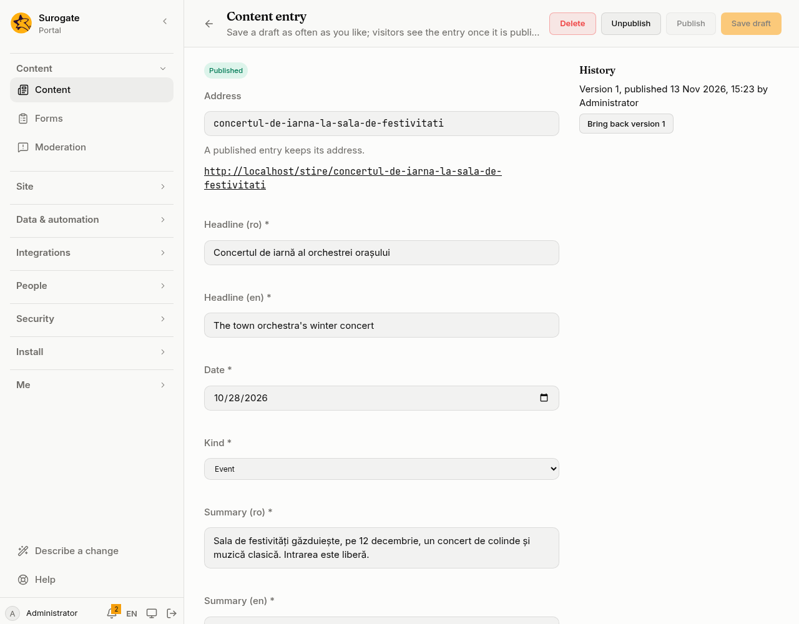
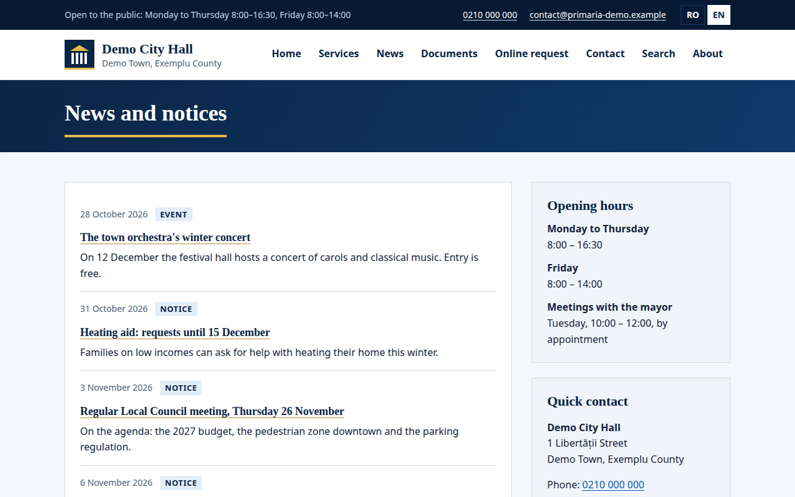
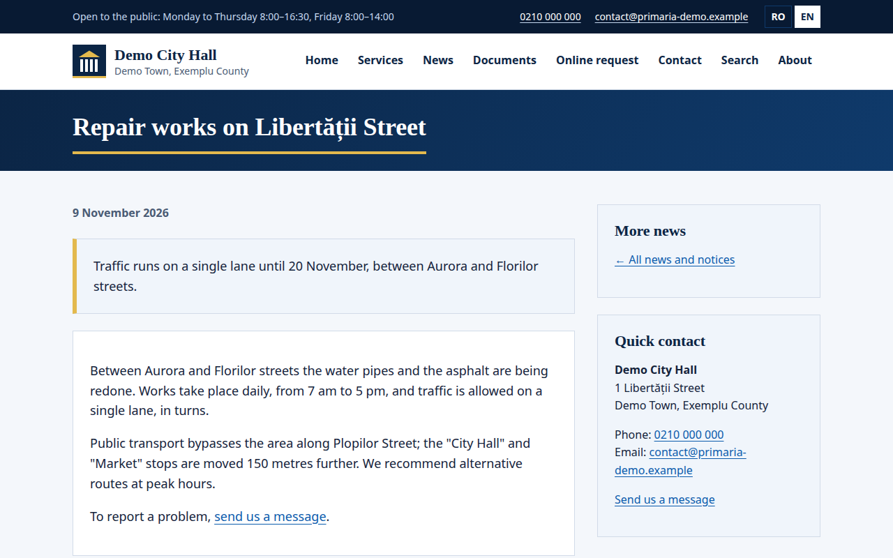

A content type says what a kind of entry holds, such as a news item's headline, date and text. The people who edit a site write entries in the console's [Content](/portal/console/content/) page; pages show them with the content widget.

## What people see

**People who edit a site** find its entries under **Content** in the console, filtered by site and content type:

An entry's form is built from the type's fields: the headline and the summary once for each language, a day for the date, a choice for the kind, and so on. Fields marked with a star must be filled in to publish.

**Visitors** see the published entries on the site's pages. A list shows each entry as the type's template says, and each entry has a page of its own:

Administrators can also build the types in the console, on [Content types](/portal/console/content-types/).

## A content type

A content type is shared by all the sites of the portal. Administrators build content types in the console, on [Content types](/portal/console/content-types/).

- A content type has a name, and each of its fields a label, in Romanian and English.
- Its **Title** is the text field that names an entry in lists.
- A field's id is lower-case letters, digits and hyphens. A field marked as **Must be filled in to publish** must be filled in, in every language, to publish.
- A portal has at most 100 content types, each with at most 50 fields.
- A content type can be a [blog](/portal/sites/blogs/): its entries are posts, each by the person who wrote it. The console's builder does not turn this on yet. For now, this is set in the site's configuration: see [Developer: Content types](/portal/developer/content-types/#a-content-types-file).

## Field types

| Type | Holds | Written in each language |
|---|---|---|
| Text | one line, 200 characters unless the field's most characters says otherwise | yes |
| Longer text | lines of plain text, 10,000 characters unless the field's most characters says otherwise | yes |
| Rich text (HTML) | HTML, as an [HTML block](/portal/sites/layouts/#an-html-block) holds | yes |
| Number | a number | no |
| Yes or no | yes or no | no |
| Date | a day, shown in the visitor's language | no |
| Link | an address and its text | yes |
| Image | an image's address and what it shows | yes |
| Choice from a list | one of the field's options | no |

A text, link or image field can be made the same in every language: untick **Written in each language** in the builder.

## How an entry looks

Without a template, an entry shows its title as a heading, then each other field.

A **template** places the fields in markup of your own, written under **Template** in the builder. It takes what a site's [layouts](/portal/sites/layouts/) take, and `<portal-field name="…"></portal-field>` where a field's value goes.

A rich text field holds paragraphs and other blocks. It stands directly in a block such as a `div` or a `section`, never inside a paragraph or a heading.

When the site has a [display page](#display-pages) for the type, `<portal-entry-link>` links what it holds to the entry's address; it takes a `class` and holds no other link. Without a display page it shows what it holds, unlinked. Without a template, the entry's title is the link.

Each entry is an `article` with the class `portal-content`; a list of entries is a `div` with the class `portal-content-list`. Style them in the site's layout stylesheet.

## Vocabularies

A vocabulary sorts entries into categories, such as Topics or Area. It sorts the content types it names, or all of them, and lets an entry take one of its categories or several. Make and change them on [Vocabularies](/portal/console/vocabularies/). Developers: see [Developer: Content types](/portal/developer/content-types/#a-vocabularys-file).

- Categories nest at most five levels deep, 500 per vocabulary; a portal has at most 20 vocabularies.
- A category is named by its vocabulary and its id.
- People choose an entry's categories, and type its tags, in the [content editor](/portal/console/content/#categories-and-tags).
- Categories and tags sort and filter entries; pages do not show them yet.

## Libraries

A library holds content shared by several sites, such as announcements every site of a city hall shows. Its own editors write its entries; pages of the sites it serves show them. A library serves the sites it names, or every site. Make and change them on [Libraries](/portal/console/libraries/). Developers: see [Developer: Content types](/portal/developer/content-types/#a-librarys-file).

- Who edits a library: the people and groups it names as editors, those given it on [Access](/portal/console/access/), and the administrators. A site's editors do not, unless named.
- A library's entries are written in the portal's languages, Romanian and English. A site shows them in its own languages, falling back to its main one.
- A site the portal no longer has is forgotten. A library left with no site serves none.
- Removing a library keeps its entries out of reach; making a library again under the same id brings them back, published ones included.
- At most 20 libraries.

## Collections

A collection names a set of entries once, for pages and for apps: a hand-picked list, or a saved query. The console does not build collections yet. For now, this is set in the site's configuration: see [Developer: Content types](/portal/developer/content-types/#a-collections-file).

- A hand-picked collection names up to 50 entries by their address, each once. An entry not published yet is left out until it is.
- A query works as a content list's: category, tag, order and how many.
- A page shows a collection with **Add a collection…** in the [page editor](/portal/console/content/#show-content-on-a-page), on its own site or a site its library serves. It takes the collection and nothing else.
- At most 100 collections.

### Reading a collection

Apps and other consumers read a collection's published entries from an address of the portal, in the language they ask for, or the site's main one. Categories and tags come as they are.

- A **public** collection answers anyone, unless visitors may not view its site. Answers may be kept for a minute.
- The people who edit its site or library can always read it: signed in, or with a token given the content scope. A collection that is not public answers only them.
- Anyone else is told there is no such collection.
- The address has no cross-origin access: call it from a server, or from a page of the same portal.
- Being public decides only who reads this address; pages show a collection as they show any content.

For now, this is set in the site's configuration: see [Developer: Content types](/portal/developer/content-types/#reading-a-collection).

## Show it on a page

In the [page editor](/portal/console/pages/), **Add content…** shows a site's published entries of one type: a list of the newest, one entry, or a library's entries; **Add a collection…** shows a [collection](#collections). See [Show content on a page](/portal/console/content/#show-content-on-a-page) for the choices.

- A list shows 1 to 50 entries, 10 unless said, newest first, oldest first, or by title. With a category it shows only the entries in that category or one under it, and with a tag only those with the tag; both together show the entries that have both.
- An entry is chosen by its address.
- With **From**, the entries of a library replace the site's own, on a site the library serves.

A value that no longer fits its field, after the type changed, is left out rather than breaking the page.

## Display pages

A page gives each published entry of a type its own address. Administrators make one in the console's page editor, under **One entry at a time**.

- An entry is at the page's address followed by its own: `/stire/program-de-iarna`, `/en/stire/program-de-iarna`. The page's own address shows nothing.
- **The entry shown here** shows the entry the address names; with **Part of the entry**, only that field. These placements go only on a display page, or in a page template.
- The page takes the entry's title. In the portal's own look the entry then leaves its title out, since the page's heading says it.
- The home page and a dashboard cannot be display pages. A site has one per type and library. The sitemap lists every published entry's address of a display page visitors may see.

See [Display pages](/portal/console/pages/#display-pages) in the console.
