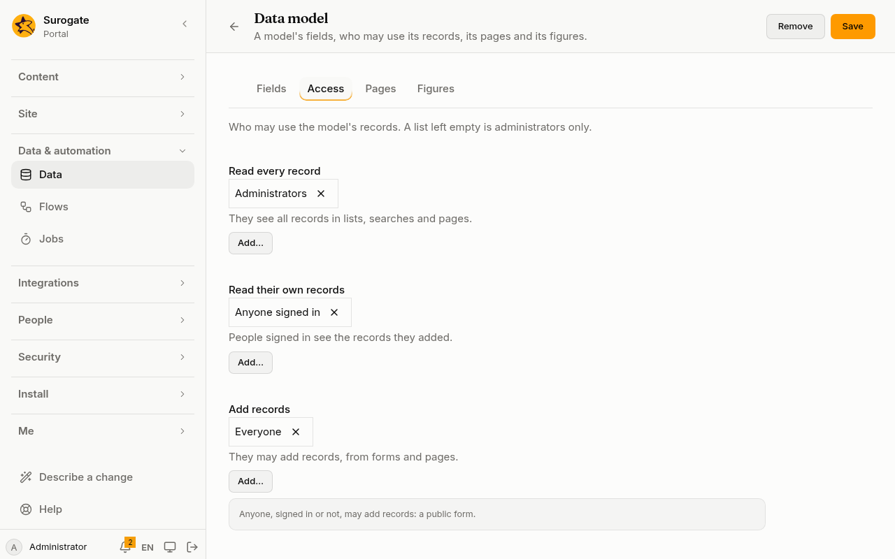
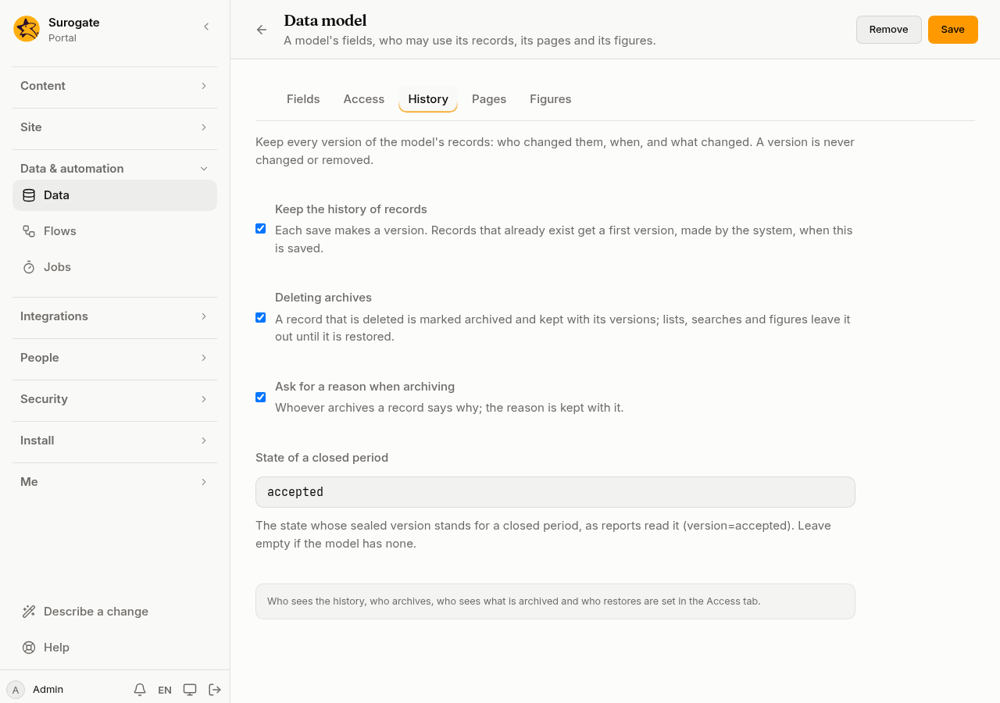
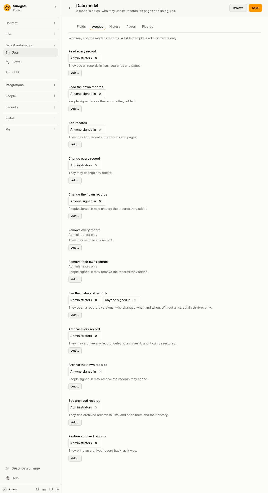
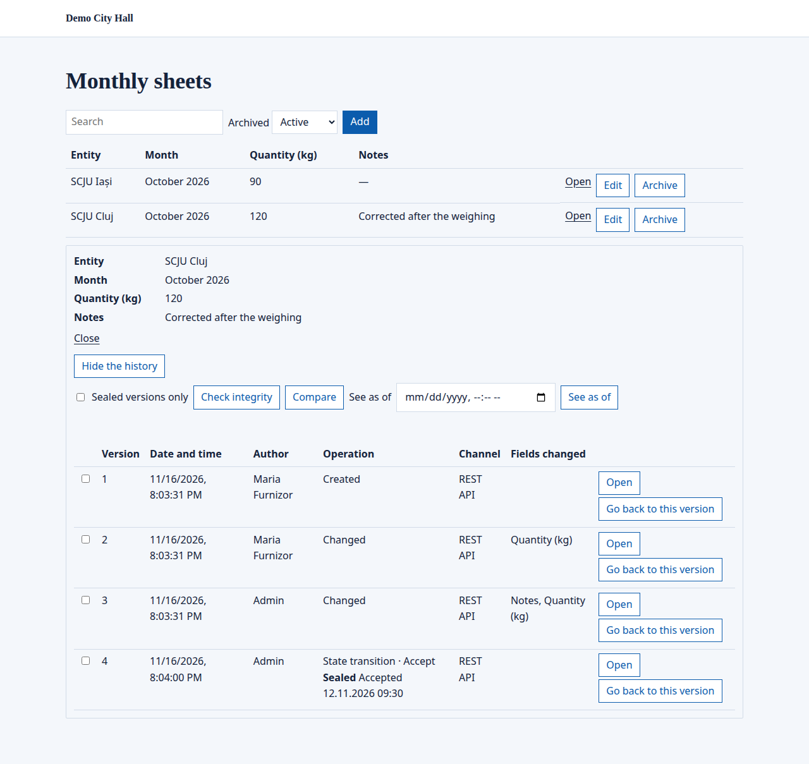
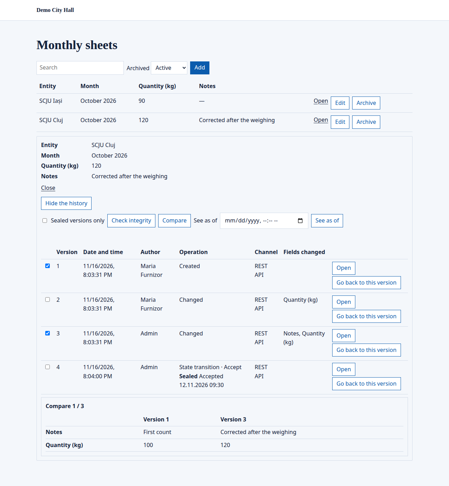

A data model is a kind of record the portal keeps for you: customers, requests, permits, appointments. You make it in the console, under **Data**, and the portal makes its table, keeps it in step with the model, and serves its records to people, pages and [action lists](/portal/sites/actions/#records).

## What people see

**Administrators** see the models under **Data** in the console: how they link to each other, each model's fields and about how many records it holds:

**Visitors and people signed in** see records on pages, through a [listing](/portal/sites/listings/), and add them through a form, as the model's permissions allow. Programs read and write them through [the API](#the-api).

## A model

A model has a name, in Romanian and English, a title field that names a record in lists, its fields, and its permissions. The Data page lists each model's name and id.

On **Data**, **New model** makes one and **Edit** changes one. The editor has nine tabs: **Fields**, **Rules**, **Lines**, **States**, **Lock**, **Access**, **History**, **Pages** and **Figures**. The first four after Fields, and the **Behaviour** area of each field, are described in [Calculated fields and checks](/portal/sites/model-logic/) and [Lines, values from other records and states](/portal/sites/model-lines-states/). **Save** stays off until the model has an id, a name in each language and at least one field; what is still missing is listed above the form, and a problem shows at the field that has it.

A model's id and each field's id are lower-case letters, digits and `_`, starting with a letter, at most 30 characters. A model's id never starts with `pg_`. A portal has at most 50 models, each with at most 100 fields. The id is the table's name: it cannot change once the model is saved. To call a model something else, change its name.

**Remove** takes the model away. Its table and its records stay, out of reach, until a model with the same id is made again: then it has the old records, with the new model's permissions. **New model** warns when its id is one of these, before you save. A model that a form, a listing, an action or another model's link still uses is not removed: the console lists what uses it, file by file.

Developers can also write a model as a file: see [Developer: Data models](/portal/developer/data-models/#a-models-file).

## Fields

| Type | Holds |
|---|---|
| Text | Text, up to 10,000 characters (500 when filterable or sortable) |
| Long text | Text, up to 1,000,000 characters |
| Number | A number |
| Amount | An amount with up to 4 decimals |
| Exact decimal | A number kept exactly, with 0 to 6 places that you choose; sums and comparisons never drift, and a point is its separator |
| Date, Date and time, Time | A day, a day and a time, or a time of day |
| Yes or no | Yes or no |
| Email, Phone, Web address | Checked as what they are; a web address is http, https or mailto |
| Link | One record of the model it points at |
| Links | Several records of the model it points at |

A field can be required, searchable (text, found by search), filterable and sortable. Long texts and Links are neither filtered nor sorted on. Every record also has its id, its owner, and when and by whom it was made and last changed.

On the **Fields** tab, **Add field** adds one: its id, its type, its label in each language, and its options. A Link or Links field also names the model it points at. **Title field** picks the field that names a record.

A saved field keeps its id, and the model a link points at. Its type can change only among the text types, which are kept alike: Text, Long text, Email, Phone and Web address. Changing to a type that does not take an option, such as a Long text that is filtered on, drops that option.

Removing a saved field keeps its values in the table, and the editor says so. A field added again with the same id has them back; it must have the type it had, and the editor says so until it does. If the removed field was the title field, the model has no title field until one is picked.

A link to a record that is deleted is cleared; a record's own links to others go with it. Where a model [keeps its history](#history-and-archiving), deleting archives instead, and links to an archived record stay.

Developers: see [Developer: Data models](/portal/developer/data-models/#fields).

## What a model can do with its values

A field can be calculated by the portal, required only when it applies, taken from another record, changeable by some people only, and checked against other fields. A model can have lines, states with moves between them, and a lock after a date. See [Calculated fields and checks](/portal/sites/model-logic/) and [Lines, values from other records and states](/portal/sites/model-lines-states/).

## Who may do what

A model says, for each role, whether it may view, edit and delete **all** records or only its **own**, and who may **add** records. People and roles are named as everywhere in the portal: everyone, people signed in, administrators, one person, a group, an organization. Administrators may always do everything; a model that says nothing is open to them alone.

A record is someone's own when they added it. A visitor owns nothing: when everyone may add records, a public form can add records that its visitors then cannot see.

The **Access** tab has a list for each: read every record, read their own, add records, change every record, change their own, remove every record, remove their own. **Add** in a list adds people signed in, a group, an organization or one person. A list left empty is administrators only.

**Everyone**, signed in or not, is offered only for reading every record and for adding records, and the editor warns when it is chosen: everyone reading is a public register, everyone adding is a public form. Changing and removing records always need someone signed in.

Developers: see [Developer: Data models](/portal/developer/data-models/#who-may-do-what).

## History and archiving

A model can keep every version of its records and archive what is deleted. Turn it on in the model's **History** tab: **Keep the history of records**. It is off until you do, and a model without it works as it always has.

With the history on:

- **Every save makes a version.** A version holds the whole record as it was after the save, who made it, with their name and email as they were then, when, how (a form, a listing, the API, GraphQL, a job or an endpoint), and which fields changed. A save that changes nothing makes no version, and neither does one that is refused. Versions are numbered 1, 2, 3 for each record, with no gaps, even when two people save at once.
- **A version is never changed or removed.** Nothing in the console or the API can do it, not even for an administrator. An attempt is refused and recorded in the [audit log](/portal/console/audit/), and every new version is recorded there too, with the model, the record, the version number and what was done, never the values.
- **The records that are already there** get a first version after you save the setting, made by the system and marked as the first, a batch at a time in the background; a record saved before its turn gets its first version at that save. If the history was off for a while, what changed meanwhile is told by a version of what the record became.
- **The person who made a version stays named.** If their account is disabled the history says so beside their name, and if it is erased, it says the account is deleted. The name and email stay on purpose, so that what was reported can always be traced. Before you erase a person, the console tells you how many versions keep their name: see [Users](/portal/console/users/#personal-data).
- **Lists, searches, figures, exports, the API and the choices in link fields all show the current version only.** Earlier versions are read on purpose, from the history.

### Archiving

**Deleting archives** is on by default when the history is on. A record that is deleted, from a listing, the API, GraphQL or an [action](/portal/sites/actions/), is marked archived and kept with its versions. Nothing is removed for good, not even by an administrator. An archived record is left out of lists, searches, figures, exports and the choices in link fields; it can no longer be changed; and the people who may not see archived records are answered as if it did not exist.

**Ask for a reason when archiving** makes whoever archives say why. The reason is kept with the record. An action that deletes records can give it too.

Other records that link to an archived one keep their link. A listing shows the linked record's name followed by "(archived)", and the archived record is not offered again when someone picks a record to link to.

Turn **Deleting archives** off to keep versions but let deleting remove records for good. The record's last version then says it was deleted, the past that reports read no longer holds it from that moment, and the records that linked to it get a version of the link that was cleared.

A model's history cannot be turned off while it has archived records: they would come back in lists, and could be deleted for good. Restore them first.

### Restoring and going back

Someone who may restore opens the archived records in a listing, and **Restore** brings a record back exactly as it was archived, with the state it had. A restore is a new version. It is refused, and nothing changes, when the record has a required link to a record that is archived, or when a rule of the model says another active record already holds the same values; the message says which field.

From the history of a record, **Go back to this version** writes an old version's values as a new version. The versions between stay. It is a save like any other: the model's rules apply, and a record that may not be changed now, because of its state, cannot be sent back.

### Who sees the history

The model's **Access** tab has five more lists once the history is on:

| List | Who it is for |
|---|---|
| See the history of records | Those who open a record's versions. Left empty, only administrators. |
| Archive every record, Archive their own records | Those who may delete, as archiving. |
| See archived records | Those who list the archived and open them. |
| Restore archived records | Those who bring a record back. |

Someone sees a record's history only if they are on that list **and** may read the record. A person who may read only their own records sees the history of their own records. Anyone else is answered as if the record did not exist: nothing says that it, or its history, is there. The history of an archived record is seen only by those who see archived records.

### Reports and closed periods

The past is the history's: reading a record or a list as it was at a date, or as accepted, needs the right to see the history, and a record that is archived now is in that past only for those who see archived records. A model can name **State of a closed period**, one of its states, such as accepted. The version sealed when a record enters that state is the one a report reads for a closed period, whatever the record is now: see [Developer: Data models](/portal/developer/data-models/#reports-and-closed-periods).

A version made as a record enters a state that seals it is marked **Sealed**, with a label such as "Accepted 12.11.2026 09:30", and gets a fingerprint of its content and of the sealed version before it. **Check integrity** in the history recalculates the chain: it says the sealed versions are intact, or which version was changed. A correction never changes a sealed version: the record goes back to a state that may be changed, the changes make new versions, and sending it again seals a new one.

## Reading the history

Where a model is shown in a [listing](/portal/sites/listings/#archiving-and-the-history), the person who may see the history opens a record and finds **History**. It lists the versions with their number, date and time, author, what was done, how, and the fields that changed. **Sealed versions only** shows just those. A version opens with its values, read only. Two versions can be compared side by side, with the fields that differ marked. **See as of** shows the record as it was at a date and time, in Romanian time.

## When a model changes

The portal adds what a change to the model adds: a new model gets its table, a new field its column. It never takes anything away: a field or model taken out keeps its data, and comes back with it if it is put back.

A field's type changes only among the text types. Any other change is refused when it is saved, and the portal keeps what was live; add a new field with the new type instead.

A change the portal could not run, such as removing a field that a form still uses, is refused when it is saved: the console lists each problem with the file that has it, and nothing changes. A change that is saved but cannot go live yet is said as such, and the portal goes on with the model as it was; [Versions](/portal/console/versions/) says why.

## On pages

Records show on pages through a [listing](/portal/sites/listings/), and a model can make its own page and form: see [A model's own pages and form](/portal/sites/listings/#a-models-own-pages-and-form).

On the **Pages** tab, **Add page** makes a page with the model's list on a site: pick the site, write its path, such as `/cereri/registru`, and maybe a title, in both languages or in neither. **Add dashboard** makes a page of the model's [KPIs](/portal/sites/kpis/) the same way; it is offered once the model has a KPI. A model makes at most 10 pages and 5 dashboards. Each page has **Show in the main menu**, ticked for a new page, and **Under**: see [Menus](/portal/sites/menus/#a-data-models-pages).

## The API

Programs read and write a model's records through an API at the portal's address. They list records, filtering on filterable fields, searching the searchable ones, sorting, and paging on, at most 100 at a time. They read one record, add one, change the fields given, and delete one.

Adding, changing and deleting need someone signed in; an app's token needs the `data` access. A record someone may not see answers as if it did not exist. A value that does not fit its field is refused, naming the field.

The calls are in [Developer: Data models](/portal/developer/data-models/#the-api).

## KPIs

A model can declare [KPIs](/portal/sites/kpis/): counts, sums and averages over its records, shown as tiles and bars. They are made on the **Figures** tab.

## GraphQL

The same records answer GraphQL, with the same rules as the API above. Each person sees only the models they may reach. A request can read one record, list records, and create, update and delete them. Changes are offered only to someone signed in, never to visitors, and never while an administrator sees the portal as someone else. A link gives the linked record, when the person may see it.

A request may nest 6 levels, ask for 10 things at its top and name 500 fields in all. One that would read more than 2000 records stops with a single error and no data. A refused value names its field. Every change is in the [audit log](/portal/console/audit/), one entry each.

The calls and some examples are in [Developer: Data models](/portal/developer/data-models/#graphql).

## Relations

**Data** in the console draws how the models link, and says the same in words: each link, the model it points at, and whether it holds one record or many.
