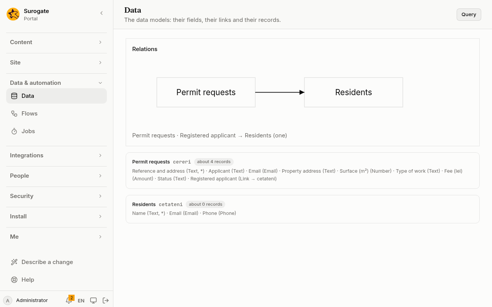

A data model is a kind of record the portal keeps for you: customers, requests, permits, appointments. You describe it in the portal's files, and the portal makes its table, keeps it in step with the file, and serves its records to people, pages and [action lists](/portal/sites/actions/#records).

## What people see

**Administrators** see the models under **Data** in the console: how they link to each other, each model's fields and about how many records it holds:



**Visitors and people signed in** see records on pages, through a [listing](/portal/sites/listings/), and add them through a form, as the model's permissions allow. Programs read and write them through [the API](#the-api).

## A model

A model lives in `models/<id>.yaml`: see the [config example](#a-models-file).

The id, here `requests`, and each field's id are lower-case letters, digits and `_`, starting with a letter, at most 30 characters. A portal has at most 50 models, each with at most 100 fields.

## Fields

| Type | Holds |
|---|---|
| `text` | Text, up to 10,000 characters (500 when filterable or sortable) |
| `largeText` | Text, up to 1,000,000 characters |
| `number` | A number |
| `money` | An amount with up to 4 decimals, answered as text such as `12.5000` |
| `date`, `datetime`, `time` | `2026-11-10`, `2026-11-10T09:30:00Z`, `09:30` |
| `boolean` | `true` or `false` |
| `email`, `phone`, `url` | Checked as what they are; a `url` is http, https or mailto |
| `link` | One record of the model named by `model` |
| `links` | Several records of the model named by `model` |

A field can be `required`, `searchable` (text, searched by `q`), `filterable` and `sortable`. Every record also has its `id`, its owner, and when and by whom it was made and last changed.

A link to a record that is deleted is cleared; a record's own links to others go with it.

## Who may do what

`permissions` says, for each role, whether it may view, edit and delete **all** records or only its **own**, and who may **add** records. Principals are those used everywhere in the portal: `everyone`, `signed-in`, `role:administrator`, `user:<email>`, `group:<name>`, `organization:<path>`. Administrators may always do everything; with no `permissions`, only they may.

A record is someone's own when they added it. A visitor owns nothing: with `add: [everyone]`, a public form can add records that its visitors then cannot see.

## When the file changes

The portal adds what the file adds: a new model gets its table, a new field its column. It never takes anything away: a field or model taken out of the file keeps its data, and comes back with it if it is put back.

A field's type can never change. A file that changes one is refused when it is saved, and the portal keeps what was live; add a new field with the new type instead.

## On pages

Records show on pages through a [listing](/portal/sites/listings/), and a model can make its own page and form: see [A model's own pages and form](/portal/sites/listings/#a-models-own-pages-and-form).

## The API

Records are served at the portal's address:

- `GET /_portal/api/data/<model>` lists records. It takes:
  - `filter.<field>=<value>` on a filterable field;
  - `q=` to search the searchable fields;
  - `sort=<field>` or `sort=-<field>`;
  - `limit` (at most 100);
  - `after`, to page on.
  The answer has `items` and, when there are more, `next`.
- `GET /_portal/api/data/<model>/<id>` reads one record.
- `POST /_portal/api/data/<model>` adds one.
- `PATCH /_portal/api/data/<model>/<id>` changes the fields given.
- `DELETE /_portal/api/data/<model>/<id>` deletes one.

Adding, changing and deleting need someone signed in; an app's token needs the `data` access. A record someone may not see answers as if it did not exist. A value that does not fit its field is refused, naming the field.

## KPIs

A model can declare [KPIs](/portal/sites/kpis/): counts, sums and averages over its records, shown as tiles and bars.

## GraphQL

The same records answer GraphQL at `POST /_portal/api/graphql`, with the same rules as the API above. Each person sees only the models they may reach:

- `get_<model>(id: "…")` reads one record, or gives null when there is none for them.
- `list_<model>(first, after, q, sort, filter)` lists records, with `items` and `next` as above. `filter` takes the filterable fields.
- `create_<model>(values: {…})`, `update_<model>(id: "…", values: {…})` and `delete_<model>(id: "…")` change records. They are offered only to someone signed in, never to visitors, and never while an administrator sees the portal as someone else.

A record has `id`, `ownerId`, `createdAt`, `updatedAt` and its fields. A link gives the linked record, when the person may see it.

```graphql
{
  list_requests(first: 20, filter: { status: "new" }) {
    items { id subject applicant { name } }
    next
  }
}
```

```graphql
mutation {
  create_requests(values: { subject: "Fence repair" }) { id }
}
```

A request may nest 6 levels, ask for 10 things at its top and name 500 fields in all. One that would read more than 2000 records stops with a single `too_costly` error and no data. A refused value names its field in `extensions.field`. Every change is in the [audit log](/portal/console/audit/), one entry each.

## Relations

**Data** in the console draws how the models link, and says the same in words: each link, the model it points at, and whether it holds one record or many.

## Config example

### A model's file

In `models/<id>.yaml`, here `models/requests.yaml`:

```yaml
name:
  ro: Cereri
  en: Requests
title: subject
fields:
  subject:
    type: text
    label: { ro: Subiect, en: Subject }
    required: true
    searchable: true
    sortable: true
  status:
    type: text
    label: { ro: Stare, en: Status }
    filterable: true
  amount:
    type: money
    label: { ro: Sumă, en: Amount }
  citizen:
    type: link
    model: citizens
    label: { ro: Cetățean, en: Citizen }
permissions:
  view: { all: [group:clerks], own: [signed-in] }
  add: [everyone]
  edit: { all: [group:clerks] }
  delete: { all: [role:administrator] }
```

- `name`: what the model is called, in Romanian and English.
- `title`: the field that names a record in lists.
- `fields`: each by its id, with a `type` from the [field types](#fields) and a `label` in both languages. Add `required`, `searchable`, `filterable` or `sortable` as the field needs. A `link` names the `model` it points at.
- `permissions`: who may `view`, `edit` and `delete` all records or only their own, and who may `add`. See [Who may do what](#who-may-do-what).

