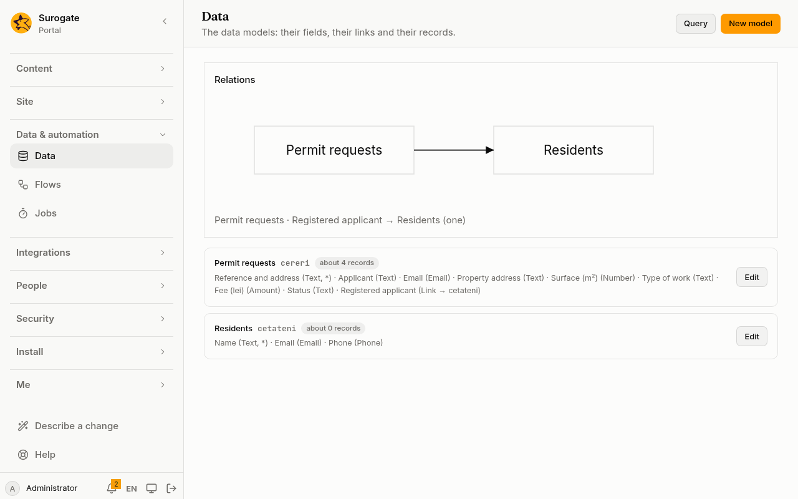
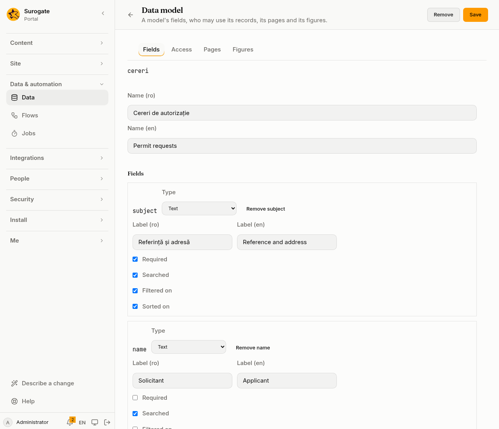

A data model is a kind of record the portal keeps for you: customers, requests, permits, appointments. You make it in the console, under **Data**, and the portal makes its table, keeps it in step with the model, and serves its records to people, pages and [action lists](/portal/sites/actions/#records).

## What people see

**Administrators** see the models under **Data** in the console: how they link to each other, each model's fields and about how many records it holds:

**Visitors and people signed in** see records on pages, through a [listing](/portal/sites/listings/), and add them through a form, as the model's permissions allow. Programs read and write them through [the API](#the-api).

## A model

A model has a name, in Romanian and English, a title field that names a record in lists, its fields, and its permissions. The Data page lists each model's name and id.

On **Data**, **New model** makes one and **Edit** changes one. The editor has four tabs: **Fields**, **Access**, **Pages** and **Figures**. **Save** stays off until the model has an id, a name in each language and at least one field; what is still missing is listed above the form, and a problem shows at the field that has it.

A model's id and each field's id are lower-case letters, digits and `_`, starting with a letter, at most 30 characters. A model's id never starts with `pg_`. A portal has at most 50 models, each with at most 100 fields. The id is the table's name: it cannot change once the model is saved. To call a model something else, change its name.

**Remove** takes the model away. Its table and its records stay, out of reach, until a model with the same id is made again: then it has the old records, with the new model's permissions. **New model** warns when its id is one of these, before you save. A model that a form, a listing, an action or another model's link still uses is not removed: the console lists what uses it, file by file.

Developers can also write a model as a file: see [Developer: Data models](/portal/developer/data-models/#a-models-file).

## Fields

| Type | Holds |
|---|---|
| Text | Text, up to 10,000 characters (500 when filterable or sortable) |
| Long text | Text, up to 1,000,000 characters |
| Number | A number |
| Amount | An amount with up to 4 decimals |
| Date, Date and time, Time | A day, a day and a time, or a time of day |
| Yes or no | Yes or no |
| Email, Phone, Web address | Checked as what they are; a web address is http, https or mailto |
| Link | One record of the model it points at |
| Links | Several records of the model it points at |

A field can be required, searchable (text, found by search), filterable and sortable. Long texts and Links are neither filtered nor sorted on. Every record also has its id, its owner, and when and by whom it was made and last changed.

On the **Fields** tab, **Add field** adds one: its id, its type, its label in each language, and its options. A Link or Links field also names the model it points at. **Title field** picks the field that names a record.

A saved field keeps its id, and the model a link points at. Its type can change only among the text types, which are kept alike: Text, Long text, Email, Phone and Web address. Changing to a type that does not take an option, such as a Long text that is filtered on, drops that option.

Removing a saved field keeps its values in the table, and the editor says so. A field added again with the same id has them back; it must have the type it had, and the editor says so until it does. If the removed field was the title field, the model has no title field until one is picked.

A link to a record that is deleted is cleared; a record's own links to others go with it.

Developers: see [Developer: Data models](/portal/developer/data-models/#fields).

## Who may do what

A model says, for each role, whether it may view, edit and delete **all** records or only its **own**, and who may **add** records. People and roles are named as everywhere in the portal: everyone, people signed in, administrators, one person, a group, an organization. Administrators may always do everything; a model that says nothing is open to them alone.

A record is someone's own when they added it. A visitor owns nothing: when everyone may add records, a public form can add records that its visitors then cannot see.

The **Access** tab has a list for each: read every record, read their own, add records, change every record, change their own, remove every record, remove their own. **Add** in a list adds people signed in, a group, an organization or one person. A list left empty is administrators only.

**Everyone**, signed in or not, is offered only for reading every record and for adding records, and the editor warns when it is chosen: everyone reading is a public register, everyone adding is a public form. Changing and removing records always need someone signed in.

To give a verb to some people only for some records, such as the sheets of their own county, and to keep who worked for which entity, see [Access to records by condition](/portal/sites/row-access/).

Developers: see [Developer: Data models](/portal/developer/data-models/#who-may-do-what).

## When a model changes

The portal adds what a change to the model adds: a new model gets its table, a new field its column. It never takes anything away: a field or model taken out keeps its data, and comes back with it if it is put back.

A field's type changes only among the text types. Any other change is refused when it is saved, and the portal keeps what was live; add a new field with the new type instead.

A change the portal could not run, such as removing a field that a form still uses, is refused when it is saved: the console lists each problem with the file that has it, and nothing changes. A change that is saved but cannot go live yet is said as such, and the portal goes on with the model as it was; [Versions](/portal/console/versions/) says why.

## On pages

Records show on pages through a [listing](/portal/sites/listings/), and a model can make its own page and form: see [A model's own pages and form](/portal/sites/listings/#a-models-own-pages-and-form).

On the **Pages** tab, **Add page** makes a page with the model's list on a site: pick the site, write its path, such as `/cereri/registru`, and maybe a title, in both languages or in neither. **Add dashboard** makes a page of the model's [KPIs](/portal/sites/kpis/) the same way; it is offered once the model has a KPI. A model makes at most 10 pages and 5 dashboards.

## The API

Programs read and write a model's records through an API at the portal's address. They list records, filtering on filterable fields, searching the searchable ones, sorting, and paging on, at most 100 at a time. They read one record, add one, change the fields given, and delete one.

Adding, changing and deleting need someone signed in; an app's token needs the `data` access. A record someone may not see answers as if it did not exist. A value that does not fit its field is refused, naming the field.

The calls are in [Developer: Data models](/portal/developer/data-models/#the-api).

## KPIs

A model can declare [KPIs](/portal/sites/kpis/): counts, sums and averages over its records, shown as tiles and bars. They are made on the **Figures** tab.

## GraphQL

The same records answer GraphQL, with the same rules as the API above. Each person sees only the models they may reach. A request can read one record, list records, and create, update and delete them. Changes are offered only to someone signed in, never to visitors, and never while an administrator sees the portal as someone else. A link gives the linked record, when the person may see it.

A request may nest 6 levels, ask for 10 things at its top and name 500 fields in all. One that would read more than 2000 records stops with a single error and no data. A refused value names its field. Every change is in the [audit log](/portal/console/audit/), one entry each.

The calls and some examples are in [Developer: Data models](/portal/developer/data-models/#graphql).

## Relations

**Data** in the console draws how the models link, and says the same in words: each link, the model it points at, and whether it holds one record or many.
