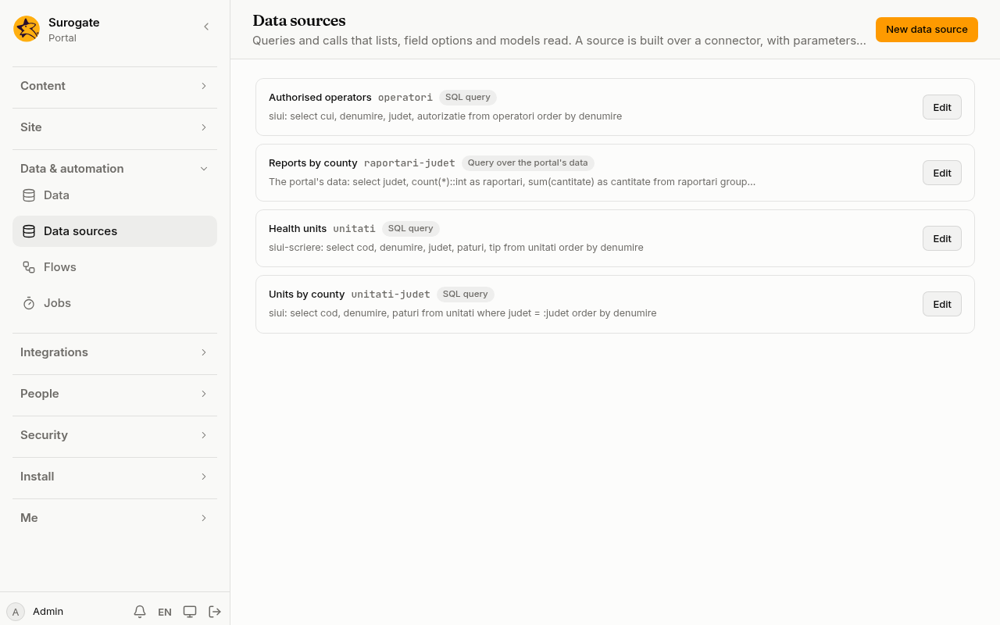
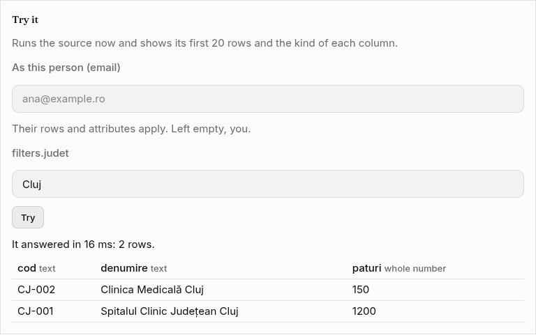
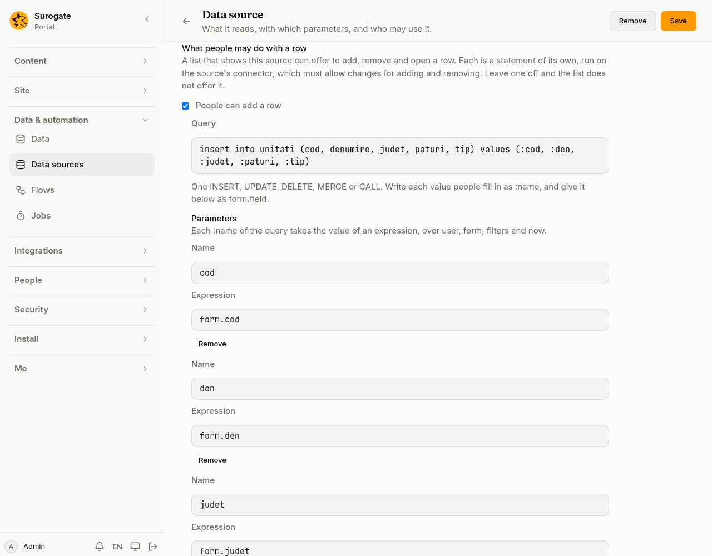
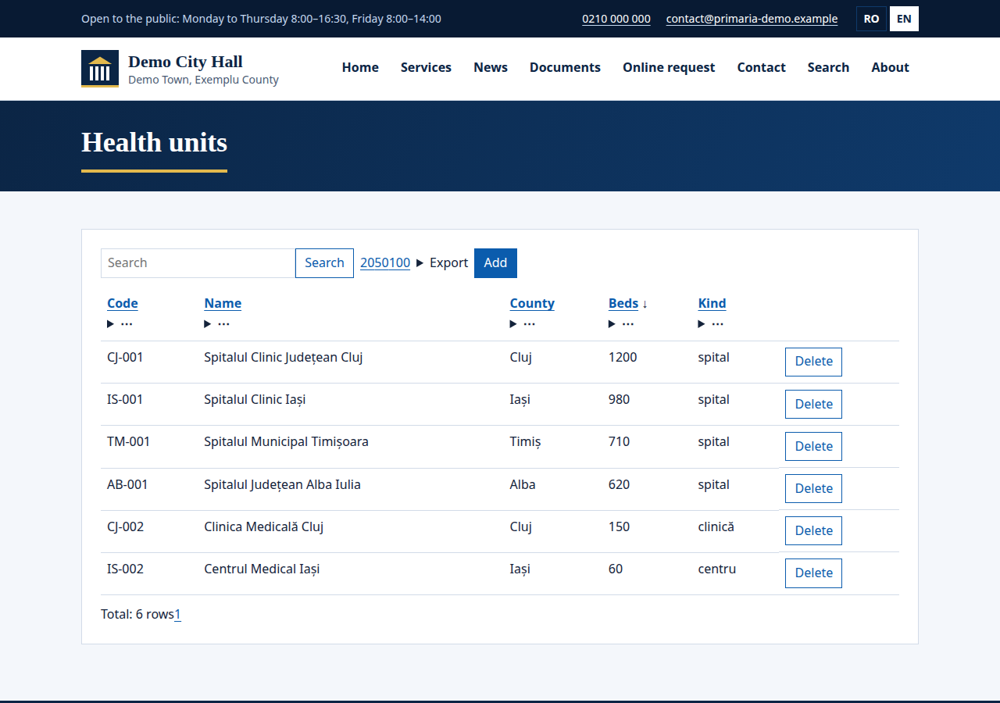

A data source is a name for rows that come from somewhere: a SQL query on your own database, a question put to the portal's own data, a call to a web service that answers a list, or what people sent through a form. Once a source has a name, a [listing](/portal/sites/listings/) shows it, a [form field](/portal/sites/forms/#options-from-a-model-a-data-source-or-a-web-service) takes its options from it, and a [data model](/portal/sites/data-models/#a-model-read-from-a-data-source) can be read from it.

Everything that reads outside rows goes through data sources, so there is one place to say what is read, with which parameters, and who may use it.

## What people see

**Administrators** make and change data sources under **Data sources** in the console, in the **Data & automation** group:

Each source shows its name, its id, its kind and what it reads: the connector and the start of its query. **New data source** makes one, and **Edit** changes one. A portal has at most 100 data sources.

**Visitors and people signed in** never see a data source itself. They see what shows its rows: a listing on a page, or a list of options in a form. They see only what the source's **Who may use this source** names.

## The kinds of source

- **SQL query:** one SELECT on a [SQL database connector](/portal/sites/connectors/#sql-databases). The result is read only.
- **Query over the portal's data:** one SELECT over the tables of the portal's own [data models](/portal/sites/data-models/). Each person reads only the records they may see, as the model's permissions say.
- **JSON web service:** a GET call to a [web connector](/portal/sites/connectors/#call-a-service) that answers a JSON list. The source says where the list is in the answer, and where each column is in an item.
- **Form submissions:** what was sent through a form. The form's reviewers read all of it; with **Each person sees what they sent themselves**, everyone else reads only their own.

A source keeps the kind it was made with: make another for another kind.

## Make or change a data source

**New data source** asks for:

- **Id:** lower-case letters, digits and hyphens, starting with a letter. It cannot be changed once the source is saved.
- **Name** and **Description**, in each language.
- **Kind of source.**
- For a SQL query, **SQL database connector** and **Query**. For a query over the portal's data, **Query**. For a JSON web service, **Web connector**, **Path** (such as `/operators`), **Query string**, **Where the list is in the answer** and **Keep the answer**. For form submissions, **Form**.
- **Parameters:** each `:name` written in the query takes the value of an expression, written over the person (`user`), the form or dialog being filled (`form`), the listing's filters (`filters`), the time (`now`) and the language (`locale`). A source has at most 20.
- **Most rows:** 1 to 10,000 rows; 1,000 when left empty. The connector's own limit also holds.
- **Key column:** the column that identifies a row, needed to remove or open a row.
- **Columns:** left empty, the columns are those the query answers. Name them to label and type them, as text, whole number, number, yes or no, date, date and time, or time. A source names at most 50.
- **Who may use this source:** people, groups and organizations, as everywhere in the portal. Left empty, only administrators.

Each problem is said at its field, and **Save** waits until there are none. A query is checked as it is written: one statement, only a read, and a value for each `:name`. A statement that changes data, that locks rows or that reaches outside the database is refused.

**Remove** takes a source away. One that a listing, a field's options or a model still uses is not removed: the console says where it is used.

### Parameters are never written into the text

A query says where its values go with `:name`. The portal hands the value to the database apart from the text, so that nothing a person typed can change what the query does. A filter, a form field or the person's own attributes can all be given to a query this way.

For example, the source in the picture reads the units of the county a listing is filtered on: its query ends in `where judet = :judet`, and the parameter `judet` is `filters.judet`.

## Try it

Once a source is saved, **Try it** runs it and shows its first 20 rows, how long it took and the kind of each column. **As this person (email)** runs it as someone else, with their rows and attributes; left empty, it runs as you. A source that asks for filters or form values shows a box for each, to try it with.

If the database does not answer, **Try it** says so in words, such as "The database server could not be reached." The database's own messages are never shown to people.

## Add, remove and open a row

A listing that shows a SQL or web service source can offer to **Add** and **Delete** rows, and to open one, when the source says how. In the editor, **What people may do with a row** has a box for each:

- **People can add a row:** a statement that adds a row (INSERT, UPDATE, DELETE, MERGE or CALL), with a value for each `:name`, given as `form.field`. **What people fill in to add a row** lists the boxes of the Add dialog: a key, a label in each language, a kind and whether it is required.
- **People can remove a row:** a statement that removes the row. Its key is `:id`.
- **People can open a row:** a SELECT that reads one row. Its key is `:id`.
- For a web service, each is a **Path** instead, with `:id` for the row's key: a POST to add, a DELETE to remove and a GET to open.

Adding and removing run on the connector, which must allow changes (see [SQL databases](/portal/sites/connectors/#sql-databases)). The listing then offers them as the listing's own **People can add** and **People can delete** settings say: see [Listings](/portal/sites/listings/#a-listing-of-a-data-source). A row can be removed or opened only if the source shows it to that person: nobody names a key of their own.

Rows added or removed this way are written to the connector's database as the connector's account, so give that account only the rights the statements need.

## Who reads what

- A data source always reads as the portal, never as each person. A connector that signs in as each person cannot be used for a source.
- The source's **Who may use this source** decides who reads it. Everyone else is told there is no such list.
- A query over the portal's data goes further: whoever uses it reads only the records the models let them see.
- A SQL source reads inside a read-only transaction, and a database is asked for at most 5 statements at once per connector. A query waits at most as long as the connector's time limit.
- A query over the portal's data runs at most 3 at once for a portal; the next waits its turn, up to its own time limit, and is then told the portal is busy.
- A source of form submissions that each person reads only their own is narrowed to the person's own where the submissions are kept, however many others there are.
- A source reads at most as many rows as **Most rows** says. **Try it** says when there are more rows than it read, and a JSON web service that answers more than 5,000 rows is not shown, with a sentence saying so.

## Failures, in words

When a source cannot answer, the list or field that shows it says so in one fixed sentence, not in the database's words: the server could not be reached, the secure connection failed, the database refused the account, the database does not exist on that server, the query exceeded the time limit, the result is too large, or the source returned too many rows. Administrators see the database's own code in a [job's](/portal/sites/jobs/) log, never in a page anyone else sees.

## Developers

Developers can also write data sources in the site's configuration: see [Developer: Data sources](/portal/developer/data-sources/).
