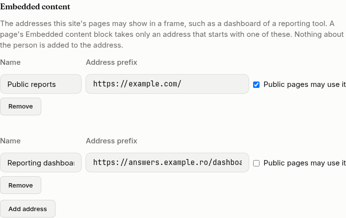
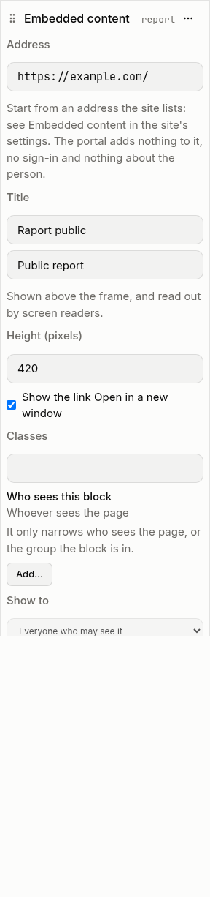
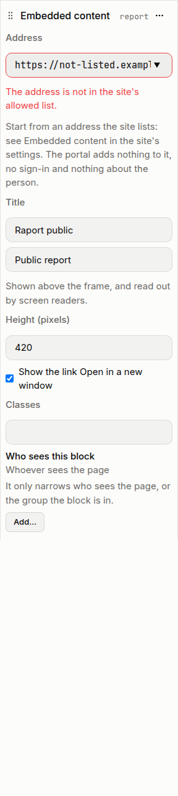
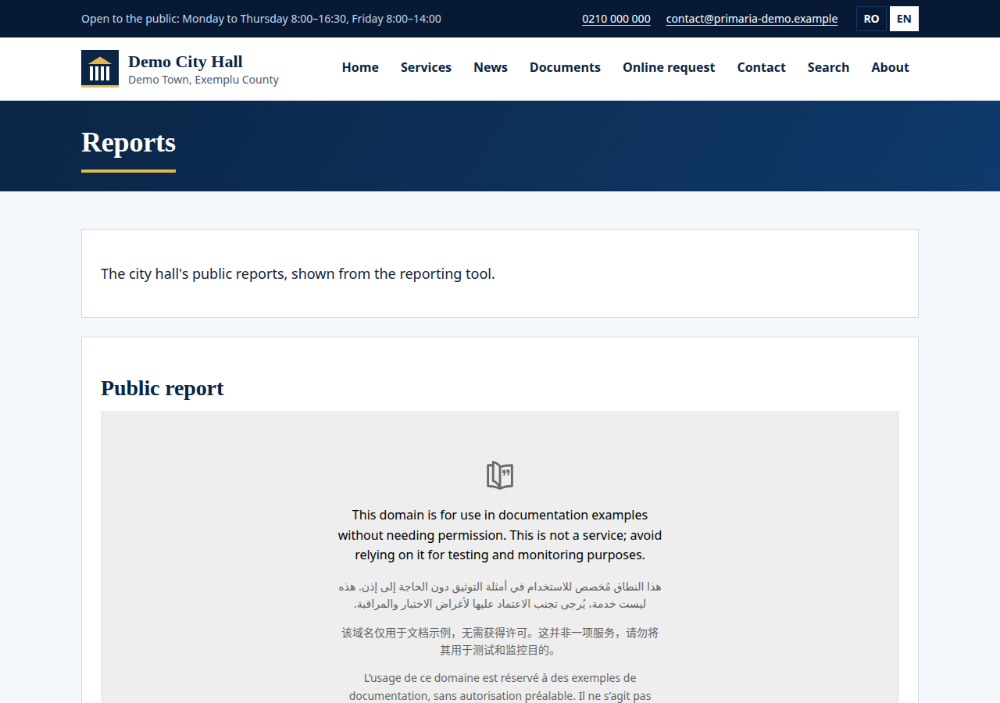

The **Embedded content** block shows another tool's page inside a page of the site: a dashboard of your reporting tool, for example. The portal shows only addresses the site's administrators have allowed, and it adds nothing to an address: no sign-in, no token, nothing about the person who looks. Who sees the report, and what they see in it, is the reporting tool's own business.

## Allow addresses

Under **Sites**, open a site's **Settings** and go to **Embedded content**. Administrators keep the list.

1. Press **Add address**.
2. Give it a **Name**, for you to tell it by.
3. Write its **Address prefix**: `https://`, the host, and, if you want to narrow it, a path that ends with `/`. The block may then show any address that starts with it. `https://answers.example.ro/dashboard/` allows `https://answers.example.ro/dashboard/12` and not `https://answers.example.ro/admin/`.
4. Tick **Public pages may use it** only for addresses that are safe for anyone to see. Left unticked, only pages that need a sign-in may show it.
5. Save the site.

A site lists at most 50 addresses. An address is matched as the browser reads it: the host without regard to capitals, the same port, and the path word by word. So `https://answers.example.ro.evil.example/` and `https://answers.example.ro/dashboardX` do not fall under `https://answers.example.ro/dashboard/`. An address with a login in it, or with an encoded slash, is never allowed.

When you take an address away that pages still show, the console names those pages first, and the save is refused until their blocks are changed.

## Put the block on a page

On [Pages](/portal/console/pages/), open the page, press **Add** in a part, and choose **Embedded content**. Its settings:

- **Address:** the address to show. It must start with one of the site's allowed addresses; as you type, the console tells you when it does not.
- **Title:** shown above the frame, and read out by screen readers. Fill it in for each language.
- **Height (pixels):** 200 to 4,000; 800 when you leave it.
- **Show the link Open in a new window:** on by default. The link is the way round when the other tool refuses to be framed.

Who sees the block is set with **Who sees this block**, as for any block. A person the block is not for sees no frame, and the page makes no room for the address.

## What people see

The title, the other tool's page in a frame the width of the part, and, below it, **Open in a new window**.

- **A page anyone may see** may show only addresses marked **Public pages may use it**. Saving anything else is refused, and so is making a page or a site public while a block of it shows an address that is not marked; the message names the block.
- **An address no longer allowed** is not shown to visitors at all. Those who edit the block see "The address is no longer allowed on this site." in its place.
- **A preview** shows what anyone may see, so it shows the frame only for addresses marked for public pages.
- **Dashboards people arrange for themselves** cannot offer this block: it has settings that must be filled in first.

## When the frame stays empty

The portal cannot tell when the other tool refuses to be framed: the browser shows an empty frame or an error. Two things are usual:

- The other tool does not allow the portal's address to frame it. In your reporting tool, add the portal's address to the origins that may embed it (BigConnect Answers calls them **Authorized origins**).
- The other tool signs people in with a cookie the browser keeps from a frame of another site. Sign-in with the same single sign-on as the portal solves it.

The link **Open in a new window** always works, so keep it on until the frame does.

## What the portal does for safety

- The frame has no more rights than it needs: it may run scripts, send forms, open pop-ups and download files, so a report's export works, and nothing else.
- The page tells the browser exactly which origins it may frame, and no others.
- The address is checked when the page is saved, and again each time the page is shown, so taking an address away from the list works at once.

For the files behind it, see [Developer: Embedded content](/portal/developer/embedded-content/).
