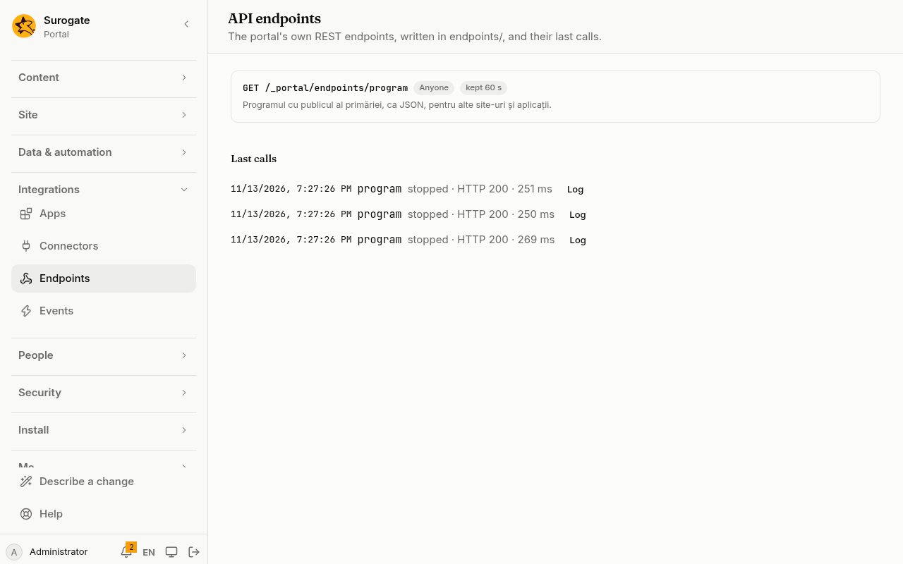

An API endpoint answers other programs, apps and pages at an address of the portal: a count of requests, a list of open cases, a record added from another system. It runs a list of [actions](/portal/sites/actions/), and answers as they say.

## What people see

An endpoint has no page of its own: a program, an app or a page of the site calls its address and gets JSON, text or a redirect. Administrators see every endpoint under **Endpoints** in the console, with who may call it and the last calls:

See [Its calls](#its-calls).

## Write an endpoint

An endpoint has a path of lower-case words joined by `/`, and a method: GET, POST, PUT, PATCH or DELETE. Two endpoints may share a path when their methods differ. It is called at `https://<your portal>/_portal/endpoints/requests/count?status=new`. A description says what it is for, in the console.

The console shows the portal's endpoints; it does not write them yet. For now, this is set in the site's configuration: see [Developer: API endpoints](/portal/developer/endpoints/#write-an-endpoint).

## Parameters

An endpoint names what a call gives, each with a type: text (at most 1000 characters, unless the endpoint sets another maximum), a number, a whole number, true or false, a day such as 2026-11-10, a record's id, or any JSON.

A GET or DELETE call gives them in the address; the others in a JSON body. A parameter the endpoint does not take, one given twice, one of the wrong type, or a required one missing is refused with 400 before anything runs. A parameter not given has no value.

## Its actions and its answer

The actions read what the call gave, the person calling, what the actions before kept and the named values, and may call [flows](/portal/sites/flows/). The answer is the one an action that responds gives:

- JSON, with a status (200 by default);
- text;
- a redirect, which sends the caller to a page of the site, or to an address the endpoint's redirects name.

Nothing after the answer runs. With no answer given, the answer is empty (204). When the list fails, the endpoint's error handling runs, reading the error's message; without an answer from it, the caller gets a 500 with the action's error message.

An endpoint never sends mail and never signs with a connector's secret. A GET endpoint, and one anyone may call, never adds, changes or deletes records or files.

## Who may call it

- Anyone: visitors may call it 60 times a minute from one address.
- People signed in: a person signed in to the portal, or a program with a token that holds **Call the portal's API endpoints**.
- Programs with a token: only a program with such a token.
- Only the portal's own actions: a private endpoint. See [Private endpoints](#private-endpoints).

A call from a page of the portal, as the person signed in, sends the page's CSRF token as the other API calls do.

## Keep answers, and other sites

A public GET endpoint's answer can be kept for a time, such as 60 seconds, for everyone. It is then always made as a visitor. A change to the site's configuration makes it again.

An endpoint can let pages of other sites call it from the browser, by naming those sites; a public endpoint may name any site.

## Private endpoints

A private endpoint does work the portal's forms, flows, jobs and other endpoints share, and no one outside calls it. Asked for from outside, it answers as an endpoint that is not there. It takes no cross-site calls, no kept answers and no redirects.

An action list calls it, or any other endpoint of the portal:

- **What it is given:** the endpoint's parameters, each of its type; the portal checks them when the configuration is published.
- **What comes back:** the answer's status and body, and its location for a redirect. An answer outside 200–299 fails the action, unless the call lists that status as fine; its answer is still kept for the error handling.
- **As whom:** the endpoint runs as the person the calling list runs as, or as a visitor, on the same site. An endpoint for people signed in needs a person, so a job calling one needs a person to run as. One for programs with a token is never called this way, and an administrator seeing the portal as someone else calls no endpoint for them.
- **Where:** a form, flow, job or endpoint that may change records calls endpoints. A GET endpoint, or one anyone may call, does not.
- **Limits:** a run calls at most 5 endpoints. Endpoints call one another at most three deep, and ten times in all, within the caller's time.

The portal checks on publishing that no endpoint calls back to itself, and that the endpoints a job calls use no connector that signs in as each person.

Each call is in the endpoint's calls, naming what called it. When the caller handles a failed call itself, with its own error handling or by listing the status as fine, no job hears of that failure.

## Its calls

**Endpoints** in the console lists every endpoint with who may call it, and the last calls: how each ended, its answer's status and how long it took. **Log** shows a call's log. Only its errors are kept, unless the endpoint is set to debug; what it answered is never kept.
