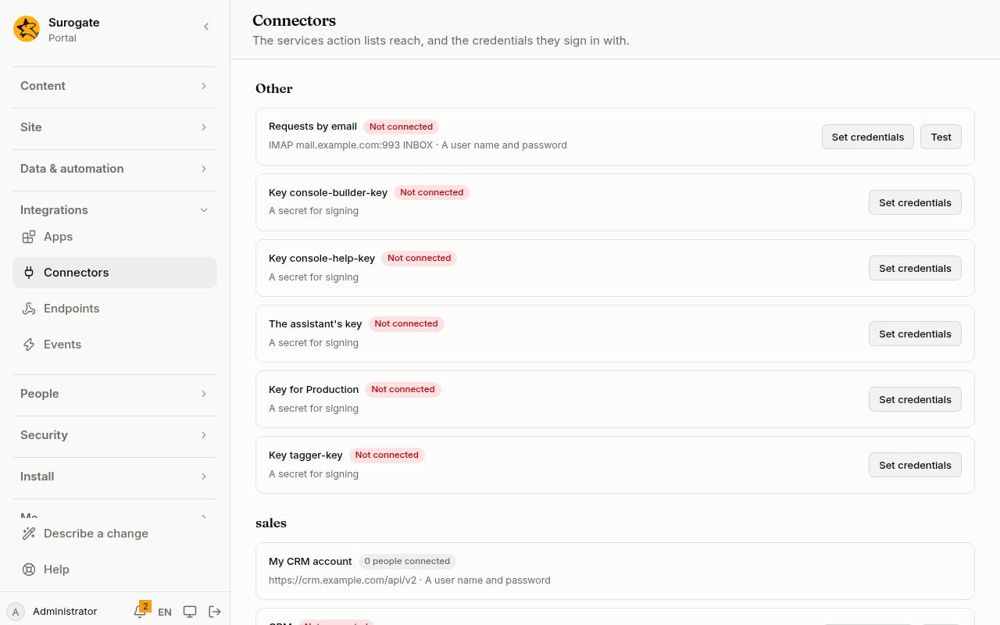
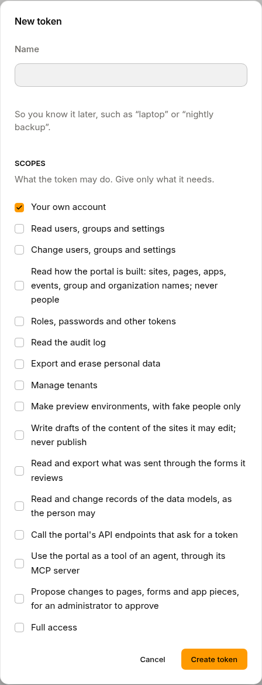

Many institutions run more than one portal: one where changes are tried, such as **Test**, and the one people use, **Production**. Each is an environment. When a version is ready on Test, an administrator sends it to Production, where it arrives as a [proposed change](/portal/console/proposals/). Nothing on Production changes until its administrators approve it.

## What people see

**On Test,** an administrator opens a version on [Versions](/portal/console/versions/#send-a-version-to-another-environment) and presses **Send to Production**. The button is greyed out until the key that Production takes the version with is set. The key is a [connector](/portal/sites/connectors/) of Test, and the console lists it with the others, not connected until its value is set:



**On Production,** the version arrives as a proposed change under [Proposed changes](/portal/console/proposals/). Its administrators read it, preview it, and approve or reject it. The key is a token of Production, made by someone signed in there:



## What travels

A version sends the files a proposal may change: pages, layouts, designs, forms, flows, values, data models, endpoints, jobs, guides and content types. Where Production has such a file the version does not have, the proposal removes it there.

What belongs to each portal stays where it is: each site's own settings (its addresses and who may edit it), connectors and their keys, apps, agents, Keel and the DMS, and `environments.yaml` itself.

## Name the environments

Name the portals this one sends to in `environments.yaml`, at the top of the portal's files: see the [config example](#config-example).

- The id (`production`): lowercase letters, digits and dashes, starting with a letter. At most 10 environments.
- `name`: what the console calls it, in Romanian, English or both.
- `url`: the other portal's address, with no path. Inside the same cluster, its service address works too, such as `http://portal.portal.svc`.
- `key`: a secret [connector](/portal/sites/connectors/) of this portal, holding the key Production takes the version with.

The key opens only for the address `environments.yaml` names. If the address changes, set the key again. The key is for sending versions alone: no action may use it, and Keel, the DMS or an agent may not name it too.

## Make the key

The key is a token of the other portal that may propose changes:

1. On **Production**, someone signed in makes a token under **Tokens** with **Propose changes** alone. Proposals arrive under that person's name, and a person never approves what they proposed, so pick someone other than the administrators who will approve: an account made for the purpose works well.
2. Copy the token.
3. On **Test**, under **Connectors**, set it as the secret of the connector `environments.yaml` names.

The version's page on Test then offers **Send to Production**. Until the key is set, the button is greyed out.

## Send a version

See [Send a version to another environment](/portal/console/versions/#send-a-version-to-another-environment).

## Config example

### The environments file

In `environments.yaml`, at the top of the portal's files:

```yaml
production:
  name: { ro: Producție, en: Production }
  url: https://portal.primaria.ro
  key: production-key
```

The key's connector is a file of its own, `connectors/production-key.yaml`:

```yaml
name: { ro: Cheia pentru Producție, en: Key for Production }
kind: secret
```

- `production`: the environment's id.
- `name`: what the console calls it.
- `url`: the other portal's address.
- `key`: the secret connector holding the key, here `production-key`.
